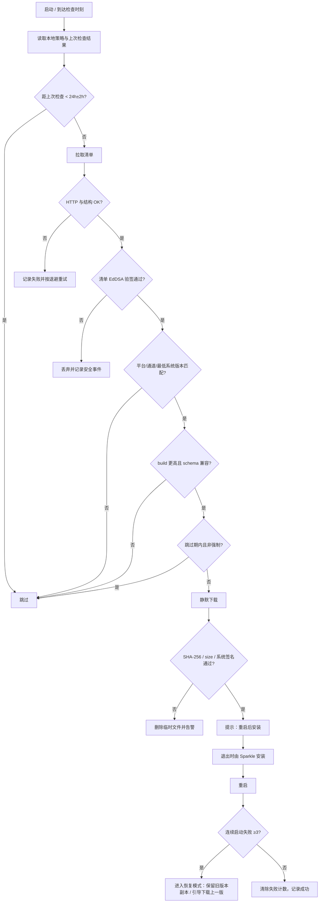
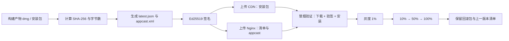

# 更新模块技术方案

基准：`main` @ `fd49ba4`
关联文档：`docs/进销存技术方案.md` 6.8 节
状态：设计稿，本文档只定义方案，不包含实现代码。

---

## 1. 目标与范围

为 macOS 桌面端、Windows 桌面端（后续）、网络版服务端与私有化部署提供统一的版本检查、下载、校验、安装与回滚能力。

已确定的核心策略：

| 场景 | 检查节奏 | 安装方式 |
| --- | --- | --- |
| 桌面端（单机） | 启动后一次，之后每 24 小时后台检查，带 ±2 小时随机抖动 | 静默下载，重启时安装；允许“跳过此版本”7 天；安全更新不受跳过限制 |
| 桌面端（连网络版） | 每次登录做一次轻量版本握手，另加每 24 小时检查 | 同上；低于服务端 `min_supported_version` 时阻断 |
| 网络版服务端 / 私有化 | 每日检查厂商更新源一次 | 不自动安装，由管理员在维护窗口执行；按 1% → 10% → 50% → 100% 分批放量，保留回滚包 |

强制升级仅限四类：

1. 安全漏洞修复（公告后 24–72 小时内强制）。
2. schema 或 API 协议不兼容。
3. 法规、税控截止（提前 30 天公告）。
4. 客户端版本低于服务端 `min_supported_version`。

---

## 2. 版本号规则

### 2.1 四条版本线

| 版本线 | 形式 | 示例 | 作用 | 变更规则 |
| --- | --- | --- | --- | --- |
| 产品版本 | SemVer `MAJOR.MINOR.PATCH` | `1.4.2` | 对用户展示、发布说明 | MAJOR：数据或 API 不兼容；MINOR：新增功能；PATCH：修复 |
| 构建号 | 单调递增整数 | `2026111301` | Sparkle / 安装包比较、灰度分桶 | 每次产出安装包必须递增，不复用、不回退 |
| schema 版本 | 整数 `vN` | `v30` | 数据库结构兼容判断 | 只增不减；一次迁移 +1；不复用号段 |
| API 版本 | 整数 | `1` | 客户端与服务端协议兼容 | 兼容新增不升；破坏性变更 +1，并保留 N-1 一个 MINOR 周期 |

### 2.2 对应关系与不可回退约束

- 一个产品版本对应唯一构建号；同一构建号不得出现两份不同二进制。
- 构建号严格递增，回滚发布也必须使用更大的构建号（回滚包重新打包并递增），否则 Sparkle 与客户端比较逻辑会判定为“无更新”。
- schema 版本单调递增；应用只允许打开 `schema_version ∈ [schema_min, schema_max]` 的数据库。
- 产品版本 MAJOR 与 schema 不强制一一对应，但 MAJOR 变更必须伴随兼容说明。
- 允许降级的前提：目标版本与当前版本 schema 相同且为 PATCH（见 Q28 建议）。

---

## 3. 更新清单（manifest）

### 3.1 文件位置与命名

- macOS：`https://<update-host>/macos/<channel>/latest.json` 与 `appcast.xml`
- Windows：`https://<update-host>/windows/<channel>/latest.json`
- 通道：`stable`、`beta`（Q24 建议保留 beta）。

### 3.2 字段定义

```json
{
  "manifest_version": 1,
  "key_id": "2026-01",
  "platform": "macos",
  "channel": "stable",
  "version": "1.4.2",
  "build": 2026111301,
  "min_os": "12.0",
  "url": "https://cdn.example.com/releases/macos/1.4.2/xiaotu-1.4.2.dmg",
  "sha256": "9f2c...e1",
  "size": 48234496,
  "published_at": "2026-11-13T08:00:00Z",
  "release_notes_url": "https://example.com/releases/1.4.2",
  "mandatory": false,
  "mandatory_reason": null,
  "mandatory_deadline": null,
  "schema_min": 28,
  "schema_max": 32,
  "api_min": 1,
  "api_max": 2,
  "rollout_percent": 100,
  "signature": "base64(Ed25519(canonical_payload))"
}
```

| 字段 | 语义 |
| --- | --- |
| `manifest_version` | 清单结构版本，结构变更时 +1；客户端不认识的版本直接忽略 |
| `key_id` | 签名密钥标识，用于轮换期选择公钥 |
| `platform` | `macos` / `windows`，不匹配则忽略 |
| `channel` | 通道名，客户端只读取自己所属通道 |
| `version` / `build` | 展示版本与单调构建号；更新判断以 `build` 为准 |
| `min_os` | 最低系统版本，低于则不下发 |
| `url` | 安装包地址，必须在 HTTPS 下 |
| `sha256` / `size` | 下载完整性校验；`size` 用于提前拒绝异常响应 |
| `published_at` | 发布时间，UTC ISO 8601 |
| `release_notes_url` | 发布说明页面，不内嵌大段文本 |
| `mandatory` / `mandatory_reason` / `mandatory_deadline` | 强制标记、四类理由之一、最晚安装时间 |
| `schema_min` / `schema_max` | 该安装包可打开/迁移的 schema 范围；当前 schema 超出范围则拒绝更新 |
| `api_min` / `api_max` | 与服务端兼容的 API 版本范围 |
| `rollout_percent` | 放量比例，仅服务端判定时使用；静态清单固定 100 |
| `signature` | 对去掉本字段后的规范化 JSON 做 Ed25519 签名 |

### 3.3 规范化与签名输入

- 使用 JSON Canonicalization Scheme（RFC 8785）：键按 UTF-8 排序、无多余空白、数字不使用指数形式、不出现 `NaN`。
- 签名输入为去掉 `signature` 字段后的规范化字节；`signature` 为 base64 编码的 64 字节 Ed25519 签名。
- 客户端先解析、再规范化重算，禁止对原始文本直接签名校验，避免空格与键序差异导致误判。

---

## 4. 签名链与密钥管理

### 4.1 校验链

```
HTTPS（证书校验）
  → 清单 EdDSA 签名（Ed25519，公钥内置于客户端）
  → 安装包 SHA-256 与 size
  → 安装包系统签名（macOS: Developer ID + 公证；Windows: Authenticode）
```

四层缺一不可：

- HTTPS 防传输篡改，但不能替代清单签名。
- 清单签名防更新源或 CDN 被篡改。
- SHA-256 绑定清单与具体安装包，防替换。
- 系统签名由操作系统在安装/首次启动时校验，防本地替换。

Sparkle 自身会校验 appcast 的 EdDSA 签名与 dmg 内 `.app` 的代码签名；自研检查只负责清单验签与版本判断，不重复实现安装包替换。

### 4.2 密钥生成

```bash
# 离线机器执行，私钥不进入仓库与 CI 缓存
openssl genpkey -algorithm ED25519 -out update_signing_2026.pem
openssl pkey -in update_signing_2026.pem -pubout -out update_signing_2026.pub.pem
```

- 公钥以 base64 原始 32 字节写入客户端（macOS 放 `Info.plist` 的 `SUPublicEDKey`），并登记 `key_id`。
- 私钥离线保存于加密介质，至少两份异地备份；发布流水线通过 CI Secret 注入，任务结束即清除。

### 4.3 轮换

1. 新密钥生成并登记 `key_id`（如 `2027-01`）。
2. 先发布一版客户端，内置新旧两把公钥（按 `key_id` 选择）。
3. 该版本全量后，更新源切换到新密钥签名。
4. 下一个版本移除旧公钥。

注意：Sparkle 的 `SUPublicEDKey` 只支持一把公钥，因此“双公钥”过渡只能由自研预检查完成；若预检查通过后再交给 Sparkle，必须保证 appcast 与清单使用同一把密钥，否则会出现自研通过、Sparkle 拒绝的情况。

### 4.4 泄露处置

1. 立即停止更新源发布，撤下受影响清单与安装包。
2. 发布安全公告，说明时间窗与影响版本。
3. 用新密钥签发紧急版本；由于旧密钥可能被用于伪造，紧急版本需通过官网手动下载 + 系统签名/公证作为独立信任锚。
4. 在下一个客户端版本内置 `revoked_key_ids`，拒绝旧密钥签名的清单。
5. 事后审计 CDN、CI Secret 与发布机访问日志。

---

## 5. 检查接口

### 5.1 两种部署形态

- **桌面端直连静态清单**：单机版直接 `GET https://<update-host>/macos/<channel>/latest.json`，不经过业务服务端。
- **网络版经服务端代理**：客户端调用自身服务端 `GET /api/update/check`，服务端拉取并缓存厂商清单，叠加 `min_supported_version` 与灰度判定后返回。这样内网客户端只需访问内网服务端。

### 5.2 请求

```http
GET /api/update/check?current_version=1.3.0&build=2026100101&channel=stable&platform=macos&schema_version=29&api_version=1
```

| 参数 | 必填 | 说明 |
| --- | --- | --- |
| `current_version` | 是 | 当前产品版本 |
| `build` | 是 | 当前构建号 |
| `channel` | 是 | `stable` / `beta` |
| `platform` | 是 | `macos` / `windows` |
| `schema_version` | 是 | 当前数据库 schema |
| `api_version` | 否 | 客户端 API 版本，网络版必填 |

### 5.3 响应

```json
{
  "update_available": true,
  "mandatory": false,
  "min_supported_version": "1.2.0",
  "check_after_seconds": 86400,
  "latest": {
    "version": "1.4.2",
    "build": 2026111301,
    "url": "https://cdn.example.com/releases/macos/1.4.2/xiaotu-1.4.2.dmg",
    "sha256": "9f2c...e1",
    "size": 48234496,
    "published_at": "2026-11-13T08:00:00Z",
    "release_notes_url": "https://example.com/releases/1.4.2",
    "mandatory_reason": null,
    "mandatory_deadline": null
  }
}
```

无更新时返回 `update_available=false`，`latest` 为 `null`，仍返回 `check_after_seconds`。

### 5.4 错误处理、超时与重试

| 情况 | 行为 |
| --- | --- |
| HTTP 4xx | 视为配置错误，记录日志；不重试，等待下一次计划检查 |
| HTTP 5xx / 超时 | 指数退避重试：1 分钟、10 分钟、1 小时，三次后放弃至下一周期 |
| 清单签名无效 / 结构非法 | 丢弃清单，不上报为“有新版本”，记录安全事件日志 |
| 当前版本高于清单 | 视为无更新（可能处于回滚期） |
| 离线 | 不阻塞启动与业务；保留上次检查结果；恢复网络后按计划检查 |
| 系统时间异常 | 以单调时钟计算间隔；时间跳变超过 1 天时立即重查一次 |

超时建议：连接 5 秒，总请求 10 秒；下载单独设置，不占用检查超时。

### 5.5 隐私

- 默认不采集匿名统计（Q23 建议）。
- 若启用，仅上报：随机安装 UUID、当前/目标版本与构建号、通道、平台、schema/API 版本、检查与安装结果、失败阶段。
- 不上报：用户名、公司名、单据数据、硬件序列号、MAC 地址、完整 IP。
- 服务端访问日志保留原始 IP 不超过 7 天，之后仅保留聚合计数。
- 设置中提供关闭入口；关闭后仍执行强制安全检查，但不上报结果。

---

## 6. 客户端流程



要点：

- 检查、版本比较、强制判定、跳过期由自研部分完成；下载、替换、重启由 Sparkle 完成（macOS）。
- 下载在后台进行，不阻塞开单；下载完成后仅提示“重启后安装”。
- 连续 3 次启动失败：不再自动安装新版本，弹出恢复指引，保留旧 `.app` 副本与升级前数据库备份（`pre-v*`）。
- 旧版本副本：Sparkle 安装前保留当前 `.app` 到 `~/Library/Application Support/com.simem.xiaotu/previous/`，仅保留最近 1 份，成功启动 3 次后清理。

---

## 7. 单机版与网络版差异

| 维度 | 单机版 | 网络版 |
| --- | --- | --- |
| 版本来源 | 直连厂商静态清单 | 经自身服务端代理厂商清单 |
| 检查节奏 | 启动一次 + 每 24h±2h | 每次登录握手 + 每 24h±2h |
| 升级对象 | 客户端自身 | 客户端与服务端分别升级 |
| 服务端升级 | 不适用 | 管理员在维护窗口执行，不自动安装 |
| 阻断条件 | 仅强制四类 | 低于服务端 `min_supported_version` 即阻断 |
| 灰度 | 依赖 Sparkle 分阶段或通道 | 服务端按比例判定，可即时调整 |
| 恢复方式 | 旧 `.app` 副本 + 升级前备份 | 回滚包 + 数据库备份；服务端保留上一版本安装包 |
| 离线 | 可长期离线使用，仅无法检查更新 | 内网可离线更新；客户端连不上服务端时按本地缓存策略 |

---

## 8. 服务端与发布侧

### 8.1 发布流水线



- 清单与 appcast 由 `tools/package/` 下的脚本生成，签名私钥仅在发布任务中可用。
- 安装包上传后先做一次“下载 → 验签 → 校验 SHA-256 → 挂载/安装”的冒烟，再切换 `latest.json`。

### 8.2 目录结构

```
/updates/
  macos/stable/latest.json
  macos/stable/appcast.xml
  macos/beta/latest.json
  macos/beta/appcast.xml
  windows/stable/latest.json
/releases/
  macos/1.4.2/xiaotu-1.4.2.dmg
  macos/1.4.2/xiaotu-1.4.2.dmg.sha256
  windows/1.4.2/xiaotu-1.4.2-setup.exe
```

### 8.3 缓存与失效

| 资源 | Cache-Control | 说明 |
| --- | --- | --- |
| `latest.json` / `appcast.xml` | `no-cache, max-age=300` | 允许 5 分钟缓存，切换后主动 purge |
| 安装包 | `public, max-age=31536000, immutable` | 按版本归档，不覆盖 |
| `.sha256` | `no-cache, max-age=300` | 与安装包同版本 |

- 清单切换采用“先上传安装包 → 再原子替换清单”；替换后对 CDN 执行 purge。
- 回滚时发布新的清单指向旧安装包，同时构建号保持递增（重新打包）或明确标记回滚版本（Q28）。

### 8.4 灰度放量

- 分桶：`bucket = SHA-256(install_id + ":" + target_build) 的前 4 字节 mod 100`。
- `install_id` 为客户端首次启动生成的随机 UUID，不含硬件信息；未启用统计时仍本地生成，仅用于分桶，不上报。
- 网络版由服务端判定并下发；单机静态清单无法按比例分桶，采用「beta 先行 → stable 全量」，或使用 Sparkle 的分阶段推送能力（具体属性需按所用 Sparkle 版本核对，标注为不确定）。
- 放量节奏：1% → 10% → 50% → 100%，每档至少观察 24 小时；出现启动失败率或更新失败率异常即停在当前档。

---

## 9. macOS 与 Windows 落地差异

### 9.1 macOS

- 使用 Sparkle 2：`SPUStandardUpdaterController` 负责下载、EdDSA 校验、原子替换与重启。
- `Info.plist` 关键键：
  - `SUFeedURL`：`https://<update-host>/macos/stable/appcast.xml`
  - `SUPublicEDKey`：Ed25519 公钥 base64
  - `SUEnableAutomaticChecks`：`true`
  - `SUScheduledCheckInterval`：`86400`（由自研调度控制实际时机，此值作兜底）
  - `SUAutomaticallyUpdate`：`true`（静默下载）
- 自研预检查通过后启动 Sparkle 检查；跳过 7 天与强制更新由自研层过滤。
- 发布包需 Developer ID 签名 + 公证 + staple；缺失时 Sparkle 安装会被 Gatekeeper 拦截。

### 9.2 Windows

首版采用**手动下载 + 安装包覆盖**，不接入自动更新，理由：

- 尚无 Authenticode 证书与稳定的安装包流水线；
- WinSparkle 需要额外的 appcast 与安装器集成，短期收益低于成本；
- 手动下载可先验证版本分发与签名链，再决定是否引入 WinSparkle。

后续若接入，优先评估 WinSparkle + Inno Setup，复用同一静态清单与 Ed25519 规范（Q26 建议）。

---

## 10. 失败与回滚

| 失败场景 | 检测点 | 处理 |
| --- | --- | --- |
| 下载损坏 / 截断 | size 或 SHA-256 不符 | 删除临时文件，按退避重试；连续 3 次失败提示手动下载 |
| 清单签名不符 | Ed25519 验签失败 | 丢弃清单，记录安全事件，不提示更新；上报（若启用统计） |
| 安装包系统签名无效 | 系统安装/首次启动 | 阻止安装/启动，提示从官网重新下载 |
| 安装中断 | Sparkle 暂存目录 | 旧 `.app` 未被替换，重启后仍为旧版本；清理残留并重试 |
| 升级后无法启动 | 启动失败计数 ≥3 | 停止自动更新，显示恢复指引；引导使用旧 `.app` 副本或重新下载上一版 |
| schema 不兼容 | 启动时版本检查 | 拒绝打开数据库并说明所需版本；引导升级或恢复备份 |
| schema 降级 | 旧程序打开新库 | 拒绝启动，提示升级；不得自动改库 |
| 强制更新未完成 | 超过 `mandatory_deadline` | 阻断业务入口，仅保留“立即更新 / 退出 / 导出数据” |

回滚包保留：更新源保留最近 3 个 stable 版本与对应清单；本地保留最近 1 份升级前 `.app` 与 1 份 `pre-v*` 数据库备份（Q28 建议）。

---

## 11. 与 `docs/进销存技术方案.md` 6.8 的关系

- 本文档是 6.8 的**细化**，不替代 6.8 的总体架构与职责划分（清单与分发自管、安装替换交给 Sparkle）。
- 6.8 继续保留：更新路线、Sparkle 与自研边界、发布流水线概要、与发布产物的关系。
- 本文档新增并建议回写 6.8 的内容：
  1. 版本号四条线及不可回退约束；
  2. manifest 完整字段与规范化/签名规则；
  3. 密钥轮换与泄露处置；
  4. 检查接口的请求/响应/超时/隐私口径；
  5. 单机与网络版的检查节奏差异（24h±2h、登录握手）；
  6. 灰度分桶与缓存策略；
  7. Q23–Q28 的建议值。
- 6.8 中“检查接口可由静态文件实现”的表述保留；本文档补充网络版由服务端代理的形态。

---

## 12. 模块划分建议（不实现，仅定位）

| 模块 | 位置 | 职责 |
| --- | --- | --- |
| 版本与清单领域逻辑 | `core/include/xiaotu/update.h`、`core/src/update.cpp` | 版本比较、schema/API 兼容判断、强制判定、跳过期、分桶；纯函数，便于单测 |
| JSON 规范化与验签 | `core/src/update_signature.cpp` | RFC 8785 规范化、Ed25519 验签；依赖需引入（见 12.1） |
| 网络版检查接口 | `server/src/update_routes.cpp`、`server/src/update_service.*` | 拉取并缓存厂商清单、`min_supported_version`、灰度判定、超时与退避 |
| 登录握手 | `server/src/routes.cpp` 的 health/version 响应 | 返回 `server_version`、`api_version`、`min_supported_version` |
| macOS 更新壳 | `shell/mac/updater.mm` | 自研预检查、Sparkle 启动、跳过期与强制提示、失败计数 |
| 发布工具 | `tools/package/sign_manifest.py`、`tools/package/gen_appcast.py`、`tools/package/release.sh` | 生成清单/appcast、签名、上传、冒烟 |
| 更新源配置 | `deploy/nginx/updates.conf.example` | 缓存头、目录映射、purge 说明 |
| 服务端每日检查 | `deploy/systemd/xiaotu-update-check.*` 或 cron | 调用 `xiaotu-server --check-update`，只记录不安装 |

### 12.1 待定的技术依赖

- Ed25519 验签需要引入实现：可选 OpenSSL EVP（macOS 自带 LibreSSL 头文件不完整）、libsodium，或将小型 Ed25519 实现放入 `third_party/`。建议 `third_party/ed25519`，避免新增系统依赖。
- Sparkle 版本与分阶段推送属性需在实现前核对官方文档，当前标注为不确定。

---

## 13. 测试策略

### 13.1 可自动化

| 用例 | 方式 |
| --- | --- |
| 清单解析：缺字段、类型错误、未知 `manifest_version` | `core` 单测 |
| JSON 规范化稳定性：键序、空白、数字格式 | 固定样本对比 |
| Ed25519 验签：正确、篡改、错 key_id | 测试密钥对 |
| 版本比较：build 更大/相等/更小、semver 边界 | 表驱动单测 |
| schema/API 兼容范围判断 | 表驱动单测 |
| 强制判定：四类理由与截止时间 | 表驱动单测 |
| 跳过期：7 天内非强制跳过、安全更新不跳过 | 注入时钟 |
| 分桶：同一 install_id 稳定、比例分布 | 统计断言 |
| 退避与超时 | 本地 mock HTTP（cpp-httplib） |
| 网络版代理：缓存、min_supported_version、5xx 降级 | 集成测试 |
| 清单签名工具 | Python 测试：生成→验签→篡改失败 |

### 13.2 必须真机或外部条件

- Sparkle 端到端：下载、验签、替换、重启、失败回退。
- Developer ID 签名、公证、staple 后的 Gatekeeper 行为。
- 网络版服务端升级与客户端握手阻断。
- Windows 安装包与 Authenticode。
- 真实网络环境下的超时、代理、CDN 缓存行为。

---

## 14. Q23–Q28 建议值

以下均为**建议**，不是既定结论。

| 编号 | 决策点 | 建议值 | 理由 |
| --- | --- | --- | --- |
| Q23 | 检查频率、是否默认开启、匿名统计 | 每日一次 + ±2h 抖动；默认开启、允许关闭；首版不采集匿名统计 | 与已定策略一致；无账号体系下统计价值有限，先降低隐私与合规成本 |
| Q24 | beta 通道与灰度 | 保留 beta（设置中显式开启）；stable 按 1%→10%→50%→100% 分档，每档观察 24h | 私有化与早期客户需要提前验证；分档可控制故障面 |
| Q25 | 强制升级与静默安装 | 仅四类强制；静默下载、重启安装；允许跳过 7 天，安全更新除外 | 与已定策略一致；减少打断，同时保留安全兜底 |
| Q26 | Windows 更新方案 | 首版手动下载；后续 WinSparkle + Inno Setup | 当前无签名证书与安装包流水线，先保证可分发 |
| Q27 | 网络版升级执行方式 | 管理员自助 + 维护窗口；提供离线包与内网更新源；不内置自动安装 | 避免服务端被自动重启；内网客户需要离线路径 |
| Q28 | 降级与版本保留 | 仅同 schema 的 PATCH 允许降级；更新源保留最近 3 个 stable；本地保留 1 份旧 `.app` 与 1 份 `pre-v*` 备份 | 兼顾回滚能力与磁盘/维护成本 |

---

## 15. 实施顺序建议

1. `core` 版本比较、清单模型、强制判定与单测（无外部依赖）。
2. 签名工具与清单生成、更新源目录与 Nginx 配置。
3. macOS 自研预检查 + Sparkle 接入（先 stable 全量，验证链路）。
4. 网络版 `/api/update/check`、登录握手与 `min_supported_version`。
5. 灰度分桶与放量脚本、回滚演练。
6. Windows 手动下载页与安装包（后续再评估 WinSparkle）。

---

## 16. 风险与不确定项

- Sparkle 的分阶段推送属性名称与行为需按实际版本核对；当前不作为确定能力。
- Ed25519 依赖选型未定（`third_party` 自带 vs libsodium），会影响构建体积与跨平台。
- 无 Developer ID 证书时，macOS 自动更新无法达到“下载即装”；签名与公证是前置条件。
- 单机版长期离线时无法感知强制更新，只能在下一次联网或手动检查时阻断；这是离线优先的必然取舍。
- 灰度分桶依赖本地 `install_id`，清理应用数据会重新分桶，比例会有轻微偏差。
