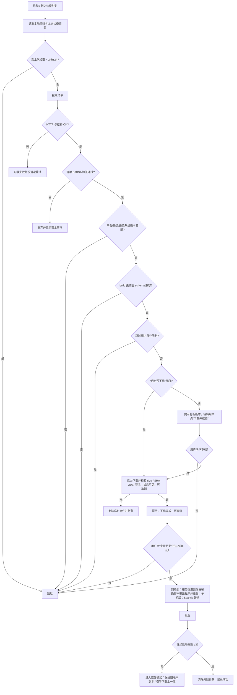

# 更新模块技术方案

基准：`main` @ `bae9997`（0.9.0 发布链路实测）
关联文档：`docs/进销存技术方案.md` 6.8 节
状态：macOS 单机版已端到端跑通并实测——启动 30 秒首查、之后每 24h±2h 拉取 `latest.json`、Ed25519 验签、发现更高 build 后由内嵌的 Sparkle 2.10.1 弹窗确认、下载、原子替换 `/Applications/小兔进销存.app` 并重启。自动检查与后台预下载两个开关已实现（默认开，关于页可改；首次后台下载前需确认流量提示，可取消，失败按 60 秒 / 600 秒退避、最多 3 次）。清单与安装包托管在阿里云 OSS（香港）+ CDN（`https://dl.xiaotu.online`），`tools/package/publish_oss.sh` 一条命令完成上传、签名、本地验签、purge、下载页数字同步与 CDN 预热；安装包走 Developer ID 签名 + 公证 + staple。网络版服务端已接入厂商清单（`[update] manifest_url`，验签后缓存 10 分钟，拉取失败回退旧缓存），安装经管理员二次确认后自动替换程序并重启，失败回滚旧版本。未实现：Sparkle 复用预下载包（安装时仍会重新下载）、强制升级 UI、灰度分桶、Windows 桌面端自动更新；恢复模式与旧版本回退已实现（安装前保留 1 份 `.app`，连续 3 次启动失败后可一键回退，稳定启动 3 次后清理）。Q25 口径不变：允许自动检查，安装必须用户显式确认，绝不静默安装。本文档区分「当前实现」「本轮口径」「未实现待做」。

---

## 1. 目标与范围

为 macOS 桌面端、Windows 桌面端（后续）、网络版服务端与私有化部署提供统一的版本检查、下载、校验、安装与回滚能力。

已确定的核心策略：

| 场景 | 检查节奏 | 安装方式 |
| --- | --- | --- |
| 桌面端（单机） | 启动后一次，之后每 24 小时后台检查，带 ±2 小时随机抖动 | **自动检查 + 后台预下载（默认开）**；首次预下载前提示流量，状态可见、可随时取消、取消后不自动重试、失败最多 3 次；安装必须由用户在关于页显式点击并确认会关闭程序；从不静默安装；允许“跳过此版本”7 天 |
| 桌面端（连网络版） | 每次登录做一次轻量版本握手，另加每 24 小时检查 | 同上；低于服务端 `min_supported_version` 时阻断（网络版兼容护栏，仍不自动安装） |
| 网络版服务端 / 私有化 | 每日检查厂商更新源一次，失败按缓存兜底 | 管理员在维护窗口显式确认后自动替换程序并重启；失败回滚旧版本；当前只开 stable，不做 beta 与灰度放量 |

**Q25 现行口径（2026-11-13 起）**：桌面端不做强制升级、不做静默安装；允许自动检查与后台预下载，安装必须用户显式确认。强制升级仅作为网络版兼容护栏或未来改口径后的能力保留，当前发布不启用；若未来启用，仅限四类：

1. 安全漏洞修复（公告后 24–72 小时内）。
2. schema 或 API 协议不兼容。
3. 法规、税控截止（提前 30 天公告）。
4. 客户端版本低于服务端 `min_supported_version`（仅网络版）。

---

## 2. 版本号规则

### 2.1 四条版本线

| 版本线 | 形式 | 示例 | 作用 | 变更规则 |
| --- | --- | --- | --- | --- |
| 产品版本 | SemVer `MAJOR.MINOR.PATCH` | `1.4.2` | 对用户展示、发布说明 | MAJOR：数据或 API 不兼容；MINOR：新增功能；PATCH：修复 |
| 构建号 | 单调递增整数 | `2026111301` | Sparkle / 安装包比较、灰度分桶 | 每次产出安装包必须递增，不复用、不回退 |
| schema 版本 | 整数 `vN` | `v30` | 数据库结构兼容判断 | 只增不减；一次迁移 +1；不复用号段 |
| API 版本 | 整数 | `1` | 客户端与服务端协议兼容 | 兼容新增不升；破坏性变更 +1，并保留 N-1 一个 MINOR 周期 |

### 2.2 对应关系与不可回退约束

- 一个产品版本对应唯一构建号；同一构建号不得出现两份不同二进制。
- 构建号严格递增，回滚发布也必须使用更大的构建号（回滚包重新打包并递增），否则 Sparkle 与客户端比较逻辑会判定为“无更新”。
- schema 版本单调递增；应用只允许打开 `schema_version ∈ [schema_min, schema_max]` 的数据库。
- 产品版本 MAJOR 与 schema 不强制一一对应，但 MAJOR 变更必须伴随兼容说明。
- 允许降级的前提：目标版本与当前版本 schema 相同且为 PATCH（见 Q28 建议）。

---

## 3. 更新清单（manifest）

### 3.1 文件位置与命名

- macOS（在用）：`https://dl.xiaotu.online/<product>/updates/<channel>/latest.json` 与同目录 `appcast.xml`；`<product>` 取 `xiaotu` / `devcard` / `mote`，安装包位于 `https://dl.xiaotu.online/<product>/<安装包文件名>`。
- 网络版服务端（在用）：清单与安装包由同一套发布工具产出，`platform` 为 `windows`（或目标平台），包内必须是单文件可执行程序或含同名可执行文件的 zip；地址通过 `[update] manifest_url` 配置。
- Windows 桌面端（预留，未启用）：`https://<update-host>/windows/<channel>/latest.json`。
- 通道：目录与脚本参数支持 `stable` / `beta`，当前只发布 `stable`（Q24）。

### 3.2 字段定义

```json
{
  "manifest_version": 1,
  "key_id": "2026-01",
  "platform": "macos",
  "channel": "stable",
  "version": "1.4.2",
  "build": 2026111301,
  "min_os": "12.0",
  "url": "https://cdn.example.com/releases/macos/1.4.2/xiaotu-1.4.2.dmg",
  "sha256": "9f2c...e1",
  "size": 48234496,
  "published_at": "2026-11-13T08:00:00Z",
  "release_notes_url": "https://example.com/releases/1.4.2",
  "mandatory": false,
  "mandatory_reason": null,
  "mandatory_deadline": null,
  "schema_min": 28,
  "schema_max": 32,
  "api_min": 1,
  "api_max": 2,
  "rollout_percent": 100,
  "upgrade_path": [
    {"schema": 28, "version": "1.3.8", "build": 2026100101}
  ],
  "signature": "base64(Ed25519(canonical_payload))"
}
```

| 字段 | 语义 |
| --- | --- |
| `manifest_version` | 清单结构版本，结构变更时 +1；客户端不认识的版本直接忽略 |
| `key_id` | 签名密钥标识，用于轮换期选择公钥 |
| `platform` | `macos` / `windows`，不匹配则忽略 |
| `channel` | 通道名，客户端只读取自己所属通道 |
| `version` / `build` | 展示版本与单调构建号；更新判断以 `build` 为准 |
| `min_os` | 最低系统版本，低于则不下发 |
| `url` | 安装包地址，必须在 HTTPS 下 |
| `sha256` / `size` | 下载完整性校验；`size` 用于提前拒绝异常响应 |
| `published_at` | 发布时间，UTC ISO 8601 |
| `release_notes_url` | 发布说明页面，不内嵌大段文本 |
| `mandatory` / `mandatory_reason` / `mandatory_deadline` | 强制标记、四类理由之一、最晚安装时间 |
| `schema_min` / `schema_max` | 该安装包可打开/迁移的 schema 范围；当前 schema 超出范围则拒绝更新 |
| `api_min` / `api_max` | 与服务端兼容的 API 版本范围 |
| `rollout_percent` | 放量比例，仅服务端判定时使用；静态清单固定 100 |
| `upgrade_path` | 可选数组，`{schema, version, build}`，按 schema 升序；本地 schema 低于 `schema_min` 时给出应先升级到的中间版本 |
| `signature` | 对去掉本字段后的规范化 JSON 做 Ed25519 签名 |

### 3.3 规范化与签名输入

- 使用 JSON Canonicalization Scheme（RFC 8785）：键按 UTF-8 排序、无多余空白、数字不使用指数形式、不出现 `NaN`。
- 签名输入为去掉 `signature` 字段后的规范化字节；`signature` 为 base64 编码的 64 字节 Ed25519 签名。
- 客户端先解析、再规范化重算，禁止对原始文本直接签名校验，避免空格与键序差异导致误判。

---

## 4. 签名链与密钥管理

### 4.1 校验链

```
HTTPS（证书校验）
  → 清单 EdDSA 签名（Ed25519，公钥内置于客户端）
  → 安装包 SHA-256 与 size
  → 安装包系统签名（macOS: Developer ID + 公证；Windows: Authenticode）
```

四层缺一不可：

- HTTPS 防传输篡改，但不能替代清单签名。
- 清单签名防更新源或 CDN 被篡改。
- SHA-256 绑定清单与具体安装包，防替换。
- 系统签名由操作系统在安装/首次启动时校验，防本地替换。

Sparkle 自身会校验 appcast 的 EdDSA 签名与 dmg 内 `.app` 的代码签名；自研检查只负责清单验签与版本判断，不重复实现安装包替换。

### 4.2 密钥生成

```bash
# 离线机器执行，私钥不进入仓库与 CI 缓存
openssl genpkey -algorithm ED25519 -out update_signing_2026.pem
openssl pkey -in update_signing_2026.pem -pubout -out update_signing_2026.pub.pem
```

- 公钥以 base64 原始 32 字节写入客户端（macOS 放 `Info.plist` 的 `SUPublicEDKey`），并登记 `key_id`。
- 私钥离线保存于加密介质，至少两份异地备份；发布流水线通过 CI Secret 注入，任务结束即清除。

### 4.3 轮换

1. 新密钥生成并登记 `key_id`（如 `2027-01`）。
2. 先发布一版客户端，内置新旧两把公钥（按 `key_id` 选择）。
3. 该版本全量后，更新源切换到新密钥签名。
4. 下一个版本移除旧公钥。

注意：Sparkle 的 `SUPublicEDKey` 只支持一把公钥，因此“双公钥”过渡只能由自研预检查完成；若预检查通过后再交给 Sparkle，必须保证 appcast 与清单使用同一把密钥，否则会出现自研通过、Sparkle 拒绝的情况。

### 4.4 泄露处置

1. 立即停止更新源发布，撤下受影响清单与安装包。
2. 发布安全公告，说明时间窗与影响版本。
3. 用新密钥签发紧急版本；由于旧密钥可能被用于伪造，紧急版本需通过官网手动下载 + 系统签名/公证作为独立信任锚。
4. 在下一个客户端版本内置 `revoked_key_ids`，拒绝旧密钥签名的清单。
5. 事后审计 CDN、CI Secret 与发布机访问日志。

---

## 5. 检查接口

### 5.1 两种部署形态

- **桌面端直连静态清单**：单机版直接 `GET https://dl.xiaotu.online/xiaotu/updates/<channel>/latest.json`，不经过业务服务端。
- **网络版经服务端代理**：客户端调用自身服务端 `GET /api/update/check`，服务端拉取并缓存厂商清单（`[update] manifest_url`，缓存 10 分钟；新清单验签通过后才替换缓存，拉取失败回退上一次缓存），叠加 `min_supported_version` 与灰度判定后返回。这样内网客户端只需访问内网服务端。
- **内网/离线部署**：只配 `[update] manifest_file`，由部署侧用 `deploy/update-sync.sh` 同步；两份配置都存在时优先使用 `manifest_url`，本地文件作为兜底。

### 5.2 请求

```http
GET /api/update/check?current_version=1.3.0&build=2026100101&channel=stable&platform=macos&schema_version=29&api_version=1
```

| 参数 | 必填 | 说明 |
| --- | --- | --- |
| `current_version` | 是 | 当前产品版本 |
| `build` | 是 | 当前构建号 |
| `channel` | 是 | `stable` / `beta` |
| `platform` | 是 | `macos` / `windows` |
| `schema_version` | 是 | 当前数据库 schema |
| `api_version` | 否 | 客户端 API 版本，网络版必填 |

### 5.3 响应

```json
{
  "update_available": true,
  "mandatory": false,
  "min_supported_version": "1.2.0",
  "check_after_seconds": 86400,
  "latest": {
    "version": "1.4.2",
    "build": 2026111301,
    "url": "https://cdn.example.com/releases/macos/1.4.2/xiaotu-1.4.2.dmg",
    "sha256": "9f2c...e1",
    "size": 48234496,
    "published_at": "2026-11-13T08:00:00Z",
    "release_notes_url": "https://example.com/releases/1.4.2",
    "mandatory_reason": null,
    "mandatory_deadline": null
  }
}
```

无更新时返回 `update_available=false`，`latest` 为 `null`，仍返回 `check_after_seconds`。
本地 schema 低于清单 `schema_min` 且 `upgrade_path` 可推导时，返回 `code=INTERMEDIATE_REQUIRED`，
并附带 `intermediate: {version, build, schema}`，客户端应提示先升级到该版本，而不是直接装最新版。

### 5.4 错误处理、超时与重试

| 情况 | 行为 |
| --- | --- |
| HTTP 4xx | 视为配置错误，记录日志；不重试，等待下一次计划检查 |
| HTTP 5xx / 超时 | 指数退避重试：1 分钟、10 分钟、之后每小时；成功一次即回到正常周期 |
| 清单签名无效 / 结构非法 | 丢弃清单，不上报为“有新版本”，记录安全事件日志 |
| 服务端未配置公钥 | 返回 `UPDATE_UNVERIFIED`，不返回任何可用更新信息 |
| 服务端验签失败 | 返回 `UPDATE_SIGNATURE_INVALID`，不信任清单 |
| 厂商清单拉取失败 | 回退上一次验签通过的缓存并在状态里标记 `manifest_stale`；无缓存返回 `UPDATE_MANIFEST_UNREACHABLE` |
| 新清单损坏/验签失败 | 不覆盖缓存，继续使用旧缓存并记录安全事件日志 |
| 当前版本高于清单 | 视为无更新（可能处于回滚期） |
| 离线 | 不阻塞启动与业务；保留上次检查结果；恢复网络后按计划检查 |
| 系统时间异常 | 以单调时钟计算间隔；时间跳变超过 1 天时立即重查一次 |

超时建议：连接 5 秒，总请求 10 秒；下载单独设置，不占用检查超时。

当前实现（`shell/mac/updater.mm`）：连接与总请求均 10 秒；失败后等 2 秒重试一次（首次启动常见冷 DNS / CDN 首包慢），仍失败则记 `CHECK_FAILED` 并按 1 分钟 / 10 分钟 / 1 小时退避重查（`check_retry_delay`，成功一次清零），日志带具体原因（`网络错误 <code>：<描述>`、`HTTP <status>`、`响应不是 JSON 对象`、`请求超时（10s）`）。状态字典返回 `check_failures` 与已按退避重排的 `next_check_at`。安装包预下载失败仍按 60 秒 / 600 秒退避，最多 3 次。

### 5.5 隐私

- 默认不采集匿名统计（Q23 建议）。
- 若启用，仅上报：随机安装 UUID、当前/目标版本与构建号、通道、平台、schema/API 版本、检查与安装结果、失败阶段。
- 不上报：用户名、公司名、单据数据、硬件序列号、MAC 地址、完整 IP。
- 服务端访问日志保留原始 IP 不超过 7 天，之后仅保留聚合计数。
- 设置中提供关闭入口；关闭后仍执行基础检查（不预下载、不安装），但不上报结果。

---

### 5.6 客户端开关

| 开关 | 配置键 | 默认值 | 语义 | 当前状态 |
| --- | --- | --- | --- | --- |
| 自动检查更新 | `[update] auto_check` | `true` | 启动后 30 秒与每 24h±2h 拉清单、验签并记录待更新版本；不安装 | 已实现：单机版存 NSUserDefaults（关于页开关，立即生效）；网络版读 config.toml，由服务端后台调度，**改后需重启服务** |
| 后台预下载 | `[update] prefetch` | `true` | 自动检查发现新版本且开关开启时，后台下载并验签；状态可见、可取消、取消后本次不再自动重试、失败最多 3 次 | 已实现：单机版后台下载、校验、取消与 3 次退避重试（关于页开关，立即生效）；网络版服务端后台下载、`POST /api/update/download/cancel` 取消与同样规则的退避重试，并自动清理旧包，**改后需重启服务** |

- 两个开关独立：关闭自动检查不影响手动检查；关闭后台预下载不影响用户手动下载。
- **默认开启的流量约束**：`prefetch` 默认开，意味着用户未做任何操作也可能产生下载流量。首次预下载前必须给一次性提示，说明「会在后台下载安装包，可能产生网络流量并占用磁盘，可在设置中关闭」；设置页开关文案必须是「发现新版本时自动下载安装包」，不能只写「自动更新」让人误以为会自动安装。
- **取消与重试**：用户可随时取消；取消后删除未完成文件，本次版本不再自动重试，手动下载仍可。失败最多 3 次（首次 + 2 次退避），仍失败则等下一次检查。单机版由壳内下载任务取消；网络版服务端终止 curl 并把任务状态置为 `canceled`，`POST /api/update/download/cancel` 立即返回、前端轮询 `GET /api/update/status` 获取最终状态；服务停止时也会中止正在跑的下载，避免退出等待。
- **单包与磁盘**：同一时间只保留一个最新待装包；下载新版本前删除旧待装包，稳定后只占一份包体，不随版本累积（删除旧包时不显示释放的字节数）。网络版在启动新下载前清空 `<数据目录>/updates/` 中的其他包；后台检查确认已是最新且下载空闲时清空该目录；同一版本包已缓存时删掉其余残留。单机版启动时若已安装到当前版本，删除 `done` 状态的旧包并回到 idle，旧包不长期占用 Application Support。
- 配置键已加入 `server/src/config.cpp` 的白名单，默认均为 `true`；单机版开关在关于页修改后立即生效，网络版修改 config.toml 后需重启服务。

**实现细节（2026-11-17 核对）**

- 单机版：开关存 `NSUserDefaults` 的 `XiaotuAutoCheckEnabled` / `XiaotuPrefetchEnabled`，`registerDefaults` 默认 `YES`；首次后台下载的确认存 `XiaotuPrefetchNoticeAcked`。关闭自动检查只递增令牌作废旧定时器，关于页「检查更新」不受影响；关闭预下载会取消进行中的下载并作废重试，手动「下载并校验」不受影响。
- 预下载状态机：`idle` → `needs_consent`（首次未确认流量提示）→ `running` → `done` / `failed`；失败进入 `retrying`（60 秒、600 秒，最多 3 次）；用户取消进入 `canceled`，手动下载可重新发起。
- `status` 返回 `auto_check`、`prefetch`、`prefetch_notice_acked`、`prefetch_state`、`prefetch_version`、`prefetch_bytes`、`prefetch_total`、`prefetch_file`、`prefetch_message`，关于页据此渲染开关、进度、取消与「已下载」。
- 网络版：`auto_check` / `prefetch` 只从 `[update]` 读取（缺省 `true`），服务启动时生效，运行中不提供切换；`GET /api/update/status` 只读回显，页面标注「config.toml」。手动检查与手动下载不受这两个开关限制。

## 6. 客户端流程



要点：

- 检查、版本比较、强制判定、跳过期由自研部分完成；下载由后台预下载（开关开启）或用户点击触发；替换与重启只在用户确认安装后由 Sparkle 或系统安装器完成。
- 下载不在后台自动开始，不阻塞开单；下载完成后只提示“可安装”，不自动退出、不自动替换。
- 网络版服务端按同一流程下载并校验；管理员在关于页点「安装并重启」并二次确认后，服务端复验安装包、解包并定位新程序，返回响应后优雅退出；替换脚本等进程退出，把旧程序备份为 `<程序>.old`、覆盖新程序并按原启动参数重启，覆盖失败时回滚旧程序。`<data_dir>/updates/staging-*/update-apply.log` 记录结果。
- 连续 3 次启动失败：暂停更新提示，弹出恢复指引，保留旧 `.app` 副本与升级前数据库备份（`pre-v*`）。
- 旧版本副本：安装前把当前 `.app` 复制到 `~/Library/Application Support/com.simem.xiaotu/previous/previous.app`，只保留最近 1 份；新版本稳定启动 3 次后自动删除，回退成功后由脚本删除。
- 恢复模式：连续 3 次启动未稳定（新版本验证期或仍有待装版本）时置 `recovery_required`，关于页展示“回退到上一版本 / 继续使用当前版本 / 打开备份目录”。回退由脚本在当前进程退出后替换 `.app` 并重启；只替换程序，数据库结构变更需先用 `backups/app-*-pre-v*.db` 恢复。

实现状态（2026-11）：A–J、K 的下载校验、L、L2–N 已实现。J 的后台预下载默认开启，首次下载前需确认流量提示；状态与进度在关于页可见，可取消，取消后本次不再自动重试，失败按 60 秒 / 600 秒退避、最多 3 次；同一时间只保留一个待装包，新版本下载前清理旧包，单机版与网络版均已实现（网络版另有 `POST /api/update/download/cancel` 与服务端目录清理）。连续 3 次启动未稳定会置 `XiaotuUpdatePaused` 与 `XiaotuUpdateRecoveryRequired` 并写 error 日志。O 的恢复模式与旧版本回退已实现：安装前保留 1 份 `.app`，失败后可一键回退、继续使用当前版本或打开备份目录，新版本稳定启动 3 次后删除旧副本。链接 Sparkle 时安装仍由 Sparkle 重新下载，预下载包不复用；网络版已接入厂商清单与自动替换重启（`manifest_url` + 替换脚本），但仅支持单文件可执行包或含同名程序的 zip，`.dmg` 等安装器型包仍返回不支持；灰度分桶与强制升级 UI 未启用。

---

## 7. 单机版与网络版差异

| 维度 | 单机版 | 网络版 |
| --- | --- | --- |
| 版本来源 | 直连厂商静态清单 | 经自身服务端代理厂商清单 |
| 检查节奏 | 启动一次 + 每 24h±2h | 每次登录握手 + 每 24h±2h |
| 升级对象 | 客户端自身 | 客户端与服务端分别升级 |
| 服务端升级 | 不适用 | 管理员在维护窗口二次确认后自动替换程序并按原参数重启 |
| 阻断条件 | 不做强制升级 | 低于服务端 `min_supported_version` 即阻断（网络版兼容护栏） |
| 灰度 | 依赖 Sparkle 分阶段或通道 | 服务端按比例判定，可即时调整 |
| 恢复方式 | 旧 `.app` 副本 + 升级前备份 | 回滚包 + 数据库备份；服务端保留上一版本安装包 |
| 离线 | 可长期离线使用，仅无法检查更新 | 内网可离线更新；客户端连不上服务端时按本地缓存策略 |

---

## 8. 服务端与发布侧

### 8.1 发布流水线

实际发布是一条命令（`tools/package/publish_oss.sh`，三款产品共用，`PRODUCT=` 选目录）：

1. 读仓库根 `VERSION`、从 dmg 内 `Info.plist` 读构建号，核对 dmg 存在；
2. 上传 dmg 到 `<product>/`，`Cache-Control: public, max-age=31536000, immutable`；
3. 用 `tools/package/update_manifest.py` 生成 `latest.json` 与 `appcast.xml` 并做 Ed25519 签名；
4. 本地验签：清单签名 + dmg 的 `size` / `sha256`；
5. 上传两个清单到 `<product>/updates/<channel>/`，`no-cache, max-age=60`；
6. purge CDN 上的 dmg 与两个清单；
7. 回写桶根 `index.html` 里该产品的字节数与 SHA256（`UPDATE_INDEX_PAGE=false` 关闭，重复执行幂等）；
8. 下载一次新 dmg 预热 CDN 边缘缓存（`WARMUP=false` 关闭）。

- OSS 凭据只从环境变量或仓库外 `~/.config/xiaotu-updates/oss-credentials.env`（权限 600/400）读取，不写进仓库。
- 灰度（1% → 10% → 50% → 100%）尚未实现，清单 `rollout_percent` 固定 100，当前靠 `stable` 全量发布。
- 冒烟：发布后用真实客户端装一次新包确认，实测流程见 13.2。

### 8.2 目录结构

```
dl.xiaotu.online/                    ← 桶 xiaotu-update（cn-hongkong）+ CDN
  index.html                         ← 下载页（桶根）
  xiaotu/xiaotu-inventory-0.9.0.dmg
  xiaotu/updates/stable/latest.json
  xiaotu/updates/stable/appcast.xml
  devcard/…  mote/…                  ← 同结构，各自独立
```

不产出 `.sha256` 边车文件：哈希写在 `latest.json` 里，`appcast.xml` 用 `sparkle:edSignature` 签 dmg 字节。

### 8.3 缓存与失效

| 资源 | Cache-Control | 说明 |
| --- | --- | --- |
| `latest.json` / `appcast.xml` | `no-cache, max-age=60` | 60 秒 TTL，发布脚本仍主动 purge。曾用 300 秒，发版后 CDN 仍返回旧清单导致误判「无更新」，已下调 |
| 安装包 | `public, max-age=31536000, immutable` | 按版本归档，不覆盖；发布后预热一次边缘缓存 |

- 清单切换采用“先上传安装包 → 再原子替换清单”；替换后对 CDN 执行 purge，并下载一次新包预热。
- 回滚时发布新的清单指向旧安装包，同时构建号保持递增（重新打包）或明确标记回滚版本（Q28）。

### 8.4 灰度放量

- 分桶：`bucket = SHA-256(install_id + ":" + target_build) 的前 4 字节 mod 100`。
- `install_id` 为客户端首次启动生成的随机 UUID，不含硬件信息；未启用统计时仍本地生成，仅用于分桶，不上报。
- 网络版由服务端判定并下发；单机静态清单无法按比例分桶，采用「beta 先行 → stable 全量」，或使用 Sparkle 的分阶段推送能力（具体属性需按所用 Sparkle 版本核对，标注为不确定）。
- 放量节奏：1% → 10% → 50% → 100%，每档至少观察 24 小时；出现启动失败率或更新失败率异常即停在当前档。
- 当前状态：未启用。清单 `rollout_percent` 固定 100，客户端不生成 `install_id`、不分桶；Sparkle 分阶段推送也未开启。

---

## 9. macOS 与 Windows 落地差异

### 9.1 macOS

- 使用 Sparkle 2.10.1：`Sparkle.framework` 随包内嵌在 `Contents/Frameworks`，可执行文件的 rpath 为 `@loader_path/../Frameworks`（`shell/CMakeLists.txt`，`XIAOTU_SPARKLE_DIR` 指向解压目录）。
- 自研层负责定时检查、清单验签、版本与跳过判定；`SPUStandardUpdaterController` 只在需要安装时启动，由 Sparkle 完成下载、appcast `sparkle:edSignature` 校验、原子替换与重启。Sparkle 自身不做静默安装。
- `Info.plist` 关键键（由 `tools/package/make_dmg.sh` 打包时注入，仓库内保持空占位）：
  - `SUFeedURL`：`https://dl.xiaotu.online/<product>/updates/stable/appcast.xml`
  - `XiaotuUpdateManifestURL`：`https://dl.xiaotu.online/<product>/updates/stable/latest.json`
  - `SUPublicEDKey`：Ed25519 公钥 base64（当前 `key_id = 2026-11`）
  - `SUEnableAutomaticChecks` / `SUAutomaticallyUpdate` / `SUAllowsAutomaticUpdates`：均为 `false`，关闭 Sparkle 自己的检查与自动安装，避免双份检查/提示
  - `CFBundleDevelopmentRegion=zh_CN`、`CFBundleLocalizations=[zh_CN]`：让 Sparkle 使用中文资源，弹窗显示「软件更新」「安装更新」「跳过这个版本」
- 检查节奏：首次启动 30 秒后查一次，之后 24h±2h；检查结果与下次时间记在 `NSUserDefaults`（`XiaotuLastCheckAt` / `XiaotuNextCheckAt` / `XiaotuLastCheckResult`）。
- 发布包必须 Developer ID 签名 + 公证 + staple（见 `docs/发行与安装说明.md`），否则 Sparkle 替换后会被 Gatekeeper 拦截。
- 已实测（0.9.0）：新装 → 30 秒检查 → 验签通过 → 中文 Sparkle 弹窗 → 下载 → 替换 `/Applications/小兔进销存.app` → 重启后 `CFBundleVersion` 为新构建号，`codesign --verify` 与 `spctl -a -vv` 均通过。

### 9.2 Windows

桌面端首版采用**手动下载 + 安装包覆盖**，不接入自动更新，理由：

- 尚无 Authenticode 证书与稳定的安装包流水线；
- WinSparkle 需要额外的 appcast 与安装器集成，短期收益低于成本；
- 手动下载可先验证版本分发与签名链，再决定是否引入 WinSparkle。

后续若接入，优先评估 WinSparkle + Inno Setup，复用同一静态清单与 Ed25519 规范（Q26 建议）。

网络版服务端不受上述限制：它替换的是 `xiaotu-server.exe` 本身，使用「等待进程退出 → 备份 → 覆盖 → 重启」的批处理脚本完成，不需要 Authenticode 集成；但程序目录必须可写，且包内必须提供同名可执行文件。

---

## 10. 失败与回滚

| 失败场景 | 检测点 | 处理 |
| --- | --- | --- |
| 下载损坏 / 截断 | size 或 SHA-256 不符 | 删除临时文件，按退避重试；连续 3 次失败提示手动下载 |
| 清单签名不符 | Ed25519 验签失败 | 丢弃清单，记录安全事件，不提示更新；上报（若启用统计） |
| 安装包系统签名无效 | 系统安装/首次启动 | 阻止安装/启动，提示从官网重新下载 |
| 安装中断 | 替换脚本 / Sparkle 暂存目录 | 旧程序未被替换或已回滚，重启后仍为旧版本；清理残留并重试 |
| 服务端替换失败 | 替换脚本覆盖阶段 | 把 `<程序>.old` 移回原位置，保持旧版本可启动；原因写入 `updates/staging-*/update-apply.log` |
| 厂商清单不可达 | 拉取超时 / 5xx / 断网 | 回退上一次验签通过的缓存并标记 `manifest_stale`；无缓存返回 `UPDATE_MANIFEST_UNREACHABLE`，不影响业务 |
| 升级后无法启动 | 启动失败计数 ≥3 | 已实现：置 `XiaotuUpdatePaused` 与 `XiaotuUpdateRecoveryRequired`，关于页展示恢复模式，可一键回退安装前保留的上一版本、继续使用当前版本或打开备份目录 |
| schema 不兼容 | 启动时版本检查 | 拒绝打开数据库并说明所需版本；引导升级或恢复备份 |
| schema 降级 | 旧程序打开新库 | 拒绝启动，提示升级；不得自动改库 |
| 强制更新未完成（仅未来口径） | 超过 `mandatory_deadline` | 阻断业务入口，仅保留“立即更新 / 退出 / 导出数据” |

回滚包保留：目标是更新源保留最近 3 个 stable 版本与对应清单；本地保留最近 1 份升级前 `.app`（已实现）与 1 份 `pre-v*` 数据库备份（服务端迁移前自动生成）。当前 OSS 只追加不清理，保留数量未落实。

---

## 11. 与 `docs/进销存技术方案.md` 6.8 的关系

- 本文档是 6.8 的**细化**，不替代 6.8 的总体架构与职责划分（清单与分发自管、安装替换交给 Sparkle）。
- 6.8 继续保留：更新路线、Sparkle 与自研边界、发布流水线概要、与发布产物的关系。
- 本文档新增并建议回写 6.8 的内容：
  1. 版本号四条线及不可回退约束；
  2. manifest 完整字段与规范化/签名规则；
  3. 密钥轮换与泄露处置；
  4. 检查接口的请求/响应/超时/隐私口径；
  5. 单机与网络版的检查节奏差异（24h±2h、登录握手）；
  6. 灰度分桶与缓存策略；
  7. Q23–Q28 的建议值。
- 6.8 中“检查接口可由静态文件实现”的表述保留；本文档补充网络版由服务端代理的形态。

---

## 12. 模块划分（实现位置）

| 模块 | 位置 | 状态 |
| --- | --- | --- |
| 版本与清单领域逻辑 | `core/include/xiaotu/update.h`、`core/src/update.cpp` | 已实现：版本比较、schema/API 兼容判断、强制判定、跳过期、`upgrade_path`、恢复模式判定；分桶未实现 |
| JSON 规范化与验签 | `core/src/update_signature.cpp`、`core/include/xiaotu/update_signature.h` | 已实现：RFC 8785 规范化 + OpenSSL 3.0 EVP Ed25519 |
| 网络版检查接口 | `server/src/update_routes.cpp`、`server/src/update_service.*`、`server/src/update_install.cpp` | 已实现：`manifest_url` 拉取 + 验签后缓存 + 失败回退；安装复验、解包、替换脚本与重启 |
| 登录握手 | `server/src/http_server.cpp` 的 `/api/health` 响应 | 已实现：返回 `min_supported_version`，桌面壳启动时比对并展示“必须升级”阻塞页 |
| macOS 更新壳 | `shell/mac/updater.mm`、`shell/mac/webview.mm` | 已实现：定时检查与失败退避、验签、跳过、开关（自动检查/后台预下载）、预下载与取消、Sparkle 启动、强制升级拦截、轻量握手阻断、恢复模式与旧版本回退 |
| 发布工具 | `tools/package/make_dmg.sh`、`tools/package/update_manifest.py`、`tools/package/publish_oss.sh` | 已实现：打包签名公证、生成并签清单、上传/purge/同步下载页/预热 |
| 更新源 | 阿里云 OSS `xiaotu-update`（cn-hongkong）+ CDN `dl.xiaotu.online` | 已启用；Nginx + systemd 方案未采用 |

### 12.1 技术依赖

- Ed25519 验签已选用 OpenSSL 3.0 EVP 实现（`core/src/update_signature.cpp`）；CMake 用 `find_package(OpenSSL 3.0 REQUIRED)`，缺失即配置失败，不再降级为 stub。macOS 装 `openssl@3` 并静态链接，Windows 用 Chocolatey / vcpkg 并提供 `OPENSSL_ROOT_DIR`；发布脚本也强制 OpenSSL 3.x，拒绝 macOS 自带的 LibreSSL。
- Sparkle 固定在 2.10.1；分阶段推送属性仍未启用。

---

## 13. 测试策略

### 13.1 可自动化

| 用例 | 方式 |
| --- | --- |
| 清单解析：缺字段、类型错误、未知 `manifest_version` | `core` 单测 |
| JSON 规范化稳定性：键序、空白、数字格式 | 固定样本对比 |
| Ed25519 验签：正确、篡改、错 key_id | 测试密钥对 |
| 版本比较：build 更大/相等/更小、semver 边界 | 表驱动单测 |
| schema/API 兼容范围判断 | 表驱动单测 |
| 强制判定：四类理由与截止时间 | 表驱动单测 |
| 跳过期：7 天内非强制跳过、安全更新不跳过 | 注入时钟 |
| 分桶：同一 install_id 稳定、比例分布 | 统计断言 |
| 退避与超时 | `check_retry_delay` 表驱动单测 + 本地 mock HTTP（cpp-httplib） |
| 网络版代理：缓存、min_supported_version、5xx 降级 | 集成测试 |
| 清单签名工具 | Python 测试：生成→验签→篡改失败 |

### 13.2 必须真机或外部条件

- Sparkle 端到端：下载、验签、替换、重启、失败回退。——已实测到「替换 + 重启」；恢复模式与一键回退已实现（见 §10），回退脚本替换 `.app` 后重启仍需真机复测。
- Developer ID 签名、公证、staple 后的 Gatekeeper 行为。——已实测通过（`spctl` 显示 `Notarized Developer ID`）。
- 网络版服务端升级与客户端握手阻断。——已实现（`/api/health` 返回 `min_supported_version`，壳低于即展示阻塞页），尚未真机复测。
- Windows 安装包与 Authenticode。——未做。
- 真实网络环境下的超时、代理、CDN 缓存行为。——已观察香港 OSS 冷缓存约 0.45 MB/s，发布脚本已加预热；代理与弱网未系统测试。

### 13.3 ObjC 壳手动验证（自动检查 / 预下载开关）

自动化测试只覆盖配置解析与清单逻辑；macOS 壳的开关行为需要按下面步骤真机验证。测试全程使用 App 副本，**不要替换 /Applications 里的正式版本**。

#### 准备

```bash
set -e
E2E=/tmp/xiaotu-e2e
REPO=/Users/lin/Projects/xiaotu-inventory
APP="$E2E/App.app"
CURRENT=$(/usr/libexec/PlistBuddy -c 'Print :CFBundleVersion' \
  "$REPO/build/release/shell/xiaotu-inventory.app/Contents/Info.plist")
NEW_BUILD=$((CURRENT + 1))

mkdir -p "$E2E"
cp "$REPO/build/package/xiaotu-inventory-0.9.0.dmg" "$E2E/pkg.dmg"
cp "$REPO/build/release/shell/xiaotu-inventory.app" "$APP"
# 清单用 file:// 读取：实测本机 http://127.0.0.1 与局域网 http 都会被壳进程拒绝（-1004），
# 即使测试副本加了 NSAllowsArbitraryLoads 也一样；安装包仍走 https 外网。
/usr/libexec/PlistBuddy -c \
  'Set :XiaotuUpdateManifestURL file:///tmp/xiaotu-e2e/latest.json' \
  "$APP/Contents/Info.plist"
codesign --force --deep --sign - "$APP"

# 正常清单：URL 指向 CDN 上的真实包（已预热，通常 3–15 秒下完）
"$REPO/tools/package/.venv/bin/python" \
  "$REPO/tools/package/update_manifest.py" generate \
  --file "$E2E/pkg.dmg" --version 9.9.9 --build "$NEW_BUILD" \
  --url https://dl.xiaotu.online/xiaotu/xiaotu-inventory-0.9.0.dmg \
  --platform macos --channel stable \
  --schema-min 1 --schema-max 39 --api-min 1 --api-max 1 --rollout 100 \
  --key-id 2026-11 --key "$HOME/.config/xiaotu-updates/update_signing_2026.pem" \
  --out "$E2E/latest.json"
cp "$E2E/latest.json" "$E2E/latest-ok.json"

# 失败清单：签名有效，但下载地址 404
"$REPO/tools/package/.venv/bin/python" \
  "$REPO/tools/package/update_manifest.py" generate \
  --file "$E2E/pkg.dmg" --version 9.9.10 --build "$((NEW_BUILD + 1))" \
  --url https://dl.xiaotu.online/xiaotu/does-not-exist.dmg \
  --platform macos --channel stable \
  --schema-min 1 --schema-max 39 --api-min 1 --api-max 1 --rollout 100 \
  --key-id 2026-11 --key "$HOME/.config/xiaotu-updates/update_signing_2026.pem" \
  --out "$E2E/latest-404.json"

# M6/M7 需要更长的下载窗口：改指 OSS 源站（实测约 1.8 MB/s，6.6 MB 约 3.5 秒）
# 改 url 后必须重新签名，否则验签失败。
python3 - <<'PY'
import json
d = json.load(open('/tmp/xiaotu-e2e/latest-ok.json'))
d['url'] = d['url'].replace(
    'https://dl.xiaotu.online/xiaotu/',
    'https://xiaotu-update.oss-cn-hongkong.aliyuncs.com/xiaotu/')
json.dump(d, open('/tmp/xiaotu-e2e/unsigned-slow.json', 'w'))
PY
"$REPO/tools/package/.venv/bin/python" \
  "$REPO/tools/package/update_manifest.py" resign \
  --manifest "$E2E/unsigned-slow.json" \
  --key "$HOME/.config/xiaotu-updates/update_signing_2026.pem" \
  --out "$E2E/latest-slow.json"
```

备份并清空偏好（测试副本与正式版共用 bundle id 与数据目录）：

```bash
defaults export com.simem.xiaotu "$E2E/defaults-backup.plist" 2>/dev/null || true
# 每次用例前：先退出 App，再执行
defaults delete com.simem.xiaotu 2>/dev/null || true
rm -rf "$HOME/Library/Application Support/com.simem.xiaotu/updates"
```

启动并观察：

```bash
open "$APP"
tail -f "$HOME/Library/Application Support/com.simem.xiaotu/logs/app.log" | grep '更新：'
```

UI 入口：左侧「关于与诊断」页的「软件更新」卡片。所有 `defaults read` 观察都在 App 退出后执行，避免读到未落盘的值。

#### 用例

| 编号 | 操作 | 预期 |
| --- | --- | --- |
| M1 默认开启 | 清空偏好后启动，打开「关于与诊断」 | 「自动检查更新」「发现新版本时自动下载安装包」均勾选；后台下载显示「—」。`XiaotuAutoCheckEnabled` 未落盘属正常（`registerDefaults` 只提供内存默认值） |
| M2 首轮自动检查 | 启动后等 30–40 秒；或先 `defaults write com.simem.xiaotu XiaotuNextCheckAt -float 0` 再启动 | 「待安装版本」出现 `9.9.9（构建 <NEW_BUILD>）`；`XiaotuLastCheckResult=UPDATE_AVAILABLE`；日志出现清单拉取与验签成功记录；`XiaotuNextCheckAt` ≈ 当前时间 + 86400 秒（±7200） |
| M3 首次流量确认 | 在 M2 同一次运行中观察 | 后台下载先显示「首次后台下载前需要确认流量提示」，`XiaotuPrefetchState=needs_consent`，`updates/` 目录为空；点「我知道了，开始后台下载」后开始下载，进度递增，最终 `done`，`updates/` 出现与清单同名的 dmg，`XiaotuPrefetchNoticeAcked=1` |
| M4 关闭自动检查 | 取消勾选「自动检查更新」；`defaults write com.simem.xiaotu XiaotuNextCheckAt -float 0`；退出并重启，静置 60 秒 | `XiaotuAutoCheckEnabled=0`；上次检查时间不再变化（定时器被令牌作废）；点「检查更新」仍可刷新时间与结果，说明手动链路不受影响 |
| M5 关闭后台预下载 | 退出后执行 `defaults write com.simem.xiaotu XiaotuPrefetchEnabled -bool false`，并把 `XiaotuNextCheckAt` 置 0；重启 | 检查仍发现 9.9.9，但 `XiaotuPrefetchState=idle`、`updates/` 无新文件；点「下载并校验」仍能下载成功（手动动作绕过开关） |
| M6 下载中关闭开关 | 先 `cp "$E2E/latest-slow.json" "$E2E/latest.json"`，清空偏好与 `updates/` 后启动；在「关于与诊断」页把「自动下载」勾选上，等状态变为 `running`，再立即取消勾选 | 下载立即中止，`XiaotuPrefetchState=idle`，`updates/` 下 `.part` 被删除；70 秒后仍为 `idle`、`attempts=0`，不自动重试 |
| M7 取消本次下载 | 同 M6 启动下载，出现「取消下载」按钮后点击 | 状态变 `canceled`，`.part` 删除；等待 ≥60 秒不自动重启；重启后仍为 `canceled`；点「下载并校验」可正常下载成功（实测 CDN 约 3–5 秒到 `done`） |
| M8 失败重试 | 退出 App，`cp "$E2E/latest-404.json" "$E2E/latest.json"`；执行 `defaults write com.simem.xiaotu XiaotuPrefetchNoticeAcked -bool true` 与 `defaults write com.simem.xiaotu XiaotuNextCheckAt -float 0`；重启并保持运行 | 首次失败后 `XiaotuPrefetchState=retrying`、`XiaotuPrefetchAttempts=1`，界面显示「稍后自动重试（第 2/3 次）」；约 60 秒后 `attempts=2`（第 3/3 次）；再约 600 秒后 `attempts=3`、状态 `failed`；日志有三条「后台预下载失败（第 N 次）」。实测 404 返回的错误页会先被当成安装包，报错为「安装包大小不符」 |
| M9 手动下载失败 | 在 M8 的 404 清单下点「下载并校验」 | 直接进入 `failed`，不进入退避重试（手动下载不自动重试）；实测 `attempts` 重置为 1 后不再增长 |

#### 恢复现场

```bash
osascript -e 'quit app "小兔进销存"' 2>/dev/null || true
# defaults import 只覆盖备份里的键，不会删除测试期间新增的键，先整体清空再导入
defaults delete com.simem.xiaotu 2>/dev/null || true
defaults import com.simem.xiaotu /tmp/xiaotu-e2e/defaults-backup.plist 2>/dev/null || true
rm -rf "$HOME/Library/Application Support/com.simem.xiaotu/updates" /tmp/xiaotu-e2e
```

注意：

- 先退出 `/Applications/小兔进销存.app` 再启动测试副本，否则 `open` 可能只激活已运行的正式版。
- 测试副本与正式版共用 `com.simem.xiaotu` 的偏好和 `~/Library/Application Support/com.simem.xiaotu/` 缓存目录，**必须先备份再清空**，结束时先 `defaults delete` 再导入，否则测试键会残留。
- 副本是 ad-hoc 签名，只验证到「下载并校验」；不要点「安装更新」，Sparkle 需要正式签名的包。
- 首次检查默认在启动 30 秒后触发；把 `XiaotuNextCheckAt` 写成过去时间可以跳过等待。
- 自动检查触发的后台下载不会主动推送状态给已经打开的「关于与诊断」页，页面要等下一次渲染才出现进度/取消按钮；验证 M6/M7 时请从页面勾选开关或点「下载并校验」来启动下载。
- M8 完整跑完约 11 分钟（60 秒 + 600 秒两次退避），实测第三次失败在第二次失败后约 641 秒。
- 若只想确认开关落盘位置，`defaults read com.simem.xiaotu` 中对应键为 `XiaotuAutoCheckEnabled`、`XiaotuPrefetchEnabled`、`XiaotuPrefetchNoticeAcked`。

#### 实测记录（2026-11-17）

本机按上述步骤完整跑过 M1–M9，全部通过：

| 用例 | 关键实测值 |
| --- | --- |
| M1 | 两个复选框 `value=1` |
| M2 | 启动后约 30 秒检查，`UPDATE_AVAILABLE`，待装 9.9.9 / build 2026111711，`NextCheckAt` ≈ +23.2 小时 |
| M3 | `needs_consent` → 点击确认 → `running` → `done`，落盘 dmg 6,633,958 字节，SHA256 与清单一致 |
| M4 | 关闭后置 `NextCheckAt=0` 重启，60 秒内 `LastCheckAt` 不变；手动检查正常刷新 |
| M5 | 预下载关：检查命中但状态 `idle`、目录为空；手动「下载并校验」成功 |
| M6 | 下载中取消勾选：`running → idle`，`.part` 清除，70 秒后无重试 |
| M7 | 下载中点取消：`canceled`，重启后仍 `canceled`，手动下载可完成 |
| M8 | `attempts` 依次 1 → 2（+65s）→ 3（+641s），最终 `failed`，日志三条失败 |
| M9 | 手动失败直接 `failed`，70 秒内无重试 |

#### 补充实测记录（2026-11-17，失败退避 / 强制升级 / 握手阻断）

沿用上面的副本与 `file://` 清单环境，另起测试数据目录（`--data`），逐项验证本轮新增能力：

| 用例 | 操作 | 关键实测值 |
| --- | --- | --- |
| M10 失败退避 | 删除清单文件，`XiaotuNextCheckAt=1` 后启动 | 08:17:42 第 1 次失败，日志「60 秒后重试」，`XiaotuCheckFailures=1`；08:18:46 第 2 次失败（+64s），日志「600 秒后重试」，`XiaotuCheckFailures=2`，`NextCheckAt` 距当前约 600 秒 |
| M11 成功清零 | 恢复清单，置 `XiaotuNextCheckAt=1` 后重启 | 08:19:06 验签通过并发现 9.9.9，`XiaotuCheckFailures=0`，`NextCheckAt` 距当前约 23.3 小时（落在 24h±2h 内） |
| M12 强制升级拦截 | 清单置 `mandatory=true`、`reason=SECURITY`，重启进入主界面 | 登录后弹出阻塞提示：「当前版本必须升级（安全漏洞修复）：9.9.9（构建 2026111711）。安装时会重新下载约 6.3 MB 并退出程序，升级后才能继续使用。」仅「立即安装」一个按钮，背景业务界面不可操作，无跳过入口 |
| M13 握手阻断 | `--data` 目录写入 `[update] min_supported_version = "9.9.9"` 后启动 | 未进入业务界面，直接显示「必须升级后才能继续使用」「当前版本 0.9.0 低于服务端要求的最低版本 9.9.9」，仅保留「已升级，重新进入」 |

说明：M12 的 Esc 屏蔽在代码中实现，但自动化按键受窗口焦点切换影响未取得稳定证据；强制升级弹窗本身无取消按钮，已由截图确认。

---

## 14. Q23–Q28 建议值

以下均为**建议**，不是既定结论。

| 编号 | 决策点 | 建议值 | 理由 |
| --- | --- | --- | --- |
| Q23 | 检查频率、是否默认开启、匿名统计 | 每日一次 + ±2h 抖动；默认开启、允许关闭；首版不采集匿名统计 | 与已定策略一致；无账号体系下统计价值有限，先降低隐私与合规成本 |
| Q24 | beta 通道与灰度 | 当前只开 stable，不做 beta 与灰度；能力保留，未来再按通道/比例启用 | 首版优先降低变量；私有化与早期客户验证另行安排 |
| Q25 | 强制升级与静默安装 | 允许自动检查与后台预下载；安装必须用户显式确认；不做静默安装、不做强制升级；允许跳过 7 天 | 后台预下载改善体验，但安装权留给用户；与已定策略一致 |
| Q26 | Windows 更新方案 | 首版手动下载；后续 WinSparkle + Inno Setup | 当前无签名证书与安装包流水线，先保证可分发 |
| Q27 | 网络版升级执行方式 | 管理员自助 + 维护窗口；提供离线包与内网更新源；不内置自动安装 | 避免服务端被自动重启；内网客户需要离线路径 |
| Q28 | 降级与版本保留 | 仅同 schema 的 PATCH 允许降级；更新源保留最近 3 个 stable；本地保留 1 份旧 `.app` 与 1 份 `pre-v*` 备份 | 兼顾回滚能力与磁盘/维护成本 |

---

## 15. 实施顺序建议

1. `core` 版本比较、清单模型、强制判定与单测（无外部依赖）。——已完成
2. 签名工具与清单生成、更新源目录与 Nginx 配置。——已完成，更新源改用 OSS + CDN，未用 Nginx
3. macOS 自研预检查 + Sparkle 接入（先 stable 全量，验证链路）。——已完成，0.9.0 实测
4. 网络版 `/api/update/check`、登录握手与 `min_supported_version`。——已完成；同时接入厂商清单与自动替换重启
5. 灰度分桶与放量脚本、回滚演练。——未做
6. Windows 手动下载页与安装包（后续再评估 WinSparkle）。——构建链已有；安装包未签名、不接自动更新

---

## 16. 风险与不确定项

- Sparkle 的分阶段推送属性名称与行为需按实际版本核对；当前不作为确定能力。
- 香港节点的 CDN 冷缓存下载慢（实测约 0.45 MB/s），发布脚本已加预热；备案完成后迁回内地只需改 `OSS_REGION` / `CDN_DOMAIN`。
- 回退只替换程序：本地保留 1 份升级前 `.app`，连续 3 次启动失败后可一键回退；数据库结构变更不在回退脚本内处理，需先用 `backups/app-*-pre-v*.db` 恢复（关于页提供备份目录入口）。
- 回退脚本依赖对 `.app` 所在目录的写权限；从只读 DMG 直接运行时替换会失败，脚本会恢复现场并重新打开当前版本，日志写入 `previous/rollback.log`。
- 预下载包与 Sparkle 未打通：链接 Sparkle 时安装仍由 Sparkle 重新下载，用户可能为同一版本消耗两份流量；未链接 Sparkle 的构建才直接打开预下载包。
- 无 Developer ID 证书时，macOS 自动更新无法达到“下载即装”；当前已完成签名 + 公证 + staple。
- 单机版长期离线时无法感知强制更新，只能在下一次联网或手动检查时阻断；这是离线优先的必然取舍。
- 灰度分桶依赖本地 `install_id`，清理应用数据会重新分桶，比例会有轻微偏差；当前未启用。
