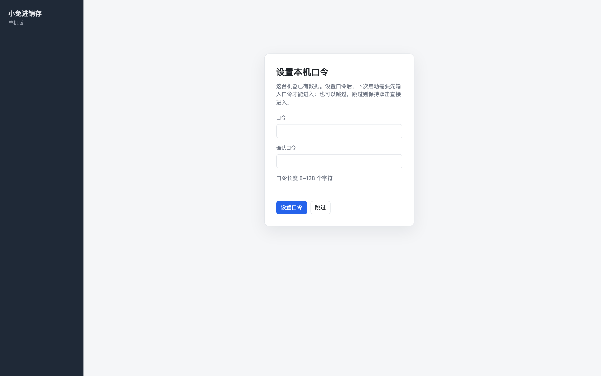
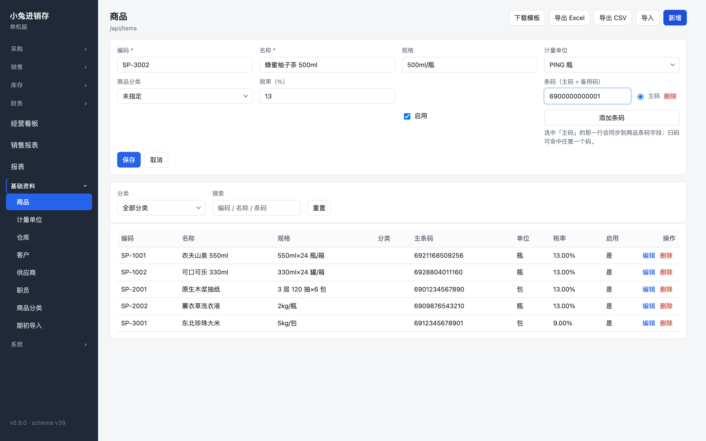
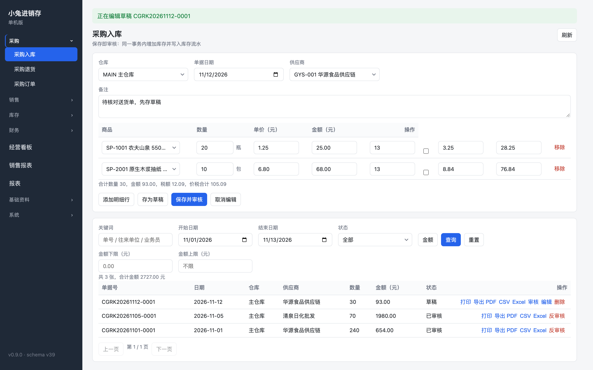
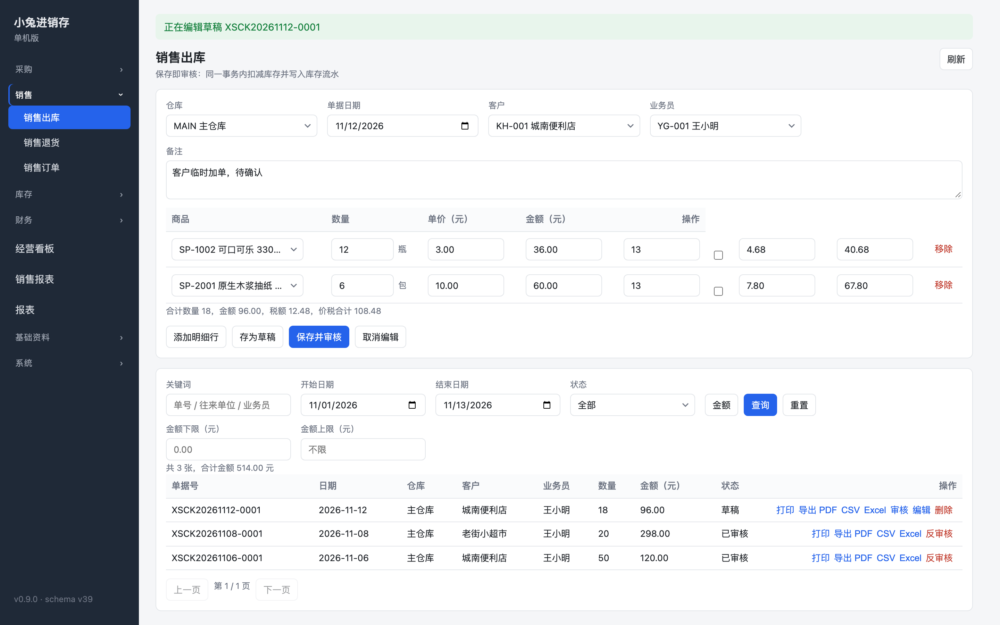
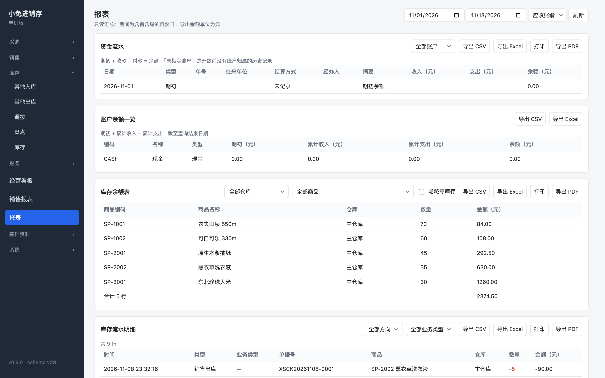

# 小兔进销存 用户手册

适用版本：**0.9.0**（macOS 单机版 / 网络版）

这本手册按「第一次用的人」的顺序写：装好 → 打开 → 设口令 → 建资料 → 开单 → 查库存 → 看报表 → 打印 → 备份。每一节都说明在哪里点、输入什么、结果是什么。

> 本手册的截图来自一套独立的演示数据，商品、客户、供应商名称都是虚构的，不对应任何真实单位。截图中的金额、库存和日期仅用于说明界面，不代表你的账。

## 0. 第一次用，按这个顺序

1. 安装并打开程序（第 2 节）。
2. 按提示决定要不要设置本机口令（第 2.1 节）。跳过也可以，以后在「系统参数」里还能改。
3. 建计量单位、商品分类、仓库、商品、供应商、客户（第 4 节）。
4. 开第一张采购入库单，把货进到仓库（第 5 节）。
5. 开销售出库单，把货卖出去（第 5 节）。
6. 到「库存」看结存数量和成本（第 6 节）。
7. 到「报表」看进销存汇总、销售毛利（第 7 节）。
8. 需要给客户或供应商单据时，用「打印」（第 8 节）。
9. 每周做一次备份，换电脑前再备份一次（第 10 节）。

多人一起用时，先看第 11 节「网络版」，不要两个人分别双击单机版去开同一份数据。

## 1. 先认识几个词

- **商品档案**：所有要管理的东西的清单，比如「农夫山泉 550ml」。
- **仓库**：货实际存放的地方。只有一个仓库时，所有单据都选它即可。
- **单据**：一次业务动作的记录，比如「今天从华源食品进了 100 瓶水」。
- **草稿**：还没生效的单据，可以随便改、可以删，不影响库存和账款。
- **审核**：让单据正式生效。审核后才会计入库存和应收应付。
- **反审核**：把已审核的单据撤回。系统会补一笔反向记录，把库存和账款还原，单据回到草稿状态。
- **移动加权平均**：一种算库存成本的方法。每次进货后，把「原来的库存金额 + 本次进货金额」除以总数量，得到新的平均单价；出库按这个平均单价结转成本。
- **往来单位**：和你有钱款关系的对象，供应商和客户都属于往来单位。
- **应收 / 应付**：客户欠你的钱是应收，你欠供应商的是应付。
- **核销**：收到客户的钱、或付钱给供应商之后，把这笔钱和对应单据勾掉，表示「这笔账结了一部分或全部」。
- **本机口令**：只保护这台电脑上的单机版。设了以后，打开程序先要输入口令；它和网络版的用户名/口令是两套东西。
- **本机免输**：设了本机口令后，默认把一枚服务端签发的凭据存进 macOS 钥匙串，30 天内打开不再问口令。钥匙串里不保存口令本身。

界面左侧是分组菜单，同一时间只展开一组。点组名可以收起或换组。当前页所在的组会自动展开；下次打开会回到上次看的页面。页面地址带 `#/` 和短名，例如 `#/purchase`，刷新后会留在原页。

单机版窗口没有后退/前进按钮，也不支持触控板横扫后退；换页面请用左侧菜单。网络版用浏览器打开时，浏览器的前进/后退可以正常使用。

## 2. 安装与第一次启动（macOS）

1. 双击 `xiaotu-inventory-0.9.0.dmg`，把「小兔进销存」拖进「应用程序」文件夹。
2. 第一次打开会被 macOS 拦下，提示「无法打开，因为 Apple 无法检查其是否包含恶意软件」。当前发布包没有做 Developer ID 签名和公证，这是 Gatekeeper 的常规拦截，不是中毒。
3. 打开「系统设置」→「隐私与安全性」，在页面下方找到「已阻止使用 小兔进销存」的提示，点「仍要打开」，再确认一次。
4. 也可以在「应用程序」里按住 Control 点应用图标，选「打开」，在弹窗里再点「打开」。
5. 之后正常双击启动。程序会自己打开窗口，并在本机准备数据目录；第一次启动稍慢几秒是正常的。

不需要安装数据库、编译器或其他软件。数据默认在：

```text
~/Library/Application Support/com.simem.xiaotu/
```

Windows 和 Linux 网络版的启动方式不同，见第 11 节。

### 2.1 第一次启动：要不要设本机口令

程序会先看两件事：这台机器上**有没有业务数据**，以及**有没有设过本机口令**。

- **新装、空数据**：不询问，直接进主界面。
- **已有数据、从没设过本机口令**：问一次「是否设置本机口令」，可以跳过。
- **已经设过**：不再询问，直接走第 2.2 节的口令页。



在这个页面：

- 输入两遍 8–128 个字符的口令，点「设置口令」：口令写入本机，之后每次启动都要先过口令页。
- 点「跳过」：保持原来的行为，双击直接进入，不设口令。跳过之后不会再反复问；以后想设，可以在「系统参数 → 本机免输」里处理，或按第 2.3 节用命令行重设。

口令只保护这台电脑上的单机版，不会同步到别的电脑。

### 2.2 设了口令之后：门禁页

设过口令后，启动不再直接进主界面，而是先出现门禁页：


- 只输入**本机口令**，没有用户名输入框；程序内部用内置管理员身份进入。
- 输错会提示「用户名或口令错误」，重新输入即可。
- 默认 30 天内免输：第一次输对后，程序把服务端签发的随机凭据存进 macOS 钥匙串。之后打开直接进主界面，不再问口令。
- 30 天到期、凭据被清除、或者系统时间被往回拨，都会回到这个页面重新输入。

如果不想让它记住，进「系统 → 系统参数 → 本机免输」，改成「每次都要输」，或点「清除本机记忆」。见第 9.2 节。

### 2.3 忘记本机口令

不需要恢复码。能访问数据目录的人本来就有重置权限，退出程序后在终端执行：

```bash
XIAOTU_PASSWORD='新口令' \
  /Applications/小兔进销存.app/Contents/MacOS/xiaotu-inventory \
  --data ~/Library/Application\ Support/com.simem.xiaotu \
  --set-password admin
```

执行完重新打开程序，用新口令进门禁页。门禁仍然保留；如果原来设过「30 天免输」，改口令不会自动清掉钥匙串里的旧凭据，建议改完后到「系统参数」点一次「清除本机记忆」，再用新口令登录。

## 3. 主界面

登录后默认进入「经营看板」。左侧是菜单，右侧是当前页：


菜单分组：

- **采购**：采购入库、采购退货、采购订单；
- **销售**：销售出库、销售退货、销售订单；
- **库存**：库存查询、调拨、盘点、其他入库、其他出库；
- **财务**：收付款、对账单、成本调整、资金账户；
- **报表**：单独的入口，不在任何组里；
- **基础资料**：商品、计量单位、仓库、客户、供应商、职员、商品分类、期初导入；
- **系统**：用户、审计日志、打印模板、系统参数、备份与恢复、关于与诊断。

首页的「经营看板」直接显示今日与本月销售额、退货额、成本、毛利，库存总额和应收欠款 Top N，口径与销售报表一致。

### 3.1 有未保存内容时退出

桌面版在两种情况下会拦一下：

- 点窗口左上角的红色关闭按钮；
- 按 `Cmd+Q` 退出。

只有在「正在录入、草稿还没保存、请求正在提交」时才弹确认。弹窗有两个按钮：「退出」和「取消」，默认焦点在「取消」，直接按回车是取消。没有未保存内容时，点红叉或 `Cmd+Q` 直接退出，不会弹无谓的窗口。

网络版用浏览器时，关闭标签页由浏览器自己的「离开此网站？」提示负责；单机版走的是程序自己的确认。

## 4. 建好基础资料（开单前必做）

顺序建议：计量单位 → 商品分类 → 仓库 → 商品 → 供应商 / 客户。

1. **计量单位**：进「基础资料 → 计量单位」，新增「件」「瓶」「包」「千克」等。商品必须选一个单位。
2. **商品分类**：进「基础资料 → 商品分类」，最多建三层（第三层下不再显示「新增子分类」）；同一级下不能重名。停用的分类不再出现在新建商品的下拉里，已有商品照常显示。
3. **仓库**：进「基础资料 → 仓库」，系统自带一个默认仓库，用不上可以再建。仓库停用后新单据选不到它。
4. **商品**：进「基础资料 → 商品」，填编码、名称、单位、规格、分类、条码、税率。编码不能重复；条码支持一个商品多个码（主码 + 备用码），在表单的条码区逐行增删，选中「主码」的那一行即主码。每个码都不能与其他商品重复，留空不参与判重。税率按百分数录入，`13` 即 13%，`0` 表示不计税。
5. **供应商**：进「基础资料 → 供应商」，填编码、名称、联系人、电话和税号。
6. **客户**：进「基础资料 → 客户」，同样填编码、名称、联系方式、税号；还可以填「信用额度」。
   - 额度按元填，留空或填 `0` 表示不限制。
   - 控制点在**销售出库审核**：已占用 = 该客户未核销的应收合计，本次出库金额加上去超过额度才触发。销售订单不占额度、不校验。
   - 默认「提示不拦」：页面弹出超额明细（额度、已占用、本次、超出），确认后照常出库并记审计日志；需要硬拦时在 `config.toml` 加 `[sales]` 段并设置 `credit_limit_mode = "reject"`。
7. **职员**：进「基础资料 → 职员」，填工号、姓名、电话、部门、职位。职员是业务档案，不要求绑定登录账号；社区版最多 10 名在职职员。停用（离职）后历史单据照常显示，新建销售单仍可选中并标注「（停用）」。

销售订单、销售出库、销售退货的表头可以选「业务员」，保存时会记下当时的姓名快照；不选则为「未指定」，报表里单列，不会并进其他人名下。销售订单转出库时业务员自动带过去。

档案停用（状态改为停用）不会删掉历史单据，只是开新单时选不到。

### 4.1 商品列表

进「基础资料 → 商品」，列表显示编码、名称、规格、分类、主条码、单位、税率和启用状态：


- 左上角可以按分类筛选，也可以按编码 / 名称 / 条码搜索。
- 右上角「新增」用来建商品；表格每行的「编辑」用来改商品。
- 「下载模板」「导出 Excel」「导出 CSV」「导入」用于批量维护，规则见 4.2。

### 4.2 新增 / 编辑商品

点「新增」后，表单在列表上方展开：



按顺序填：

1. **编码**：自己定，建议有规律，如 `SP-3002`。不能和已有商品重复。
2. **名称**：例如「蜂蜜柚子茶 500ml」。
3. **规格**：例如「500ml/瓶」，打印和列表都会显示。
4. **单位**：从下拉里选，单位必须先建好。
5. **分类**：可选；要先在「商品分类」里建好。
6. **条码**：在「条码（主码 + 备用码）」区填。第一行默认是主码；需要多个码就点「添加条码」，选中一行前面的「主码」。
7. **税率（%）**：填 `13` 就是 13%，填 `0` 就是不计税。
8. **启用**：默认勾选。停用后新单据选不到，但历史单据照常显示。

点「保存」写入；点「取消」放弃。编码重复、条码重复、单位不存在都会在保存时提示，不会写一半。

### 4.3 批量导入导出（商品 / 供应商 / 客户）

商品、供应商、客户的列表页右上角有四个按钮：**下载模板、导出 Excel、导出 CSV、导入**。

第一次用建议按这个顺序：

1. 点「下载模板」，得到只有表头的 xlsx；
2. 在 Excel 里按表头填数据（列顺序可以调整，但列名不能改，也不能多出系统不认识的列）；
3. 点「导入」选文件，确认后系统先校验，再自动备份数据库，最后一次性写入。

需要记住的规则：

- **空单元格 = 这一格不动，不是清空。** 已有档案的「启用」留空不会把档案改成启用，也不会把停用的档案重新启用；要改状态请明确填「是」或「否」。
- 按编码匹配：编码已存在就更新，不存在就新增。商品允许同名不同编码，供应商/客户编码不能重复。同一个文件里编码出现两次会直接报错。
- 商品模板多三列：**分类路径**（如 `食品/饮料`，必须先在「商品分类」里建好，否则整批拒绝）、**条码**（多个码用 `|` 分隔，第一个是主码；同码重复或与其他商品冲突整批拒绝并给出行号）、**税率%**（填 `13` 或 `13.5`，最多两位小数）。导出按同样格式回写。
- **任何一行有错，整批都不导入**，不会出现「导了一半」。错误会列出「第几行 / 哪一列 / 为什么」，点「下载清单」可以拿到完整的 CSV 错误表，改完再导一次。
- 每次真正写库前都会自动备份到数据目录的 `backups` 文件夹，文件名带 `pre-import-商品/供应商/客户`；备份失败会中止导入，不会硬写。导入成功后页面会提示备份文件名。
- 单次最多 **5000 行、5MB**，超了请分批。
- 编码、电话建议在 Excel 里把列设为「文本」格式，否则 `001` 会变成 `1`、长电话可能丢前导零。
- 导入只认真正的 `.xlsx`。不要用 CSV 改名成 xlsx，也不要选「CSV UTF-8」来导入。
- 「导出当前全部」导出的就是导入格式，可以直接拿来做备份：改完再导回去即可。
- 导入需要对应的写权限（商品/供应商/客户），导出和下载模板只需要查看权限。

### 4.4 期初导入（库存 / 应收 / 应付 / 资金账户）

「基础资料 → 期初导入」一张页面管四类期初，各自下载模板后导入：

| 类型 | 模板列 | 写入方式 |
| --- | --- | --- |
| 库存期初 | 仓库编码、商品编码、数量、成本单价（元） | 生成「其他入库 + 期初」，直接审核并进结存；成本单价必填，空单元格按错误处理 |
| 应收期初 | 客户编码、金额（元）、业务日期、到期日期（可空） | 直接写应收台账并打期初标记，不生成业务单据，可正常核销 |
| 应付期初 | 供应商编码、金额（元）、业务日期、到期日期（可空） | 同上，方向为应付 |
| 资金账户期初 | 账户编码、期初余额（元，可为负） | 更新账户已有的期初余额字段，不另建记录 |

规则：

- 导入前自动备份数据库；备份失败直接中止。
- 整批校验：任何一行有错误都不会写入，按行号与列名报出来。
- **有业务流水之后一律拒绝导入**（不覆盖、不追加），判定依据是已有库存流水/已审核单据、应收应付台账或收付款记录；期初自身生成的单据不算业务流水，所以四类可以依次导入，但同一类不能导第二次。
- 需要重来时只能清空数据目录重建（先备份），不能靠再次导入覆盖。

## 5. 开单

单据类型和用途：

| 单据 | 用在什么场景 | 对库存 | 对往来 |
| --- | --- | --- | --- |
| 采购入库 | 向供应商进货，货到仓库 | 增加 | 生成应付（你欠供应商） |
| 采购退货 | 把进错的货退给供应商 | 减少 | 应付红字，冲减欠款 |
| 销售出库 | 卖给客户，货发出去 | 减少 | 生成应收（客户欠你） |
| 销售退货 | 客户把货退回来 | 增加 | 应收红字，冲减欠款 |
| 其他入库 | 盘盈、赠品、借入等非采购来源的入库 | 增加 | 不产生往来 |
| 其他出库 | 内部领用、损耗、赠送等 | 减少 | 不产生往来 |
| 库存调拨 | 同一个商品从一个仓库挪到另一个仓库 | 源仓减少、目标仓增加 | 不产生往来 |
| 库存盘点 | 定期核对实物和账面 | 按「实盘 − 账面」的差额调整 | 不产生往来 |
| 销售订单 | 客户先订货、还没发货 | 不占库存、不动库存 | 不产生往来，只记录订单 |

### 5.1 通用开单步骤

1. 左侧点单据名称，例如「采购入库」。
2. 选日期、仓库；采购类选供应商，销售类选客户。
3. 在明细区选商品，填数量、单价（单位是元）。需要多行就点「添加明细行」。
4. 需要说明就填「备注」（单头一句话，最多 200 个字，可留空）。
5. 选「保存并审核」立即生效；暂不确定就选「存为草稿」。

采购入库页面的完整形态：



- 表头从左到右是仓库、单据日期、供应商。
- 明细表每行选商品、填数量、单价；金额、税额、价税合计会自动算。
- 底部有「添加明细行」「存为草稿」「保存并审核」。
- 下方的列表是历史单据，可以按条件筛选（见 5.4）。

### 5.2 备注怎么填、会出现在哪里

表头的「备注」在明细表上方，是一个两行的输入框：


- 最多 200 个字，可以留空。
- 备注跟着单据保存；单据列表的关键字搜索能命中备注内容。
- 单据详情、CSV 导出、Excel 导出都会带「备注」列。
- 销售订单转出库时，订单备注会原样带到生成的销售出库单；之后改订单备注不影响已经生成的出库单，出库单也不会再往下传备注。

### 5.3 各单据的特别之处

- **采购退货**按你填的退货单价冲减库存金额，所以退货单价要填供应商实际退款的价格。
- **销售退货**按你填的成本单价增加库存金额。
- **其他出库**按当前移动加权平均成本结转，不需要填成本；单价只作记录。
- **调拨**要选源仓库和目标仓库，两边成本一致，只换存放位置。
- **盘点**的明细数量填**实盘数量**（实际数出来多少），不是差异数。系统自动按差额调整，盘盈盘亏都会生成流水。
- **销售订单**确认后不能改，只能「转出库」生成销售出库单，或「关闭」结束。一张订单可以分多次转出库。

销售出库页面和采购入库结构相同，只是往来单位换成客户：



### 5.4 单据列表：四个条件筛选

每个单据页下方的列表都有一条筛选栏，可以组合使用四类条件：


1. **关键词**：匹配单号、往来单位、业务员、备注。比如输入 `HY-1101` 或 `加急`。
2. **开始日期 / 结束日期**：按单据日期筛选，含首含尾；只填一个也可以。
3. **状态**：全部、草稿、已审核、已反审核。
4. **金额**：先点「金额」按钮展开，再填「金额下限（元）」和「金额上限（元）」；不填表示不限。收起金额时，金额条件不参与筛选。

填好后点「查询」；点「重置」清空全部条件。列表底部显示总单数、总金额和分页，翻页不会丢掉当前筛选条件。筛选条件会按单据类型记住，下次打开同一类单据还在。

### 5.5 订单转出库

销售订单确认后，列表里会出现「转出库」：


1. 点「转出库」，页面展开转出表单。
2. 选本次出库的仓库、日期。
3. 每行填本次出库数量；可以只转一部分，剩余数量留在订单上。
4. 点「确认出库」，生成一张销售出库单，订单状态变成「部分出库」或「已全部出库」。
5. 不想继续履行时点「关闭」，订单结束，不再出现在可转出列表里。

订单转出不会重复扣库存；生成的销售出库单仍按正常出库规则校验库存。

### 5.6 草稿、审核与反审核

- **存为草稿**：不影响库存和账款，可以反复编辑、删除。列表里状态显示「草稿」。
- **审核**：草稿在单据列表里点「审核」即可生效；开单时直接点「保存并审核」会同时保存和审核。
- **反审核**：已审核的单据在列表里点「反审核」，确认后系统生成反向流水，库存和账款还原，单据回到草稿。
- 已审核的单据**不能直接改**。要改就先反审核，改完再审核。
- 已经有核销记录的应收应付，必须先到「收付款」撤销对应收付款单，才能反审核原单据。
- 销售订单不支持反审核，用「关闭」结束。
- 反审核不会删除历史，只是追加反向记录，所以库存流水始终可追溯。

## 6. 看库存与成本

左侧「库存」页面分三块：


- **库存余额**：每个商品在每个仓库的结存数量、平均成本和结存金额。这里的数字由流水自动算出，不能手工改。
- **库存流水**：每一次入库、出库、调拨、盘点的明细记录，只增不改。想查某笔数怎么来的，看这里。
- **成本重算核对**：系统按流水重新算一遍移动加权平均，和当前账面比对。只读，不会改数据；显示「一致」就说明成本没有被算错。

页面顶部可以按仓库、商品筛选。库存不足时，销售出库和其他出库会直接拒绝保存，提示库存不足。

## 7. 报表与导出

左侧「报表」页面，选好期间后点「查询」：



| 报表 | 看什么 |
| --- | --- |
| 库存余额表 | 当前各仓库各商品的结存数量与金额 |
| 库存流水明细 | 期间内每一笔出入库流水 |
| 收发明细 | 按商品看期初、入库、出库、期末 |
| 进销存汇总 | 按商品跨仓库汇总，数量与金额双口径，满足「期初 + 入库 − 出库 = 期末」 |
| 销售毛利 | 收入取单据金额，成本取审核写入的库存流水；已反审核的单据不计入 |
| 销售报表 | 按客户或按业务员汇总销售额、退货额、净销售额、成本与毛利，可切换维度 |
| 销售明细 | 逐行列出已审核的销售出库与退货，带业务员与单行毛利 |
| 资金流水 | 选资金账户后看期初、逐笔收款/付款和余额；升级前无账户的记录归入「未指定账户」 |
| 应收应付余额与账龄 | 每个往来单位的欠款余额和账龄区间 |
| 账户余额一览 | 每个资金账户的期初、累计收入、累计支出与当前余额 |

销售报表、库存流水、采购明细与销售明细按每页 200 行分页，页面底部可以翻页；导出一律取全部数据（单次上限 10 万行），不受当前页影响。

每个报表都有「导出 CSV」「导出 Excel」「打印」三个按钮，资金流水同样支持；账户余额一览直接看页面即可。CSV 可以用 Excel 或 WPS 直接打开；导出文件名带报表名和期间。

## 8. 打印与打印模板

单据列表和单据详情里有「打印」。点「打印」后先出现打印预览：


默认按 A4 纵向输出，包含模板页眉（公司名）、单据信息、明细表和页脚。桌面版已在原生打印中关闭系统页眉页脚，纸张顶部不会出现额外的日期与「小兔进销存」标题。

网络版用浏览器打印时，浏览器可能额外打印日期和网页标题（「小兔进销存」）。这是浏览器的页眉页脚，不是模板内容；请在打印对话框取消勾选「页眉和页脚」。

要改样式：进入「系统 → 打印模板」，点「新建模板」或编辑现有模板：

1. **名称 / 编码**：自己起名，编码用于区分。
2. **目标**：这张模板用于哪类单据，例如「采购入库」。一张单据类型可以有多张模板，勾选「设为该目标默认」的那张会在打印时自动使用。
3. **纸张 / 方向 / 页边距 / 字号**：选 A4 或自定义宽高（毫米）。
4. **页眉文本 / 页脚文本**：支持占位符，例如 `{title}`（单据名）、`{date}`（日期）、`{doc_no}`（单号），打印时自动替换。
5. 勾选「启用」并保存。停用的模板不会出现在打印选择里。

模板只影响排版，不会改动单据数据。打印时浏览器若提示拦截弹窗，选择允许即可。不同型号打印机的纸张和驱动差异，需要在你的机器上按实际纸张再调一次边距。

## 9. 系统参数、用户与审计

### 9.1 公司信息与开单规则

「系统 → 系统参数」可维护公司名称、联系电话与公司地址（操作员可改、只读角色只能看）。这三项会作为打印模板占位符 `{{company_name}}`、`{{company_phone}}`、`{{company_address}}`；模板没写抬头时默认打印公司名称。

页面还可开关「允许负库存出库」：默认关闭，出库超过结存会被拒绝；开启后允许结存数量为负（金额仍不能为负），开关变化会写审计。会话的空闲超时（分钟）与绝对上限（小时）也在这里调整，保存后下一次请求即按新值判断（包括已登录会话）。单据编号、日期格式、金额小数位是固定口径，页面只读展示，不能在这里改。

### 9.2 本机免输（单机版）

设过本机口令后，「系统参数」里会出现「本机免输」：


- **30 天内免输**（默认）：第一次输对口令后，服务端签发一枚 30 天有效的随机凭据，程序把它存进 macOS 钥匙串。30 天内启动直接进主界面。
- **每次都要输**：保存后立刻作废服务端凭据，之后每次启动都回到门禁页。
- **清除本机记忆**：立即作废当前凭据，并清掉钥匙串里的那一枚；下次启动要重新输入口令。

钥匙串里存的是随机凭据，不是口令本身，也不是口令的哈希。凭据到期、被清除、或者系统时间被往回拨，都会失效并回到门禁页。

改本机口令（`--set-password`）不会自动清除免输凭据；如果你是因为口令泄露而重置，重置后请到本页点一次「清除本机记忆」。

### 9.3 用户、审计与诊断

「系统 → 用户」：管理员可以新增账号，填用户名、姓名、角色和初始口令。三种角色：**管理员**（全部权限，可管账号）、**操作员**（开单、查库存和报表，不能管账号）、**只读**（只能看，不能改）。连续输错 5 次口令，该账号会被锁定 5 分钟。

「系统 → 审计日志」记录谁在什么时候做了什么：登录成功与失败（含来源 IP）、导出（路径与筛选条件）、手动备份与恢复、用户角色变更、系统参数修改、主数据导入、单据审核/反审核、收付款与成本超限确认等。审计只追加不修改，可按日期、对象和操作人筛选。

「系统 → 关于与诊断」显示版本、schema 版本、构建类型与编译信息、数据目录、数据库大小、监听地址和当前用户，全部只读；点「复制诊断信息」可整段复制发给维护人员。页面上不会出现口令、密钥或登录令牌。

## 10. 备份与恢复

数据都在一个目录里：macOS 是 `~/Library/Application Support/com.simem.xiaotu/`，Windows 是 `%LOCALAPPDATA%\com.simem.xiaotu\`。里面有 `app.db`（全部数据）和 `backups/`（备份）。

**自动备份**：每次程序升级、数据库结构要变更时，启动前会自动把旧库备份到 `backups/app-<时间>-pre-v<版本>.db`，升级失败可以直接回退。

**升级失败与回退**：如果新版本连续 3 次启动未稳定，程序会在「系统 → 关于与诊断 → 软件更新」显示恢复模式，可一键回退到升级前的旧版本（安装前会自动保留一份旧程序）。若本次升级变更了数据库结构，回退前请先用升级前的自动备份恢复数据；页面提供「打开备份目录」入口，恢复步骤见下文。升级成功并稳定启动 3 次后，旧版本副本会自动删除。

**手动备份**：关掉程序后，在程序所在目录执行：

```bash
./xiaotu-server --data "<数据目录>" --backup
```

会生成 `backups/app-<时间>-manual.db`，并检查备份文件完整性。建议每周做一次，把备份文件复制到移动硬盘或网盘。

**在界面里恢复**：


1. 进「系统 → 备份与恢复」，页面列出 `backups/` 里的备份文件。
2. 点某一份的「预检查」，确认文件大小、schema、完整性、是否为本程序数据库。
3. 预检查通过后点「恢复到该备份」，再确认一次。程序会先把当前库另存一份安全备份，然后退出；重新打开后完成恢复，本页会显示结果。
4. 恢复失败会自动回滚，不会把当前库覆盖成半成品。

**换电脑迁移**：退出程序 → 把整个数据目录（含 `app.db` 和 `backups/`）拷到新电脑 → 在新电脑上把目录放到相同位置（或启动时用 `--data` 指定新路径）。也可以只带一份备份文件，在新电脑上首次启动后恢复。

## 11. 网络版（多人用同一套数据）

单机版是「一台电脑、一个窗口、一份数据」。网络版是「一台电脑做服务端，其他电脑用浏览器连上来」，大家看到同一份数据。它不是多机数据同步，不要把同一份数据目录同时开给单机版和网络版。

### 11.1 在服务端启动

在放程序的目录执行：

```bash
./xiaotu-server --server --port 8080 --data "/path/to/data"
```

- `--server`：网络版模式，必须加；不加就是单机版。
- `--port`：监听端口，默认 8080；被占用时换一个，例如 8081。
- `--data`：数据目录；不写就用默认目录。

启动后终端会打印服务地址，例如：

```text
服务地址: http://127.0.0.1:8080/
局域网访问时，把监听地址换成本机 IP；使用用户名与口令登录。
```

第一次使用前，在服务端设置内置管理员口令：

```bash
XIAOTU_PASSWORD='你的口令' ./xiaotu-server --server --port 8080 --data "/path/to/data" --set-password admin
```

然后重新启动服务，用 `admin` 和这个口令登录。

### 11.2 别的电脑怎么连

1. 在服务端查本机局域网 IP。macOS：

   ```bash
   ipconfig getifaddr en0
   ```

   Windows 用 `ipconfig`，找「IPv4 地址」。
2. 其他电脑的浏览器打开 `http://<服务端IP>:8080/`，例如 `http://192.168.1.20:8080/`。
3. 输入管理员给你的用户名和口令。内置管理员是 `admin`；其他账号由管理员在「系统 → 用户」里建。
4. 登录状态保存在数据库里，空闲 30 分钟没有操作才会失效，每次使用都会自动顺延；同时从登录时刻起最多保留 12 小时。两个时长可在「系统 → 系统参数」调整。退出登录、改口令、停用或删除账号后，对应的人需要重新登录。

### 11.3 连不上时，先查这三种原因

**1）数据目录被单机版占用**

同一份数据目录不能同时开两个程序。如果服务端启动时提示「已有实例在使用该数据目录」，先关掉那台机器上打开的单机版窗口，再启动网络版。反过来也一样：网络版正在用这份数据时，不要再双击单机版去开同一个目录。

**2）防火墙拦了端口**

服务端本机能打开 `http://127.0.0.1:8080/`，别的电脑打不开，通常是系统防火墙没放行 8080。macOS 在「系统设置 → 网络 → 防火墙」里允许该程序接收传入连接；Windows 在「Windows 安全中心 → 防火墙和网络保护 → 允许应用通过防火墙」里放行。公司网络如果还有上网行为管理或交换机 ACL，也需要放行对应端口。

**3）IP 或端口写错**

其他电脑要填**服务端的局域网 IP**，不是 `127.0.0.1`（那指向他自己），也不是公网 IP。确认 IP 没变（DHCP 可能重新分配），端口和服务端启动日志一致。可以在其他电脑的终端先试：

```bash
curl http://192.168.1.20:8080/api/health
```

返回 JSON 说明网络通；连接被拒绝或超时，回到前两条查。

## 12. 常见问题

**点审核提示没有权限**
当前账号是「只读」角色，或该账号没有被授予对应权限。让管理员在「用户」页面改成「操作员」或「管理员」。

**审核不了，提示库存不足**
销售出库、其他出库、采购退货、调拨的源仓库都必须有足够库存。先确认仓库选对，再到「库存」页面看该商品的实际结存；确实不够就先做采购入库或其他入库，或在「系统参数」里打开「允许负库存出库」（不建议长期开着）。

**反审核提示已有核销记录**
先到「应收应付」找到对应单据，在「核销记录」里撤销核销，再回来反审核。

**不知道数据存在哪**
macOS：`~/Library/Application Support/com.simem.xiaotu/`；Windows：`%LOCALAPPDATA%\com.simem.xiaotu\`。程序启动时也会在窗口或终端打印「数据目录」。

**换电脑怎么迁移**
见第 10 节最后一段：退出后拷整个数据目录，或在新电脑上用备份文件恢复。

**忘记管理员口令（网络版）**
在服务器上执行：

```bash
XIAOTU_PASSWORD='新口令' ./xiaotu-server --server --port 8080 --data "/path/to/data" --set-password admin
```

然后重新登录。管理员重设口令不会强制下一次登录改密；只有第一次给空口令账号设置口令时才会要求改密。

**忘记本机口令（单机版）**
见第 2.3 节。用 `--set-password` 重设，不需要恢复码。

**登录提示「稍后再试」**
同一账号连续输错 5 次口令会锁定 5 分钟，等时间到了再试，或让管理员重置口令。

**启动提示端口被占用**
网络版默认 8080 端口被别的程序占了。改 `config.toml` 里的 `server.port`，或启动时加 `--port 8081`，然后重启服务。

**提示「已有实例在使用该数据目录」**
同一份数据目录不能同时开两个程序。先关掉另一个窗口再启动；如果确认没有其他实例（例如异常退出后锁文件残留），可以删除提示里的 `app.lock` 后重试。

**界面顶部提示数据目录在同步盘**
数据目录被放进了 iCloud Drive 或 OneDrive。同步客户端会并发替换文件，可能损坏数据库；请退出程序，把整个数据目录拷到本地磁盘（默认 `~/Library/Application Support/com.simem.xiaotu/`）后再启动。

**报表里没有很早以前的数据**
应收应付、账龄和对账单只统计升级到当前版本之后审核的单据；库存类报表覆盖全部历史。

**打印出来没有反应**
浏览器拦截了打印窗口。允许本站弹出窗口后重试，或换用 Chrome / Edge。桌面版打印走系统打印面板，先在预览里确认纸张和方向。

**钥匙串一直弹授权框 / 不想让它记住**
到「系统参数 → 本机免输」点「清除本机记忆」，并改成「每次都要输」。如果系统钥匙串里还有残留，打开「钥匙串访问」，搜索 `com.simem.xiaotu.local-remember` 手动删除。
