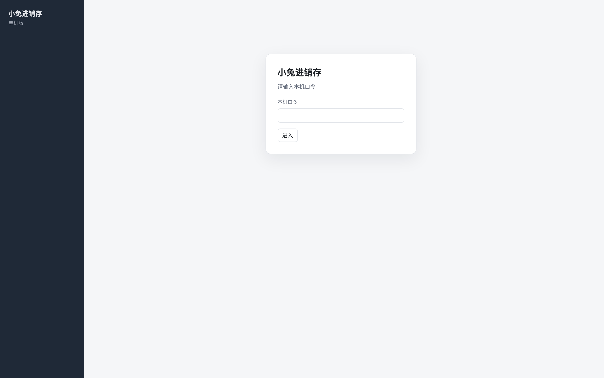
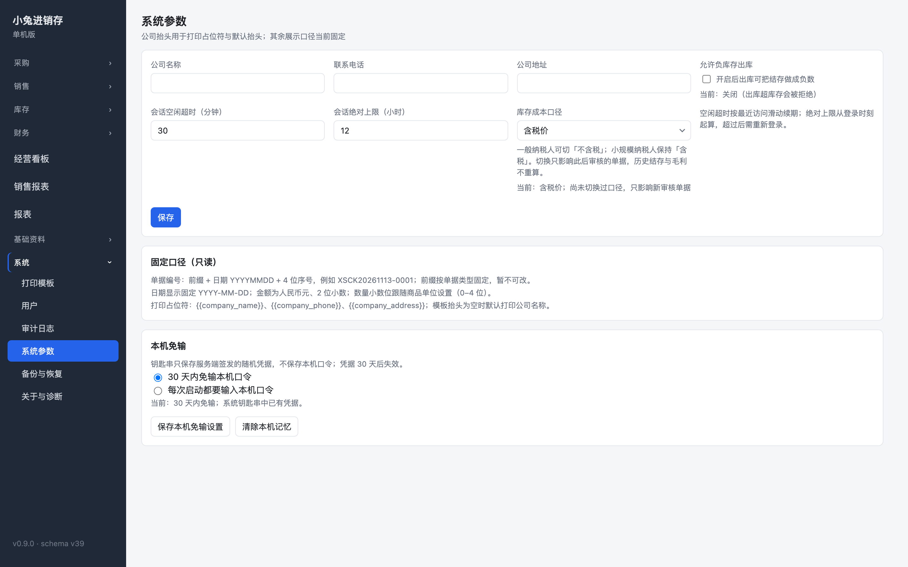
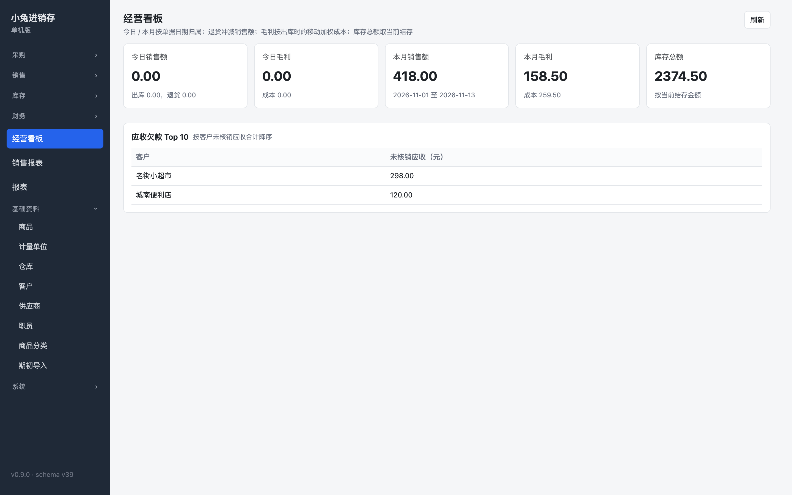
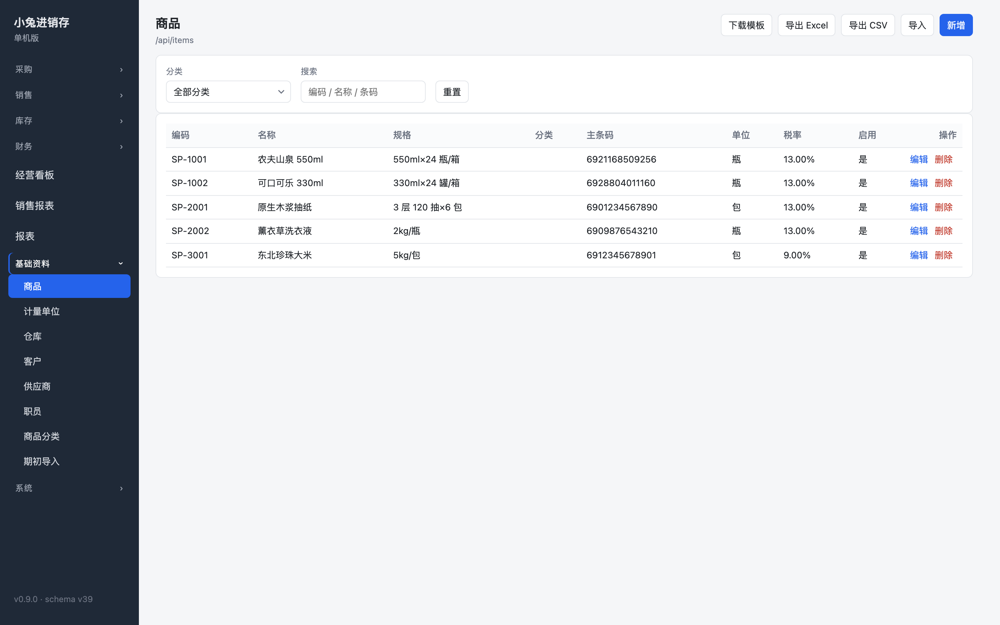
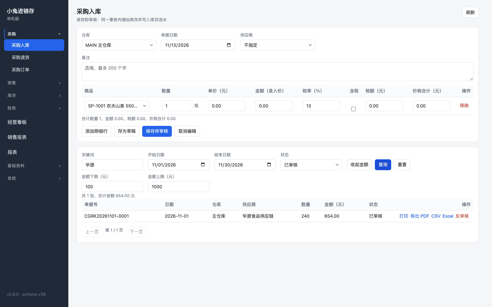
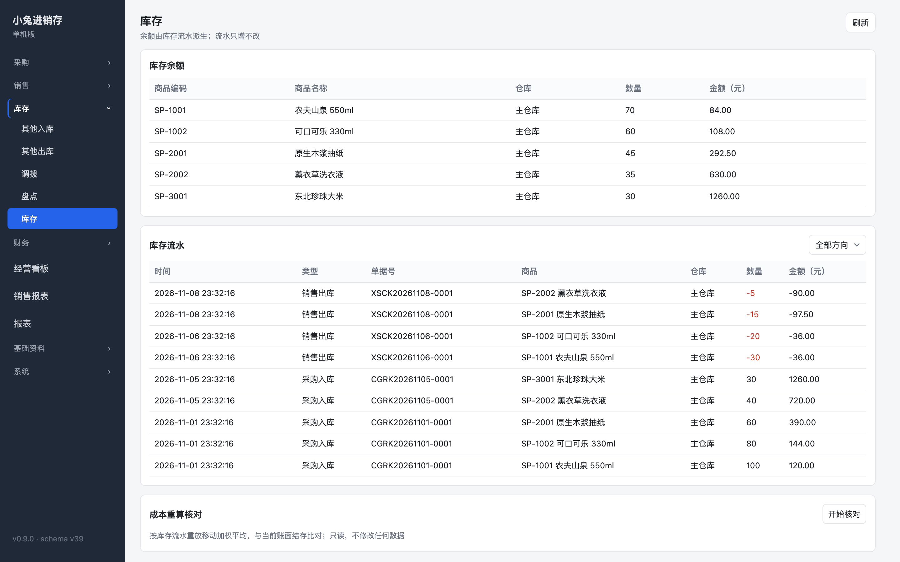
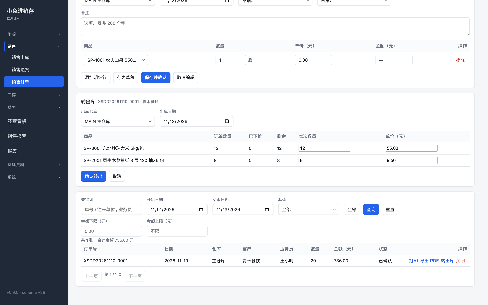
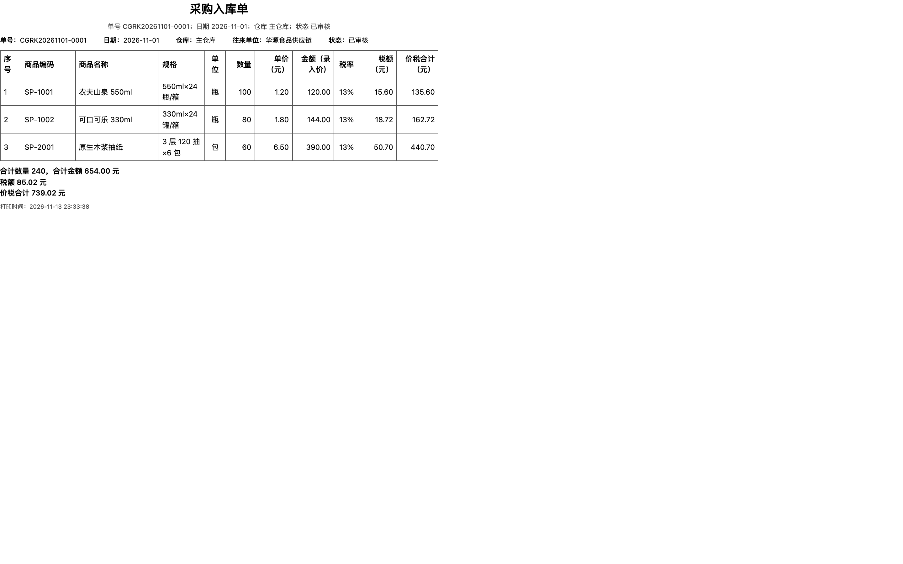
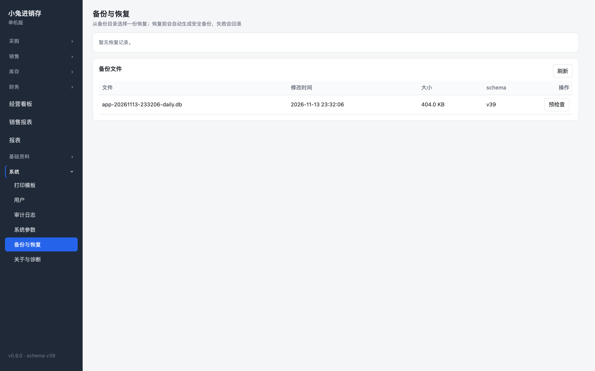

# 小兔进销存

{ width=120px height=120px }

## 用户手册

> 适用版本 **1.0.16** · macOS 14 / 15 · Apple Silicon
> 更新日期 2026-11-26
> 单机版 · 网络版通用

---

## 目录

- [开始之前](#开始之前)
- [1. 安装](#1-安装)
- [2. 第一次打开](#2-第一次打开)
  - [2.1 还没有数据——直接进](#21-还没有数据直接进)
  - [2.2 有数据但没口令——让你选](#22-有数据但没口令让你选)
  - [2.3 已经设过口令——先输口令](#23-已经设过口令先输口令)
  - [2.4 macOS 有"钥匙串记住 30 天"](#24-macos-有钥匙串记住-30-天)
  - [2.5 忘记口令怎么办](#25-忘记口令怎么办)
- [3. 界面长什么样](#3-界面长什么样)
- [4. 真正用之前，先建好这些](#4-真正用之前先建好这些)
- [5. 开第一张单：采购入库](#5-开第一张单采购入库)
- [6. 开销售出库单](#6-开销售出库单)
- [7. 看库存](#7-看库存)
- [8. 其他单据一览](#8-其他单据一览)
- [9. 报表](#9-报表)
- [10. 打印](#10-打印)
- [11. 备份是命根子](#11-备份是命根子)
- [12. 网络版（多人一起用）](#12-网络版多人一起用)
- [13. 软件更新](#13-软件更新)
- [14. 常见问题](#14-常见问题)
- [15. 一页纸速查](#15-一页纸速查)

---

## 开始之前

### 这是什么

小兔进销存是一套**单机优先、网络可用**的进销存软件。一套 C++ 代码，两种运行形态——双击就是单机版，加参数就是网络版，数据文件、商品档案、单据、库存都在同一个本地目录里。

### 给谁看

门店里实际录商品、开单、查库存、打印报表的同事。不需要懂电脑原理，按步骤照做就行。

### 两种用法先确认

- **一台电脑用**（单机版）：装完双击打开，数据只在这台电脑上。从第 1 节开始看。
- **几台电脑一起用**（网络版）：选一台当服务器，其他电脑用浏览器访问。先装好单机版，再看第 12 节。
- **只想先试试**：装好直接打开，不设口令也行，以后随时在「系统参数」里改。

### 数据存哪里（重要！）

所有数据——商品、客户、供应商、单据、库存、报表、备份——都在这个目录：

```text
~/Library/Application Support/com.simem.xiaotu/
```

里面的 `app.db` 是数据库，`backups/` 是自动备份。**不要删这个目录，不要往 iCloud Drive / OneDrive 放**。多人同时写、同步冲突或断网都可能损坏数据库。需要多台电脑共用时，用第 12 节的网络版，数据只放服务器本机磁盘。

### 术语先认识几个

| 词 | 是什么意思 |
| --- | --- |
| 商品档案 | 所有要管理的东西的清单，比如"农夫山泉 550ml" |
| 仓库 | 货实际存放的地方。只有一个仓库时，所有单据都选它 |
| 单据 | 一次业务动作的记录，比如"今天从华源食品进了 100 瓶水" |
| 草稿 | 还没生效的单据，可以随便改、可以删，不碰库存和账款 |
| 审核 | 让单据正式生效。审核后才会计入库存和应收应付 |
| 反审核 | 把已审核的单据撤回。系统会补一笔反向记录还原库存和账款 |
| 移动加权平均 | 每次进货后，把原来的库存金额 + 本次进货金额除以总数量，得到新的平均单价；出库按这个平均价结转成本 |
| 往来单位 | 和你有钱款关系的对象，供应商和客户都属于往来单位 |
| 应收 / 应付 | 客户欠你的钱是应收，你欠供应商的是应付 |
| 核销 | 收到客户的钱、或付钱给供应商之后，把这笔钱和对应单据勾掉 |

---

## 1. 安装

macOS 版不需要装数据库、编译器或其他软件，整个安装就是拖文件；Windows 版见 1.4 节。

### 1.1 拖进应用程序

1. 双击 `xiaotu-1.0.15-macos-arm64.dmg`。
2. 在弹出的窗口里，把左边的「小兔进销存」图标**拖到右边的「应用程序」文件夹图标上**。
3. 等它拷贝完成，打开「应用程序」文件夹就能看到它了。

### 1.2 第一次打开

正式发行包已用 Apple Developer ID 签名并公证；从 1.0.13 起 `.app` 本体也内置公证票据（staple），拖入「应用程序」后**即使断网首启**也能正常双击打开。

如果用的是更早的包（或系统仍弹「无法打开，因为 Apple 无法检查其是否包含恶意软件」），**这是 Gatekeeper 的常规拦截，不是中毒**。三种处理方式任选：

- **方式 A（最稳）**：打开「系统设置 → 隐私与安全性」，滚到页面底部找到「已阻止使用 小兔进销存」，点「仍要打开」，再确认一次。
- **方式 B**：在「应用程序」里按住 Control 点「小兔进销存」图标，选「打开」，在弹窗里再点「打开」。
- **方式 C（终端）**：
  ```bash
  xattr -d com.apple.quarantine /Applications/小兔进销存.app
  ```

搞定之后双击就能直接打开，不会再拦。

### 1.3 卸载

1. 先退出「小兔进销存」。
2. 打开「应用程序」文件夹，把「小兔进销存」拖进废纸篓。
3. **数据目录不会自动删除**，还在 `~/Library/Application Support/com.simem.xiaotu/`。
4. 确认以后不再用了，再手动删那个目录。

> **卸载前先备份**：如果只是换电脑或重装系统，按第 11 节把整个数据目录复制到移动硬盘再卸载。

### 1.4 Windows 版安装

Windows 客户端（网络版）双击 `xiaotu-1.0.15-win64-setup.exe`，按向导下一步即可；绿色版解压到任意目录、双击 `xiaotu-shell.exe` 也能用。

**关于 WebView2**：程序运行需要 Microsoft Edge WebView2 Runtime。如果电脑上没装，安装向导的「附加任务」页会出现一项「下载并安装 WebView2 运行环境（桌面窗口必需，需要联网）」，**保持勾选**，安装时会自动联网下载并静默装好；万一下载失败也不影响主程序安装，完成页仍会保留这个手动安装入口。已经装过的电脑不会显示这一项。

---

## 2. 第一次打开

程序启动时看两件事：**这台电脑上有没有业务数据**，以及**有没有设过本机口令**。不同情况走不同流程。

### 2.1 还没有数据——直接进

新装第一次打开，窗口直接停在「商品」列表页，显示"暂无数据"。**正常**，还没录任何东西。直接去第 4 节建商品。

### 2.2 有数据但没口令——让你选

电脑里已经有业务数据、但还没有设过本机口令时，会弹这个页面：


图 2-1　已有数据但没口令时的选择页。设了口令以后每次启动先要输；点"跳过"保持双击直接进入。

- **设口令**：会生成一个 8–128 字符的口令；输两次确认，记好它。
- **跳过**：这台电脑以后双击直接进主界面，不用输口令。随时可以进「系统参数」里再设。

### 2.3 已经设过口令——先输口令

每次启动先出这个页面：



图 2-2　本机口令页。只有口令框，没有用户名；程序内部用内置管理员身份进入。

输对了，程序自动打开窗口；输错 5 次会锁 15 分钟，等时间到再试，或让管理员按第 2.4 节重置。

### 2.4 macOS 有"钥匙串记住 30 天"

macOS 版比 Windows 版多一个便利：第一次输对口令后，程序把服务端签发的**随机凭据**存进 macOS 钥匙串。之后 30 天内双击直接进主界面，不再问口令。

钥匙串里存的是**随机凭据，不是口令本身**。改了口令、凭据到期、或系统时间被往回拨，都会回到口令页重新输入。



图 2-3　本机免输设置。三档：30 天免输（默认）、每次都要输、清除本机记忆。

- **每次都要输**：保存后立即作废当前凭据，之后每次启动都回口令页。
- **清除本机记忆**：立即作废当前凭据并清掉钥匙串里的那一枚。下次启动要重新输口令。

钥匙串一直弹授权框？到「钥匙串访问」里搜 `com.simem.xiaotu.local-remember`，删掉这条就行。

### 2.5 忘记口令怎么办

不要删数据目录，也不要重装。请电脑管理员重置：

```bash
XIAOTU_PASSWORD='新的口令' \
  /Applications/小兔进销存.app/Contents/MacOS/xiaotu-inventory \
  --data ~/Library/Application\ Support/com.simem.xiaotu \
  --set-password admin
```

看到"口令已更新"即可。重置只改口令，不动商品、单据和库存。

> **不要用"删数据目录"来解决忘记口令**——删除数据目录会连同商品、单据、库存和备份一起删掉，无法从软件里恢复。

---

## 3. 界面长什么样

左侧是功能菜单，中间是当前页面，右上角是本页能做的事。



图 3-1　主界面（经营看板）。左侧菜单按业务分组；左下角显示「单机版/网络版」和版本号。

### 3.1 左侧菜单分组

菜单一次只展开一个组，点一下组名就切换。当前页所在的组会自动展开；下次打开回到上次看的页面。

| 分组 | 里面有什么 | 什么时候用 |
| --- | --- | --- |
| 经营看板 | 首页 | 随时点开看概览 |
| 采购 | 采购入库、采购退货、采购订单 | 进货、退货、先订后到 |
| 销售 | 销售出库、销售退货、销售订单 | 卖货、退货、先订后送 |
| 库存 | 库存余额、库存流水、其他入库、其他出库、调拨、盘点 | 查库存、调货、盘库 |
| 财务 | 收付款、对账单、成本调整、资金账户 | 登记收款付款、对账 |
| 报表 | 单独入口 | 随时点开看汇总、导出 |
| 基础资料 | 商品、客户、供应商、仓库、计量单位、职员、商品分类、期初导入 | 开单前先把资料建好 |
| 系统 | 用户、审计日志、系统参数、打印模板、备份与恢复、关于与诊断 | 账号、备份、打印设置 |

### 3.2 常见操作在哪里

- **右上角按钮**：随页面变化，常见的有「新增」「导入」「导出 Excel」「导出 CSV」「下载模板」「刷新」「打印」。
- **筛选区**：列表上方的下拉框、搜索框和「重置」。输入编码、名称或条码后按回车即可筛选。
- **每一行右侧**：「编辑」「审核」「反审核」「打印」「删除」等操作。
- **列表底部**：数据多时出现分页，部分列表还可以调每页条数。
- **关闭窗口**：如果还有没保存的内容，软件会先弹确认，避免误关。

### 3.3 找不到某个功能怎么办

- 先看左侧分组是否展开。「经营看板」「销售报表」「报表」单独挂在分组上方，不在任何组里。
- 单机版窗口没有后退/前进按钮，换页面请用左侧菜单；网络版用浏览器打开时，浏览器的前进/后退可以正常用。
- 页面地址带 `#/` 和短名（例如 `#/purchase`），刷新后留在原页。

---

## 4. 真正用之前，先建好这些

开单时商品、客户、供应商、仓库都是从下拉选的，不能凭空选。**第一件事就是把这些资料建好**。顺序不限，但建议按下面的来：计量单位 → 仓库 → 商品分类 → 商品 → 客户/供应商。

### 4.1 计量单位

常见的：瓶、件、包、箱、千克、米、台、个。点「基础资料 → 计量单位 → 新增」，填编码和名称，保存。商品建完了也可以回来补，不影响。

### 4.2 仓库

至少保留一个默认仓库（比如"主仓库"）。只有一个仓库时，所有单据都选它。多个仓库就多建几个，采购入库时进哪个、销售出库时从哪个，一目了然。

### 4.3 商品

点「基础资料 → 商品」，右上角「新增」。



图 4-1　商品列表。上方按分类筛选、按编码/名称/条码搜索；右上角有导入、导出和「新增」。

一条商品记录长什么样（演示数据）：

| 编码 | 名称 | 规格 | 单位 | 分类 | 主条码 | 税率 | 零售价 |
| --- | --- | --- | --- | --- | --- | --- | --- |
| SP-3002 | 农夫山泉 550ml | 550ml/瓶 | 瓶 | 食品/饮料 | 6921168500185 | 13% | 3.00 |
| SP-3003 | 蜂蜜柚子茶 500ml | 500ml/瓶 | 瓶 | 食品/饮料 | 6921168500192 | 13% | 5.50 |
| SP-3101 | 可乐 330ml 罐装 | 330ml/罐 | 罐 | 食品/饮料 | 6921168500208 | 13% | 3.50 |
| SP-5001 | A4 复印纸（500 张/包） | 500 张 | 包 | 办公用品 | 6901234567890 | 13% | 28.00 |


图 4-2　新增商品表单。必填项有红色星号；税率按实际填，不确定就问会计。

**必填**：编码、名称、单位。编码不能重复。
**建议填**：规格、分类、税率、零售价、条码（有条码枪的，把光标放在条码框里扫一下即可）。
**可空**：备注。一个商品可以保存多个条码。

**修改 / 停用 / 批量导入**：

- **修改**：列表行点「编辑」。开过单的商品，改名称/规格前先确认不影响历史单据。
- **停用**：不再卖的商品优先「停用」，不要删除。停用后新单据选不到，历史单据照常能查。
- **批量导入**：点「下载模板」，按模板填好后再点「导入」。导入前软件会自动备份数据库；导入失败会中止，不会写一半。单次最多 5000 行、5MB。

### 4.4 客户 / 供应商

新增方式和商品类似：基础资料 → 客户（或供应商） → 新增。填编码、名称、联系人、电话、税号、地址。

- **信用额度**（客户）：填 0 或留空表示不限制；填了金额后，超额度开单会提示或拦截，取决于系统参数。客户档案合并后，额度与已占用金额按整条合并链汇总计算，原档案的欠款不会漏计。
- 客户和供应商合表存储（`partner`），以后开采购单选供应商、开销售单选客户，不会混。

### 4.5 期初导入

开店时已经有的库存、应收、应付、资金账户余额，用「期初导入」一次性录进来。期初成本单价必须大于 0，零成本商品请审核后走「其他入库」入账。四类期初可以依次导入，但**同一类不能导第二次**；有了业务流水之后一律拒绝导入（不覆盖、不追加）。重来只能清空数据目录重建（先备份！）。

### 4.6 批量导入

商品、客户、供应商、期初导入都支持批量。流程统一：点「下载模板」 → 按模板填 → 点「导入」。导入前软件会自动备份数据库，导入失败中止不写一半。

---

## 5. 开第一张单：采购入库

从供应商进货，货到仓库——这是最基础的一张单。


图 5-1　采购入库。上方是正在编辑的单据，绿色提示表示这是一张草稿；下方列表可以看到草稿、已审核等状态。

**完整示例**：今天从「华源食品」进了两批货，都进「主仓库」。

| 表头字段 | 填的值 | 说明 |
| --- | --- | --- |
| 仓库 | 主仓库 | 从下拉选，必须先建仓库 |
| 单据日期 | 2026-11-17 | 默认今天，可以改 |
| 供应商 | 华源食品 | 从下拉选，必须先建供应商 |

明细表：

| # | 商品 | 数量 | 单价（元） | 单位 | 金额（元） | 税额（13%） | 价税合计（元） |
| --- | --- | --- | --- | --- | --- | --- | --- |
| 1 | 农夫山泉 550ml | 100 | 2.00 | 瓶 | 200.00 | 26.00 | 226.00 |
| 2 | 蜂蜜柚子茶 500ml | 50 | 4.00 | 瓶 | 200.00 | 26.00 | 226.00 |
| **合计** | | | | | **400.00** | **52.00** | **452.00** |

- 金额 = 数量 × 单价；税额 = 金额 × 税率%；价税合计 = 金额 + 税额。这些都是系统自动算的，你只填数量和单价。
- 单价默认按**含税价**计算，税额和价税合计自动算。如果你们按不含税价核算，先去「系统 → 系统参数」确认成本口径，再开始正式开单。

### 5.1 备注


图 5-2　单据备注输入框。最多 200 字，可留空；搜索能命中，导出 Excel/CSV 也会带。

备注跟着单据保存，方便以后按关键词查。

### 5.2 保存 vs 保存并审核

- **保存（草稿）**：临时存一下，库存和账款**都不变**。以后可以继续编辑、审核、删除。
- **保存并审核**：让单据正式生效。主仓库农夫山泉多 100 瓶、蜂蜜柚子茶多 50 瓶；同时生成应付 452.00 元给华源食品。审核后**不能直接编辑**，要改的话先反审核（见下节）。

### 5.3 草稿 / 已审核 / 反审核

| 状态 | 能做什么 | 对库存/往来影响 |
| --- | --- | --- |
| 草稿 | 编辑、删除、审核 | 不影响，不产生应收应付 |
| 已审核 | 反审核、打印 | 已增加/扣减库存，已记应收应付 |

- 草稿只是临时保存，建议当天确认后及时审核，避免时间久了忘记。
- 反审核会把库存和往来一起冲回。如果后面已经用了这批货，软件可能不允许反审核——先处理后面的单据，再回来反审核。
- 已经有核销记录的应收应付，先到「收付款」撤销对应收付款单，才能反审核原单据。

### 5.4 单据列表与筛选



图 5-3　单据筛选栏。关键词匹配单号、往来单位、业务员、备注；日期含首含尾；金额可以展开后填上下限。

- 关键词搜单号、往来单位、业务员、备注。
- 日期范围可以精确到天。
- 金额范围——比如想找本月 >1000 元的采购单，先选日期再填金额下限。

---

## 6. 开销售出库单

和采购入库类似，只是方向反了——货从仓库出、客户付（或欠）钱。


图 6-1　销售出库。选客户、业务员，填商品、数量、售价；保存并审核后才会扣库存、记应收。

**步骤**：

1. 点左侧「销售 → 销售出库」。
2. 选客户、出库仓库、日期和业务员（可不填）。
3. 选商品，填数量和售价。售价可以改，改完合计自动更新。
4. 点「**保存并审核**」。

承接采购示例：刚才进了 100 瓶农夫山泉，现在卖 30 瓶给"好邻居便利店"，单价 3.00。审核后主仓库农夫山泉结存变成 70 瓶；客户产生应收 101.70 元（30 × 3.00 × 1.13）。

### 6.1 库存不足怎么办

销售出库、采购退货、调拨的源仓库都必须有足够库存。先到「库存余额」页看实际结存；确实不够就先做采购入库或其他入库。不建议长期打开「允许负库存出库」——账容易弄乱。

### 6.2 信用额度拦截（如果设了）

客户信用额度如果设了数字（不是 0），超过额度开销售单会按系统参数提示或拦截。**订单下推同样受此限制**：警告模式下会弹出「超出信用额度，是否仍要继续」，确认后放行并写入审计；拦截模式下需先收款或提高额度。想临时放宽，让管理员改系统参数或提高额度。

---

## 7. 看库存

开单之后，库存自动跟着变。什么时候看？随时。

### 7.1 库存余额



图 7-1　库存余额页。按商品、仓库筛选，看结存数量和结存金额。

**余额示例（主仓库，2026-11-17）：**

| 商品 | 仓库 | 结存数量 | 单位 | 平均成本（元） | 结存金额（元） |
| --- | --- | --- | --- | --- | --- |
| 农夫山泉 550ml | 主仓库 | 70 | 瓶 | 1.95 | 136.50 |
| 蜂蜜柚子茶 500ml | 主仓库 | 50 | 瓶 | 4.00 | 200.00 |
| A4 复印纸（500 张/包） | 主仓库 | 12 | 包 | 25.00 | 300.00 |

> 结存数量 = 期初 + 入库 − 出库。**平均成本**由移动加权平均自动算出（每次进货后重算），你不能改。结存金额 = 数量 × 平均成本。

### 7.2 库存流水

想追查某个商品为什么多了/少了？点「库存流水」，按日期和单据号核对每一笔入库、出库、调拨、盘点的明细。

### 7.3 负数库存？

按产品设计，结存默认不会出现负数。销售出库、采购退货、调拨在源仓库库存不够时会直接拦截。如果因为历史数据或盘点调整出现了负数，先盘点校正，再考虑是否打开「允许负库存出库」（不推荐长期用）。

---

## 8. 其他单据一览

采购入库和销售出库只是最常用的两张，还有 8 种单据覆盖其他场景：

| 单据 | 什么时候用 |
| --- | --- |
| 采购退货 | 把进错的货退给供应商，冲减库存和应付 |
| 销售退货 | 客户把货退回来，增加库存、冲减应收 |
| 采购订单 | 先订货、后到货。订单本身不占库存，**转采购入库**后才生效 |
| 销售订单 | 先订货、后发货。订单本身不占库存，**转销售出库**后才生效 |
| 调拨 | 把货从一个仓库转到另一个仓库，总数量不变 |
| 盘点 | 按实盘数调整账面，差异自动生成调整流水 |
| 其他入库 / 其他出库 | 赠品、报损、内部领用等不涉及往来单位的出入库 |
| 成本调整单 | 只调整金额不调整数量，修正账面成本和实际成本的差异 |

### 销售订单 → 销售出库（可以部分转）



图 8-1　销售订单列表里的「转出库」入口。可以部分转，剩余数量留在订单上。

客户先订货、还没发货时先录销售订单（不占库存、不记应收）。等实际发货时，在订单列表点「转出库」，每行填本次出库数量，确认后自动生成销售出库单。订单状态变成「部分出库」或「已全部出库」。也可以点「关闭」结束订单。下推带幂等保护：双击或网络重试只会生成一张出库单，已下推数量不会重复累计。

### 收付款

客户回款、供应商付款，用「收付款」单登记。可以按整单核销，也可以按部分核销。收付款会自动更新资金账户余额。

### 对账单

按客户或供应商选一段时间，导出往来明细，方便月底对账。

---

## 9. 报表


图 9-1　报表页。上方选择开始/结束日期，点「查询」刷新；每个报表区块都有自己的「导出 CSV / 导出 Excel / 打印」。

**「报表」页包含**：

| 报表 | 看什么 |
| --- | --- |
| 库存余额表 | 每个商品、每个仓库的数量和结存金额，月末盘点最常用 |
| 库存流水明细 | 期间内每一笔出入库流水 |
| 收发明细 | 按商品看期初、入库、出库、期末 |
| 进销存汇总 | 按商品跨仓库汇总，数量与金额双口径，满足「期初 + 入库 − 出库 = 期末」|
| 销售毛利 | 收入取单据金额，成本取审核写入的库存流水 |
| 应收应付余额与账龄 | 看谁欠我们、我们欠谁，以及欠了多久 |

**「销售报表」页**（单独入口）：按客户、按业务员、按单据明细查看销售情况，适合算提成和做周报。

### 报表数字对不上怎么办

- 先确认日期范围是否包含当天。
- 再确认单据是否已审核。**草稿不计入库存和毛利**。
- 应收应付类报表只统计升级到当前版本之后审核的单据；库存类报表覆盖全部历史。

---

## 10. 打印



图 10-1　打印预览。抬头来自「系统参数」里的公司名称、电话和地址；单据内容自动带入。

**步骤**：

1. 在单据列表点这一行的「打印」，或在报表区块点「打印」。
2. 先看预览：单号、日期、往来单位、商品、数量、金额是否完整。
3. 如果提示「打印内容超出纸张，可能被裁切」，点「继续」直接打印，或点「返回调整」检查纸张和边距。
4. 桌面版已关闭系统页眉页脚；网络版用浏览器打印时，请在对话框取消勾选「页眉和页脚」。
5. 没有打印机时，选「保存为 PDF」，可以先生成 PDF 发给客户。

**想改抬头？** 到「系统 → 系统参数」填公司名称、电话、地址；想调模板，到「系统 → 打印模板」。改完先打印一张试。

> **Windows 版**：从 1.0.11 起，「保存为 PDF」按当前打印模板的纸型和边距生成 PDF，不再固定用默认纸型；个别模板整体缩小 6.25% 的问题也已修正。

---

## 11. 备份是命根子

**数据丢了就没了。** 每天自动备份，换电脑前再手工复制一份到移动硬盘。

### 11.1 自动备份

软件在两种情况下自动备份：

- **每次启动**：把当前数据库完整复制一份到 `backups/`，文件名带时间戳。
- **升级 / 数据库结构变更前**：先把旧库备份，升级失败可以直接回退。

### 11.2 从备份恢复



图 11-1　「系统 → 备份与恢复」。先选中一份备份，点「预检查」，确认可用后再点「恢复到该备份」。

1. 点「预检查」，看备份日期、数据量和是否可恢复。
2. 确认无误后点「恢复到该备份」。
3. 恢复前软件会自动再做一份安全备份。
4. 恢复完成后重新登录，核对商品和库存。

> **恢复会覆盖当前数据**。恢复前先把当前数据目录整体复制一份到移动硬盘；如果只是误删了一张单，先问维护人员能否从备份里单独找回，不要直接整库恢复。

### 11.3 恢复模式一键回退

如果新版本连续 3 次启动都没稳定（一打开就崩、界面白屏），程序会自动进入恢复模式：

1. 「系统 → 关于与诊断」会出现「一键回退」按钮。
2. 点它，程序把安装前自动保留的旧版本 `.app` 替换回来，清理新版本残留。
3. 重启即用旧版本，数据不变。

> 升级成功并稳定启动 3 次后，旧版本副本会自动删除。升级含数据库结构变更时，先用升级前的自动备份恢复数据，再回退程序。

### 11.4 换电脑

1. 先完全退出软件（网络版先停掉服务器）。
2. 把**整个**数据目录复制到移动硬盘——`app.db` 和 `backups/` 一起带上，不要只复制 `app.db`。
3. 在新电脑上装好同版本软件。
4. 把数据目录放回相同位置（或启动时用 `--data` 指定新路径）。
5. 打开软件核对数据。

---

## 12. 网络版（多人一起用）

网络版需要一台电脑当**服务器**，数据只放这台电脑上；其他电脑**不用装软件**，用浏览器访问。服务器电脑建议放在收银台或办公室，不要随手关机。

> 以下命令请让电脑管理员在服务器电脑上执行。

### 12.1 第一步：给管理员设口令（只做一次）

打开终端（Terminal），依次执行：

```bash
cd /Applications/小兔进销存.app/Contents/MacOS
XIAOTU_PASSWORD='你自己定的口令' ./xiaotu-server --server --port 8080 --set-password admin
```

### 12.2 第二步：启动网络服务

```bash
./xiaotu-server --server --port 8080
```

看到类似 `监听 0.0.0.0:8080` 就表示服务已启动。**这个终端窗口不要关**——关掉窗口，所有客户端都会断开。第一次启动时 macOS 可能弹防火墙提示，点「允许」。

### 12.3 第三步：客户端连接

在同一局域网的另一台电脑上，打开 Safari 或 Chrome，地址栏输入：

```
http://服务器电脑的IP:8080/
```

服务器 IP 怎么查：在服务器终端执行 `ipconfig getifaddr en0`，返回一串数字比如 `192.168.1.20`。其他电脑访问 `http://192.168.1.20:8080/` 即可。

### 12.4 连不上怎么办

按顺序排查：

1. 两台电脑是否连**同一个路由器 / 交换机**。
2. 服务器终端窗口是否**还开着**。
3. 地址是否用了服务器的**局域网 IP**，不是 127.0.0.1。
4. macOS 防火墙是否允许小兔进销存接收传入连接（系统设置 → 网络 → 防火墙 → 允许的应用）。
5. 端口 8080 被占了？换一个：`./xiaotu-server --server --port 8081`，客户端地址也改成 `:8081`。

### 12.5 重要提醒

> **不要**各自开单机版去碰同一份数据。单机版写本地、网络版走 HTTP，两套实例并发写同一份 `app.db` 会损坏数据库。

---

## 13. 软件更新

macOS 版支持在线自动更新。

**怎么升级**：

1. 先按第 11 章做一次备份，尤其是网络版。
2. 在「系统 → 关于与诊断 → 软件更新」点「检查更新」，或设置自动检查。
3. 下载完成后重启程序，新版本自动替换旧版本（数据不变）。更新全程由程序自己完成安装，**不需要**再手动打开 dmg 拖拽覆盖。
4. 手动「检查更新」最少间隔 1 分钟；冷却期内再点会提示还剩多少秒，程序每 24 小时也会自动检查一次。
5. 如果新版本有恢复模式（见 11.3 节），旧版本已自动保留一份副本，随时能回退。

### 没联网或想手动更

从官网下载新的 `.dmg`，按第 1.1 节的步骤**重新安装**（覆盖旧版本），数据会保留。**不要先卸载旧版**，覆盖安装即可。

---

## 14. 常见问题

**双击图标没反应，或窗口一片空白**
先确认安装的是正式签名包；仍被拦截时按第 1.2 节处理。

**提示端口被占用，网络版起不来**
8080 被别的程序或另一个小兔服务占了。先确认没有重复打开服务窗口；还是不行就换端口（见 12.4 节）。

**局域网里其他电脑打不开**
见 12.4 节的 5 步排查。

**审核不了，提示库存不足**
销售出库、采购退货、调拨的源仓库库存不够。先确认仓库选对，再到「库存余额」页看实际结存。

**反审核提示已有核销记录**
先到「收付款」找到对应单据，撤销核销，再回来反审核。

**忘记本机口令（单机版）**
见第 2.5 节。用 `--set-password` 重设，不需要恢复码，不会删数据。

**登录提示「稍后再试」**
同一账号连续输错 5 次会锁 15 分钟。等时间到再试，或让管理员重置。

**提示「已有实例在使用该数据目录」**
同一份数据目录不能同时开两个程序。先关掉另一个窗口；异常退出后锁文件残留的，删除提示里的 `app.lock` 后重试。

**界面顶部提示数据目录在同步盘**
数据目录被放进了 iCloud Drive 或 OneDrive。退出程序，把整个数据目录拷到本地磁盘默认位置后再启动。

**报表里没有很早以前的数据**
应收应付、账龄和对账单只统计升级到当前版本之后审核的单据；库存类报表覆盖全部历史。

**打印出来没有反应**
桌面版先在预览里确认纸张和方向；网络版如果浏览器拦截了打印窗口，请允许本站弹出窗口后重试，或换用 Chrome。

**钥匙串一直弹授权框**
到「钥匙串访问」里搜 `com.simem.xiaotu.local-remember`，删掉这条就行。

---

## 15. 一页纸速查

第一次用按这个顺序做，不容易漏。

| 步骤 | 做什么 | 去哪做 |
| --- | --- | --- |
| ① | 安装 dmg：拖「小兔进销存」进「应用程序」 | Finder |
| ② | 第一次启动，决定要不要设本机口令 | 启动后弹窗 |
| ③ | 建**计量单位**：瓶、件、包、箱 | 基础资料 → 计量单位 |
| ④ | 建**仓库**：至少一个默认仓库 | 基础资料 → 仓库 |
| ⑤ | 建**商品**：编码、名称、单位必填 | 基础资料 → 商品 |
| ⑥ | 建**供应商**和**客户** | 基础资料 → 供应商 / 客户 |
| ⑦ | 开第一张**采购入库单**，保存并审核 | 采购 → 采购入库 |
| ⑧ | 开第一张**销售出库单**，保存并审核 | 销售 → 销售出库 |
| ⑨ | 查库存、看报表、每周备份 | 库存 / 报表 / 系统 → 备份与恢复 |

**最后三条铁律**：

1. 不要把数据目录放 iCloud Drive / 网盘。
2. 不要删数据目录来解决忘记口令。
3. 升级前先备份。

---

小兔进销存 macOS 用户手册 · 适用于 1.0.15 · 2026-11-26
