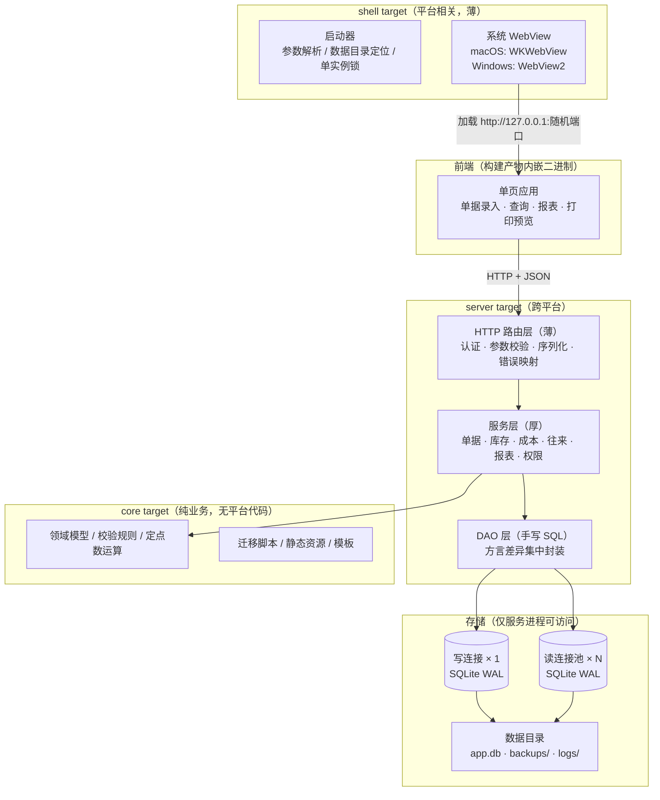

# 进销存软件（单机版 + 网络版）技术方案

| 项目 | 内容 |
| --- | --- |
| 文档名称 | 小兔进销存技术方案 |
| 产品名称 | 小兔进销存 |
| 应用标识 | `com.simem.xiaotu`（固定，不随显示名变化） |
| 发布主体 | 个人开发者 si_mem（已定）；公司主体成立后再评估迁移，见 7.4 |
| 文档版本 | v1.0 |
| 编写日期 | 2026-11-12 |
| 文档状态 | 评审稿（关键技术决策已确认，遗留项见第 10 章） |
| 适用范围 | 小兔进销存单机版、网络版的产品设计、研发实现、测试与交付 |
| 读者对象 | 后端 / 客户端开发、前端开发、测试、运维、产品 |

**阅读说明**

- 本方案中的技术路线（C++20 + SQLite + B/S 内核 + C/S 外观、单机/网络同源一套代码、先 macOS 后 Windows）已与需求方确认，不再作方案比较与论证。
- 产品名称统一为「小兔进销存」，发布主体统一写为「个人开发者 si_mem」；应用标识与显示名的解耦规则见 1.5，主体变更的影响与迁移见 7.4。
- 文中标注「待确认」的事项统一汇总在第 10 章，未确认前不作为既定事实执行。
- 文中出现的性能、包体等数值为目标值，需在实现阶段以实测为准。

---

## 目录

1. [项目概述与技术目标](#1-项目概述与技术目标)
2. [总体架构](#2-总体架构)
3. [技术选型表](#3-技术选型表)
4. [模块拆分](#4-模块拆分)
5. [核心数据模型](#5-核心数据模型)
6. [关键设计专题](#6-关键设计专题)
7. [部署与交付](#7-部署与交付)
8. [风险与未决项](#8-风险与未决项)
9. [开发计划](#9-开发计划)
10. [待确认清单](#10-待确认清单)
- [附录 A：工程目录与 target 依赖规则](#附录-a工程目录与-target-依赖规则)

---

## 1. 项目概述与技术目标

### 1.1 项目背景

面向中小商贸与轻工制造企业，提供一套覆盖「采购 — 销售 — 库存 — 往来账 — 报表」的进销存软件。产品需要同时满足两类交付场景：

- **单机版**：一台电脑装一个程序即可使用，无需安装数据库、无需配置服务器，适合个体户、小门店、单机办公场景。
- **网络版**：一台服务器（或一台常开的办公电脑）部署服务，多台电脑通过浏览器访问，多人协同录单、查库存、看报表。

两类形态在业务功能上完全一致，差异仅在「如何启动」与「用户如何接入」。因此采用**一套代码、两种运行模式**的产品结构，避免双份代码长期分叉。

### 1.2 技术目标

| 类别 | 目标 |
| --- | --- |
| 形态统一 | 单机版与网络版共用同一份服务端与前端代码，仅通过启动参数切换模式 |
| 部署轻量 | 单机版为零依赖安装包；网络版为单个可执行文件 + 一个数据目录，无外部数据库、无运行时依赖 |
| 包体可控 | macOS dmg 实测 2.84 MiB（原目标 10–30 MB 偏高，见 2.6） |
| 数据安全 | 金额零浮点误差；库存以流水为准可追溯；支持一键备份与恢复；业务操作可审计 |
| 可演进 | 数据访问层不绑定 SQLite 方言，业务量增长后可平滑迁移 PostgreSQL |
| 可交付 | macOS 走开发者签名 + 公证的 dmg 分发，不上 App Store；Windows 版后续补齐 |

### 1.3 功能边界

**本期包含**

- 基础资料：商品、分类、单位、仓库、客户/供应商、职员
- 采购：采购订单、采购入库、采购退货
- 销售：销售订单、销售出库、销售退货
- 库存：库存查询、调拨、盘点、其他出入库、库存流水
- 往来账：应收应付、收付款单、核销、账龄
- 报表：进销存汇总/明细、库存余额、成本、毛利、往来对账
- 系统管理：用户、角色、权限、参数、审计日志、备份恢复
- 打印与模板：单据打印模板、PDF 输出、系统打印

**本期不包含（明确排除，避免范围蔓延）**

- 生产制造（BOM、工单、MRP）
- 完整财务总账、凭证、报表合并
- 多组织架构下的合并报表与内部交易
- 移动端原生 App（是否提供移动端 H5 见待确认清单）
- 电商平台、开票系统、第三方 ERP 的深度对接

### 1.4 用户角色

| 角色 | 典型诉求 |
| --- | --- |
| 老板 / 店长 | 看库存、看毛利、看欠款，权限最高 |
| 采购员 | 录采购单、跟供应商欠款 |
| 销售员 | 开单、查可售库存、查客户欠款 |
| 仓管 | 出入库、调拨、盘点 |
| 财务 / 出纳 | 收付款、核销、对账 |
| 系统管理员 | 建用户、配权限、备份、打印模板维护 |

### 1.5 产品命名与发布主体

本方案涉及三组容易相互牵连的命名：**对外显示名**、**应用标识**、**发布主体**。三者必须解耦，否则后期改名或更换主体都会牵连用户数据。

| 项 | 取值 | 使用位置 |
| --- | --- | --- |
| 产品显示名 | 小兔进销存 | 窗口标题、菜单、安装包文件名、关于页、用户文档、宣传材料 |
| 应用标识（固定） | `com.simem.xiaotu` | bundle identifier、数据目录名、配置文件命名、日志标识、备份文件名前缀 |
| 发布主体（已定） | 个人开发者 si_mem | 代码签名、公证账号、安装包发行者、版权声明 |
| 公司主体 | 未确定（后续可能变更） | 变更影响与迁移做法见 7.4；不确定项见 Q20–Q22 |
| 版权声明 | `Copyright © 2026 si_mem. All rights reserved.` | 关于页、安装包信息、源码文件头 |
| 数据目录（macOS） | `~/Library/Application Support/com.simem.xiaotu/` | 数据库、备份、日志、配置 |
| 数据目录（Windows） | `%LOCALAPPDATA%\com.simem.xiaotu\` | 同上 |

**bundle identifier 建议格式**

- 采用反向域名风格：`com.<主体标识>.<产品标识>`，全小写，只允许字母、数字、连字符与点，不含下划线（因此个人标识 `si_mem` 在标识中写作 `simem`）。
- 本项目取 `com.simem.xiaotu`。将来公司主体确定后，**新**产品才使用 `com.<公司域名>.<产品>`；本产品的标识保持不变（原因见下）。
- 标识发布后不再变更：它同时是 macOS 的 App 身份、代码签名与公证的对象、升级覆盖安装的判定依据。

**硬约束：数据目录路径不得与显示名绑定**

- 反例：`~/Library/Application Support/进销存/`。显示名一旦从「进销存」改为「小兔进销存」，新版本会在新路径下创建空库，老用户看到的是「数据全没了」——数据其实还在旧目录里，但用户不会去翻。
- 正例：路径固定为 `.../com.simem.xiaotu/`，显示名只影响界面与安装包外观，改名对数据零影响。
- 同理，`config.toml`、日志文件前缀、备份文件名前缀、单实例锁名都使用应用标识，不使用显示名。
- 代码中的路径解析集中在一处（`shell/common` 的路径模块），只允许出现常量应用标识，禁止拼接显示名。

**若必须更换应用标识**（例如公司强制要求使用公司域名）：不能直接替换。新版本需内置「旧标识列表」，首次启动时若检测到旧目录存在而新目录不存在，提示用户迁移（复制数据库与备份 → 校验 → 迁移 schema → 旧目录保留为只读备份）。具体步骤见 7.4。

---

## 2. 总体架构

### 2.1 架构总览

整体为「B/S 内核 + C/S 外观」：业务全部经 HTTP API 提供，界面是浏览器技术栈实现的单页应用；单机版用一个瘦 GUI 壳（系统 WebView）把它包装成本地桌面应用的外观。



### 2.2 分层职责与依赖规则

| 层 | 职责 | 允许依赖 | 禁止 |
| --- | --- | --- | --- |
| shell | 进程启动、模式判定、数据目录定位、WebView 创建、系统打印调用、单实例控制 | server、core、平台 SDK | 承载业务逻辑 |
| server | HTTP 路由、会话与鉴权、请求校验、事务编排、调用服务、序列化 | core | 直接调用平台 API；在路由里写业务规则 |
| core | 领域模型、业务规则、定点数运算、SQL 与迁移脚本、模板与静态资源 | 标准库、第三方通用库 | 平台 API（WebView、文件路径约定、打印） |
| 前端 | 交互、表单校验、展示、打印预览 | 仅 HTTP API | 直连数据库、依赖本地文件 |

**三条硬约束（由 CI 检查）**

1. `core` 的编译单元不得包含任何平台头文件或平台条件编译分支；平台差异只能出现在 shell 层。
2. `server` 不得引用 shell；依赖方向单向：shell → server → core。
3. 前端构建产物必须以嵌入资源形式进入二进制，发布包中不存在独立的静态资源目录。

### 2.3 两种模式的差异

| 维度 | 单机版（无参数启动） | 网络版（`--server` 启动） |
| --- | --- | --- |
| 监听地址 | `127.0.0.1`，端口由系统分配（`0`） | `0.0.0.0`，端口取配置（默认固定端口） |
| 客户端 | 内嵌系统 WebView 指向本地地址 | 局域网内任意浏览器访问 |
| 认证 | 一次性 token 换会话（本机会话） | 用户名 + 密码登录，会话 Cookie |
| 用户体系 | 默认单一本机管理员，可开启多用户 | 完整 RBAC，多用户并发 |
| 并发规模 | 1 个前端连接（可能多个标签页/窗口） | 10–30 并发用户（目标值，见待确认清单） |
| 数据位置 | macOS `~/Library/Application Support/com.simem.xiaotu/`<br>Windows `%LOCALAPPDATA%\com.simem.xiaotu\` | 服务端数据目录（部署时指定） |
| 打印 | 壳层走原生 PDF 桥后调系统打印 | 浏览器打印 / 另存为 PDF，服务端不生成 PDF |
| 关闭行为 | 关窗即退出（是否托盘常驻见待确认清单） | 常驻服务，由 systemd / 服务管理器托管 |

### 2.4 请求链路

**单机模式**

```text
用户双击 App
  → shell: 解析参数（无 --server）→ 模式 = 单机
  → shell: 解析数据目录 → 打开/初始化数据库 → 检查并执行迁移
  → server: 绑定 127.0.0.1:0，取实际端口 P
  → server: 生成一次性 token T（32 字节随机，60 秒有效，用后即废）
  → shell: 创建 WKWebView，加载 http://127.0.0.1:P/#t=T
  → 前端: 读取 T → POST /api/session/local {token:T} → 换取 HttpOnly 会话 Cookie
  → 前端: history.replaceState 清除地址栏中的 token
  → 前端: GET /api/bootstrap（当前用户、权限点、系统参数）
  → 业务请求: 前端 → HTTP 路由 → 服务层 → DAO → SQLite（写连接串行 / 读连接池）
```

**网络模式**

```text
管理员启动 ./inventory --server --port 8080 --data /var/lib/inventory
  → server: 初始化数据库与迁移 → 绑定 0.0.0.0:8080
  → 浏览器访问 http://server:8080/
  → 前端: POST /api/session/login {username, password}
  → server: 校验口令（Argon2id）→ 下发 HttpOnly + SameSite=Lax 会话 Cookie
  → 前端: GET /api/bootstrap → 按权限点渲染菜单与按钮
  → 业务请求: 浏览器 → HTTP 路由（认证 + CSRF + 权限）→ 服务层 → DAO → SQLite
```

差别只在「如何拿到第一个会话」和「谁在监听」；`/api/*` 之后的业务链路完全一致。

### 2.5 前端产物内嵌

- 前端使用 Vite 构建为静态文件（`index.html` + 压缩后的 js/css/字体），构建后由 CMake 自定义命令打包为一个归档文件，再转为 C++ 字节数组（或链接进只读段），随 `server` 一起编入二进制。
- 服务进程在内存中直接提供静态资源，支持 `ETag` 与 `Cache-Control: no-cache`（HTML）/ 长缓存（带 hash 的文件名），不落盘、不依赖相对路径。
- 好处：单文件分发，杜绝「资源目录丢失导致白屏」；同时避免用户从本地文件系统直接打开 HTML 造成跨域与鉴权失效。

### 2.6 包体实测（0.9.0，macOS release）

以下为 2026-11-13 在本机对 `xiaotu-inventory-0.9.0.dmg` 的实测值：

| 组成 | 实测 |
| --- | --- |
| dmg 安装包 | 2,980,224 B（2.84 MiB） |
| `.app` 表观大小 / 磁盘实占 | 5.12 MiB / 5,256 KiB |
| 主可执行 `xiaotu-inventory` | 4,502,048 B（占 `.app` 的 83.8%） |
| 内嵌前端（未压缩） | 270,103 B |
| `Frameworks` | 0（无自带框架） |
| 应用图标 `icns` | 867,537 B |
| 未 strip 的符号表 | 约 1.03 MiB |

原估算「C++ 5–12 MB、前端 gzip 后 1–3 MB、xlsxwriter/PDF 2–5 MB、合计 10–30 MB」**已不适用**：实际未使用 xlsxwriter（自研 xlsx 写入），前端未 gzip 内嵌，包体远低于原目标。与 10–30 MB 目标相比，当前 dmg 只有其下限的约 28%，目标值应下调为「dmg ≤ 3 MiB」。

系统 WebView 由操作系统提供，不计入包体——这也是选择 WebView 而非自带 Chromium 的主要原因。

---

## 3. 技术选型表

| 组件 | 选型 | 理由 | 备选 |
| --- | --- | --- | --- |
| 语言标准 | C++20 | 已确认；`std::chrono` 日历、`std::span`、概念可减少样板；单二进制、无运行时、包体小 | — |
| 构建系统 | CMake ≥ 3.25 + vcpkg（manifest 模式） | 跨平台、IDE 友好；vcpkg 锁版本，macOS/Windows 依赖一致 | Conan |
| target 划分 | `core` / `server` / `shell` | 用编译单元隔离平台代码，违规在编译期暴露 | 单 target + 目录约定（不可强制） |
| HTTP 服务 | cpp-httplib（首选）或 Drogon | 两者均满足需求。cpp-httplib 为单头文件、依赖极少、包体小，与本项目「薄路由 + 少量接口」匹配；若后续需要 WebSocket、过滤器链、更强的路由与压测能力，切 Drogon | 见待确认清单 Q2 |
| 数据库 | SQLite 官方 amalgamation，编入二进制 | 单文件、零部署、事务完备；amalgamation 避免动态库依赖 | — |
| 数据库访问 | 手写 SQL + 薄封装（连接、语句、结果集、事务） | 可控、可审计、无 ORM 魔法；性能与 SQL 计划可预期 | sqlite_orm（被否：模板报错难读） |
| JSON | nlohmann/json | 头文件库、API 直观、与前端 JSON 天然对齐 | RapidJSON（更快，但代码冗长） |
| Excel 导出 | libxlsxwriter | 生成 xlsx 稳定，支持格式、公式、冻结窗格 | OpenXLSX |
| PDF / 打印 | 单机：WKWebView 原生 PDF 桥；网络：浏览器打印 / 另存为 PDF。不引入 libharu | 模板与界面同栈，改版成本低；省掉第三方 PDF 库的包体、字体与跨平台一致性成本 | 已定（原 Q3） |
| GUI 壳 | macOS WKWebView、Windows WebView2；起步可用 `webview/webview` | 系统自带、零包体；`webview/webview` 提供最小跨平台封装，便于先跑通 | Qt WebEngine（包体过大，否决） |
| 前端框架 | Vue 3 或 React + TypeScript + Vite | 生态成熟、构建产物小；具体框架见待确认清单 Q1 | — |
| 日志 | spdlog | 异步、滚动文件、格式化方便 | 自研（不必要） |
| 口令哈希 | libsodium（Argon2id） | 现代口令哈希，参数可调；libsodium 同时可用于随机数与常量时间比较 | OpenSSL PBKDF2 |
| 单元测试 | Catch2 或 GoogleTest | 与 CMake/CTest 集成方便；重点覆盖定点数、成本、单据状态机 | — |
| 打包（macOS） | hdiutil / create-dmg + codesign + notarytool | 系统工具链即可完成签名、公证、装订 | 第三方打包器 |
| 打包（Windows，后续） | Inno Setup 或 MSIX + WebView2 Bootstrapper | 覆盖旧系统安装习惯；WebView2 运行时缺失时可引导安装 | — |
| 自动更新（macOS） | 自研检查端（OSS/CDN 静态清单 + EdDSA 验签）+ Sparkle 2（用户确认后的替换与重启） | 清单与分发自主可控；自研负责检查、提示与验签，Sparkle 只做用户显式安装后的原子替换 | —（已确定并落地） |
| 自动更新（Windows，后续） | WinSparkle（与 Sparkle 概念对齐） | 复用同一套静态清单与签名规范，接入成本低 | Squirrel.Windows / MSIX（见 6.8.2 对比；最终选择见 Q26，仅 Windows） |

**选型原则说明**：优先「单二进制、零外部依赖、许可宽松」。凡引入需要额外运行时的组件（如 JRE、Chromium），一律否决。

---

## 4. 模块拆分

模块按「业务域」划分，每个模块对应服务层的一组服务类与一组 API 路由；模块之间只通过服务接口调用，不跨模块直接访问对方表（报表模块除外，允许只读跨表查询）。

### 4.1 基础资料

**职责**：维护所有业务单据引用的主数据，是单据录入的前提。

| 子域 | 内容 |
| --- | --- |
| 商品 | 编码、名称、规格、分类、基本单位、条码、默认税率、状态 |
| 分类 | 树形结构，支持两级以上 |
| 单位 | 单位名称与数量精度；商品多单位换算（是否启用见待确认清单 Q4） |
| 仓库 | 编码、名称、是否默认仓 |
| 往来单位 | 客户/供应商（可兼具），联系人、电话、税号、信用额度 |
| 职员 | 业务员、仓管等，用于单据归属与数据权限 |

**关键流程**

1. 新增/修改：编码唯一性校验 → 保存 → 写审计日志。
2. 停用：`status = disabled`，历史单据仍可显示；停用后不允许在新单据中选择。
3. 删除：仅允许「无任何单据引用且无库存」的资料物理删除，否则提示改为停用。所有查询默认过滤 `is_deleted = 0`。**当前实现一律软删，无引用物理删除未做（见缺口 2.9）。**

### 4.2 采购

**职责**：管理采购订单、采购入库、采购退货，形成应付。

| 单据 | 作用 | 对库存 | 对往来 |
| --- | --- | --- | --- |
| 采购订单 | 意向与到货跟踪，不产生库存 | 无 | 无 |
| 采购入库 | 实际到货入库 | 增加库存，形成入库成本 | 增加应付 |
| 采购退货 | 退回供应商 | 减少库存，按原入库成本冲减 | 减少应付 |

**关键流程（采购入库）**

```text
新建单据（草稿）
  → 选择供应商、仓库、日期
  → 逐行选择商品，录入数量与单价（服务层做定点数换算与金额计算）
  → 保存草稿（可反复修改，不产生库存）
  → 审核：
      ① 事务开始
      ② 状态校验 draft → approved（乐观锁 version）
      ③ 生成库存流水（收入），更新库存余额与移动加权平均成本
      ④ 生成应付流水
      ⑤ 写审计日志
      ⑥ 事务提交
  → 反审核：生成反向流水，状态 approved → voided；若已被下游单据（如已被销售出库消耗）引用则拒绝
```

**关联与追溯**：采购订单可下推生成入库单，入库单可下推退货单。当前不落 `source_doc_id`，下推通过原单的已下推数量累计校验「已下推数量 ≤ 订单数量」（是否允许超收见待确认清单 Q7）。下推生成的入库单在生成时原样复制订单表头备注，此后两者互不影响。

### 4.3 销售

**职责**：管理销售订单、销售出库、销售退货，形成应收与毛利。

| 单据 | 作用 | 对库存 | 对往来 |
| --- | --- | --- | --- |
| 销售订单 | 意向与发货跟踪 | 无 | 无 |
| 销售出库 | 实际发货 | 减少库存，按移动加权平均结转成本 | 增加应收 |
| 销售退货 | 客户退回 | 增加库存，按原出库成本回冲 | 减少应收 |

**关键流程（销售出库）**

1. 录入时实时展示「可售库存 = 库存余额 − 已占用（订单未出库部分，若启用占用）」；是否启用库存占用见待确认清单 Q7。
2. 审核时校验库存是否充足（策略由系统参数 `allow_negative_stock` 决定，默认不允许），不足则整单失败并返回缺货明细。
3. 审核成功后写：库存流水（发出）、成本结转、应收流水、审计日志，同一事务内完成。
4. 毛利 = 行金额 − 行成本金额；成本金额取自审核时点的移动加权平均单价，落库保存；后续不重算改写，差异通过成本调整单落账（见 5.5）。
5. 订单转出库时把订单表头备注原样复制到生成的出库单（生成时快照），只传一层；之后改订单备注不影响已生成单据，反审核后重转生成新单、不覆盖旧单备注。

### 4.4 库存

**职责**：维护库存数量与成本的准确性，提供流水追溯。

| 功能 | 说明 |
| --- | --- |
| 库存查询 | 按仓库 + 商品展示数量、金额、平均单价；支持按分类、条码、零库存过滤 |
| 库存流水 | 按商品/仓库/时间段查看每一笔出入库，含来源单据、数量、成本、结存 |
| 调拨 | 同价移库：源仓出、目标仓入，成本按源仓当时单价结转，不改变总金额 |
| 盘点 | 生成盘点单，录入实盘数，审核后按差异生成盘盈/盘亏流水 |
| 其他出入库 | 赠品、领用、报损、期初等，需选择业务类型以便报表归集 |
| 反审核 | 生成反向流水，不删除原流水；已产生下游流水的单据拒绝反审核 |

**设计要点**：库存余额是流水的结果，不是事实来源。任何余额异常都可通过「按流水重算」核对差异；金额差异用成本调整单修复，数量差异用盘点修复（不直接改写流水）。

### 4.5 往来账

**职责**：管理应收应付、收付款与核销。

| 功能 | 说明 |
| --- | --- |
| 应收/应付明细 | 由采购入库、销售出库等业务单据自动产生 |
| 收款单 / 付款单 | 记录实际收付，可指定客户/供应商、账户、金额、方式 |
| 核销 | 将收付款与具体业务单据（或期初欠款）建立核销关系，支持部分核销、一张收款核多张单 |
| 余额与账龄 | 按往来单位汇总余额，按 30/60/90 天分段统计账龄 |
| 对账单 | 按往来单位输出期间对账单（可导出 Excel / 打印 PDF） |

**关键流程（核销）**

```text
选择收付款单 → 拉取该往来单位未核销单据
  → 录入本次核销金额（Σ核销 ≤ 收付款金额；Σ核销 ≤ 单据未核销余额）
  → 事务内：写核销明细 → 更新往来余额 → 写审计日志 → 提交
```

是否允许「预收/预付」（未核销余额留存）默认允许，作为往来余额的一部分参与账龄计算（账龄口径见 10 节 Q11，已定：30/60/90/90+）。

### 4.6 报表

**职责**：以只读方式跨模块查询，输出经营视图。

| 报表 | 口径要点 |
| --- | --- |
| 库存余额表 | 截止时点各仓各商品数量、金额、平均单价 |
| 库存流水账 | 期初 + 期间出入 + 期末，逐笔可下钻到单据 |
| 进销存汇总表 | 按商品汇总期初、入库、出库、期末（数量与金额双口径） |
| 销售明细/汇总 | 按客户、商品、业务员、时间段多维汇总，含毛利 |
| 采购明细/汇总 | 按供应商、商品汇总采购量与金额 |
| 应收应付余额表 | 按往来单位汇总，支持账龄分段 |
| 经营看板 | 今日/本月销售额、毛利、库存总额、欠款 Top N |

**实现约束**

- 报表只使用读连接，显式开启只读事务，保证同一报表内多次查询的数据一致。
- 大报表分页返回（默认 200 行/页），导出 Excel 走流式写入，避免一次性构造巨大 JSON。
- 所有金额在前端按「分 → 元」格式化，禁止在前端做浮点累加。

### 4.7 系统管理

| 功能 | 说明 |
| --- | --- |
| 用户 | 新增、停用、重置密码、强制改密 |
| 角色与权限 | RBAC：角色绑定权限点；用户绑定角色（可多角色，权限取并集）。**当前实现为单角色 `app_user.role_id`，多角色未做（见缺口 2.4）。** |
| 数据权限 | 1.0 不做仓库隔离，所有登录用户可见全部仓库数据，可见范围由角色权限控制（有意取舍，见 Q17）；1.1 仅做用户-仓库白名单，且只作用于列表与报表的默认视图过滤 |
| 系统参数 | 负库存策略、单据号规则、备份保留份数、打印默认模板等 |
| 审计日志 | 关键操作留痕，只读不可删（保留期见待确认清单 Q16） |
| 备份恢复 | 手动备份、自动备份、恢复向导 |
| 关于/诊断 | 版本号、数据库路径、schema 版本、日志目录、导出诊断包 |

### 4.8 打印与模板

**职责**：把单据渲染为可打印的 PDF，并交付给系统打印。

| 环节 | 说明 |
| --- | --- |
| 模板 | 结构化模板：列定义（字段、显示名、宽度 mm、对齐、字号、加粗、可见）+ 标题/副标题/页眉/页脚文本 + 纸型/边距/方向/缩放；按物理纸张尺寸用 mm 定义版式，不使用 HTML 模板引擎 |
| 数据装配 | 服务层提供「打印数据 DTO」，不复用编辑态结构，避免前端字段耦合 |
| 渲染 | 模板 + 数据 → HTML；单机由壳层原生 PDF 桥生成 PDF，网络版交给浏览器打印 / 另存为 PDF |
| 输出 | 单机：原生 PDF 桥 → 系统打印；网络：浏览器打印 / 另存为 PDF，服务端不提供 PDF 下载 |
| 模板管理 | 内置模板只读；用户可复制为自定义模板并设默认（是否开放见待确认清单 Q12） |

**设计约束**：打印链路不直接绑定打印机驱动 API；单机版只输出 PDF，网络版把 HTML 交给浏览器打印 / 另存为 PDF。针式打印机的纸张、边距、连续纸走纸由驱动与打印对话框负责（风险见 8.1）。页码依赖打印引擎：WKWebView 实测不渲染 `@page` margin box、不支持 `counter(page)`，`position: fixed` 页脚只在末页出现并解析为 0；`show_page_no` 仅作提示性字段，不做前端显式分页与 PDF 后处理，网络版可在浏览器打印对话框勾选页眉和页脚。应用内「导出 PDF」走窗口模态打印会话（`runOperationModalForWindow`），让 WebKit 的异步分页完成后落盘；`runOperation` 不泵这些回调，本机实测会产出空白页，因此不用于导出。打印入口的查询串统一用 `URL` + `URLSearchParams` 组装，禁止手写 `?`/`&`。

---

## 5. 核心数据模型

### 5.1 通用约定

| 约定 | 规则 |
| --- | --- |
| 主键 | 64 位整数，由应用内单调生成器分配（时间戳高位 + 序列），**不依赖数据库自增**，保证迁移 PostgreSQL 时 DAO 无需改写 |
| 金额 | `INTEGER`，单位**分**；字段名统一 `*_cents`；禁止浮点、禁止 `REAL` |
| 单价 | `INTEGER`，单位 **1/10000 元**；字段名 `*_price4` |
| 数量 | `INTEGER`，单位 **1/10000**（scale = 4）；字段名 `*_qty4`（精度是否够用见待确认清单 Q4） |
| 行金额计算 | `amount_cents = round_half_up(qty4 * price4 / 1_000_000)`，全部在服务层用整数运算完成；单据合计 = Σ 行金额（不用「总量 × 均价」二次计算） |
| 时间 | `TEXT`，ISO-8601 本地时间 `YYYY-MM-DD HH:MM:SS`；业务日期 `TEXT`，`YYYY-MM-DD` |
| 布尔 | `INTEGER` 0/1 |
| 删除 | 主数据用 `is_deleted` 逻辑删除 + `status` 停用；业务单据不允许物理删除（草稿可删） |
| 审计字段 | 所有业务表带 `created_at`、`created_by`、`updated_at`、`updated_by` |
| 外键 | 全部声明 `FOREIGN KEY`，连接初始化时开启外键约束（该 PRAGMA 收在 DAO 方言层） |
| 命名 | 表名小写下划线；索引 `idx_表_列`；唯一索引 `uk_表_列` |

### 5.2 基础资料

**item（商品）**

| 字段 | 类型 | 说明 |
| --- | --- | --- |
| id | INTEGER PK | 主键 |
| code | TEXT NOT NULL | 商品编码 |
| name | TEXT NOT NULL | 商品名称 |
| spec | TEXT | 规格型号 |
| category_id | INTEGER FK → item_category.id | 分类 |
| base_unit_id | INTEGER FK → unit.id | 基本单位 |
| barcode | TEXT | 条码 |
| tax_rate_bp | INTEGER DEFAULT 0 | 默认税率（万分比，1300 = 13%） |
| status | INTEGER DEFAULT 1 | 1 启用 / 0 停用 |
| is_deleted | INTEGER DEFAULT 0 | 逻辑删除 |
| created_at / updated_at | TEXT | 审计时间 |

索引与约束：`uk_item_code(code)`；`idx_item_category(category_id)`；`idx_item_barcode(barcode)`；`CHECK(tax_rate_bp >= 0 AND tax_rate_bp <= 10000)`。

**item_category（商品分类）**：`id`、`parent_id`（0 为根）、`name`、`sort_no`、`is_deleted`。索引 `idx_item_category_parent(parent_id)`。

**unit（单位）**：`id`、`name`、`precision`（数量小数位，0–4）。约束：`CHECK(precision BETWEEN 0 AND 4)`。

**item_unit（多单位换算，待确认是否启用）**：`item_id`、`unit_id`、`factor_qty4`（1 该单位 = factor_qty4/10000 个基本单位）。主键 `(item_id, unit_id)`。

**warehouse（仓库）**：`id`、`code`、`name`、`is_default`、`status`、`is_deleted`。`uk_warehouse_code(code)`。

**partner（往来单位）**

| 字段 | 类型 | 说明 |
| --- | --- | --- |
| id | INTEGER PK | |
| code | TEXT NOT NULL | 编码 |
| name | TEXT NOT NULL | 名称 |
| partner_type | INTEGER NOT NULL | 1 客户 / 2 供应商 / 3 兼具 |
| contact / phone / address | TEXT | 联系信息 |
| tax_no | TEXT | 税号 |
| credit_limit_cents | INTEGER DEFAULT 0 | 信用额度（0 表示不限） |
| status / is_deleted | INTEGER | |

索引：`uk_partner_code(code)`；`idx_partner_name(name)`。

**employee（职员）**：`id`、`code`、`name`、`phone`、`status`、`is_deleted`。

### 5.3 单据主子表

所有业务单据共用一张主表 + 一张子表，用 `doc_type` 区分类型。选择统一表而非「一单据一张表」的理由：单据共性极强（审核、反审核、打印、审计、下推、查询都走同一套逻辑），统一表可让单据状态机、流水生成、打印装配只实现一次；类型专有字段通过少量扩展表承载。

**doc_header（单据主表）**

| 字段 | 类型 | 说明 |
| --- | --- | --- |
| id | INTEGER PK | |
| doc_no | TEXT NOT NULL | 单据号，业务唯一 |
| doc_type | TEXT NOT NULL | `PUR_ORDER` / `PUR_IN` / `PUR_RET` / `SAL_ORDER` / `SAL_OUT` / `SAL_RET` / `STK_TRF` / `STK_CNT` / `CST_ADJ` / `OTH_IN` / `OTH_OUT`；收付款走 `settlement` / `fund_account`，不占 `doc_header` |
| doc_date | TEXT NOT NULL | 业务日期 `YYYY-MM-DD` |
| partner_id | INTEGER FK → partner.id | 往来单位（内部单据为 0） |
| customer_id / customer | INTEGER / TEXT | 客户快照（销售类单据） |
| warehouse_id | INTEGER FK → warehouse.id | 主仓库（调拨单在子表记录源/目标仓） |
| target_warehouse_id | INTEGER FK → warehouse.id | 调拨目标仓 |
| status | TEXT NOT NULL | `DRAFT` / `APPROVED` / `VOIDED` |
| order_status | TEXT NOT NULL DEFAULT '' | 订单状态（订单类单据） |
| biz_category | TEXT NOT NULL DEFAULT '' | 业务分类 |
| total_qty | INTEGER NOT NULL DEFAULT 0 | 合计数量（4 位小数定点整数） |
| total_amount_cents | INTEGER NOT NULL DEFAULT 0 | 合计金额 |
| request_id | TEXT NOT NULL DEFAULT '' | 客户端幂等键 |
| version | INTEGER NOT NULL DEFAULT 0 | 乐观锁版本 |
| salesperson_id / salesperson_name | INTEGER / TEXT | 业务员 |
| remark | TEXT NOT NULL DEFAULT '' | 表头备注，六类业务单据共用，最多 200 个字符；历史单据为空串 |
| created_at / created_by | | 创建信息 |
| approved_at / approved_by | | 审核信息 |

索引与约束：

- `uk_doc_header_no(doc_no)`
- `uk_doc_header_request(request_id) WHERE request_id <> ''`（防重复提交）
- `idx_doc_header_type_date(doc_type, doc_date DESC, id DESC)`（v37 重建）
- `idx_doc_header_type_status(doc_type, status)`（v37 新增）
- `idx_doc_header_warehouse(warehouse_id, doc_date)`
- `idx_doc_header_salesperson(salesperson_id, doc_date)`

当前不落 `source_doc_id`、`updated_at`、`updated_by`；下推靠原单已下推数量累计，修改痕迹由审计日志承载。表头备注 `remark` 自 v38 起落库：六类业务单据共用，按 UTF-8 码点计最多 200 个字符，超长拒绝而不截断，允许换行，空串合法；导出写在表头键值块（与单号 / 日期 / 往来单位并列），打印模板没有备注位、不输出。订单转出时把源订单备注原样复制到目标单据（快照），只传一层；之后改订单备注不影响已生成单据，重转生成新单、不覆盖旧单备注。

**doc_line（单据子表）**

| 字段 | 类型 | 说明 |
| --- | --- | --- |
| id | INTEGER PK | |
| doc_id | INTEGER NOT NULL FK → doc_header.id | 所属单据 |
| line_no | INTEGER NOT NULL | 行号，从 1 开始 |
| item_id | INTEGER NOT NULL FK → item.id | 商品 |
| qty | INTEGER NOT NULL | 数量（1/10000，`CHECK >= 0`） |
| price_cents | INTEGER NOT NULL | 单价（分，`CHECK >= 0`） |
| amount_cents | INTEGER NOT NULL DEFAULT 0 | 行金额（分，`CHECK >= 0`） |
| converted_qty | INTEGER NOT NULL DEFAULT 0 | 订单行已下推数量（1/10000） |
| source_order_line_id | INTEGER NOT NULL DEFAULT 0 | 上游订单行（下推追溯，替代设计稿里的 `src_line_id`） |
| warehouse_id | INTEGER NOT NULL DEFAULT 0 | 行仓，0 表示用单头仓（替代设计稿里的 `src_warehouse_id`/`dst_warehouse_id`） |
| adjust_cents / adjust_reason | INTEGER / TEXT | 成本调整单专用：调整金额（分）与原因 |
| batch_no / expiry_date | TEXT NOT NULL DEFAULT '' | 批次与有效期，占位列（是否启用见 Q5） |
| remark | —— | **本版未落列**：本轮只做单头 `doc_header.remark`，行备注未实现 |

索引与约束：`uk_doc_line_no(doc_id, line_no)`；`idx_doc_line_item(item_id)`；`idx_doc_line_source_order(source_order_line_id)`；`CHECK(qty >= 0)`、`CHECK(price_cents >= 0)`、`CHECK(amount_cents >= 0)`、`CHECK(warehouse_id >= 0)`。没有 `unit_id` 与 `cost_cents` 列：本版不含多单位，行成本在报表查询时由库存流水计算。

**单据列表查询（`GET /api/documents`）**

- 必带 `doc_type`。其余参数任一出现即进入「筛选 + 分页 + 合计」分支，完全不带时仍返回原数组，兼容旧调用。
- 参数：`keyword`（单号 / 往来单位 / 业务员 / 备注，`LIKE` 模糊且转义 `%`、`_`、`\`）、`date_from` / `date_to`（闭区间）、`status`（`draft` / `approved` / `reversed`）、`amount_min` / `amount_max`（元，闭区间，服务端换算成分）、`page`（默认 1）、`page_size`（默认 20，上限 100）。
- 带参时返回 `{rows, total_count, total_amount_cents, page, page_size}`；`total_count` 与 `total_amount_cents` 与列表使用同一套 `WHERE`、不带 `LIMIT/OFFSET`，翻页不改变合计。
- 排序固定 `ORDER BY id DESC`；`v37` 的两个索引服务该查询。

### 5.4 库存流水与余额

**stock_ledger（库存流水，只增不改）**

| 字段 | 类型 | 说明 |
| --- | --- | --- |
| id | INTEGER PK | 同时作为全局流水序号（单调递增） |
| seq_no | INTEGER NOT NULL | 全局顺序号，成本重放按此排序 |
| doc_id / doc_line_id | INTEGER | 来源单据与行 |
| biz_type | TEXT NOT NULL | `PUR_IN` / `SAL_OUT` / `PUR_RET` / `SAL_RET` / `STK_TRF_IN` / `STK_TRF_OUT` / `STK_CNT_IN` / `STK_CNT_OUT` / `OTH_IN` / `OTH_OUT` / `REVERSE`；期初库存是 `OTH_IN` + `doc_header.biz_category = 'OPENING'`，不单独占一个 `biz_type` |
| biz_time | TEXT NOT NULL | 业务时间（= 单据日期 + 审核时间，用于排序与报表口径） |
| warehouse_id | INTEGER NOT NULL | 仓库 |
| item_id | INTEGER NOT NULL | 商品 |
| direction | INTEGER NOT NULL | 1 收入 / -1 发出（与 qty4 符号一致，冗余便于过滤） |
| qty4 | INTEGER NOT NULL | 有符号数量（收入为正、发出为负） |
| amount_cents | INTEGER NOT NULL | 有符号金额（成本口径） |
| unit_cost4 | INTEGER NOT NULL DEFAULT 0 | 本次结转单价（1/10000 元，仅记录便于对账，不参与余额计算） |
| batch_no | TEXT | 批次 |
| created_at | TEXT NOT NULL | |

索引与约束：

- `idx_stock_ledger_item_wh_time(item_id, warehouse_id, biz_time, seq_no)` —— 余额与重算的主索引
- `idx_stock_ledger_doc(doc_id)`
- `uk_stock_ledger_doc_line_biz(doc_line_id, biz_type)` —— 同一条单据行同一业务类型只能产生一条流水，天然防重复审核
- `CHECK(direction IN (1, -1))`
- 不设 `UPDATE` / `DELETE` 权限：服务层不提供任何修改流水的接口

**stock_balance（库存余额，可重建）**

| 字段 | 类型 | 说明 |
| --- | --- | --- |
| warehouse_id | INTEGER NOT NULL | 复合主键 |
| item_id | INTEGER NOT NULL | 复合主键 |
| qty4 | INTEGER NOT NULL | 结存数量 |
| amount_cents | INTEGER NOT NULL | 结存金额 |
| last_ledger_id | INTEGER NOT NULL | 最后一次参与计算的流水 id（用于增量校验） |
| updated_at | TEXT NOT NULL | |

主键 `PRIMARY KEY (warehouse_id, item_id)`；索引 `idx_stock_balance_item(item_id)`；`CHECK(qty4 >= 0)`（若允许负库存则该约束改为不足时告警，见 Q7）。

平均单价**不落库**，由 `amount_cents / qty4` 实时推导，避免「数量为 0 时单价无意义」的脏数据。

### 5.5 成本

成本按**移动加权平均**设计，**不提供历史重算写回**：

- 入库：`amount_cents = 行金额`（默认含税，可由系统参数切为不含税，见 10 节 Q11；只影响切换后审核的单据）；`stock_balance.amount_cents += 入库金额`。
- 出库：按剩余金额比例结转，`out_amount = round_half_up(balance_amount * out_qty / balance_qty)`。使用比例法而非「均价 × 数量」可保证清零时金额精确归零，不残留 1 分误差。
- 调拨：源仓按上式结转，目标仓按同额入账，总金额不变。
- 反审核：写入反向流水（数量与金额取反），成本按当时余额比例回冲。

**重算只做只读核对，不写回**：以 `(warehouse_id, item_id)` 为单位从 `OPENING` 流水重放，只展示差异，不更新 `stock_ledger` 与 `stock_balance`。金额差异通过成本调整单落账，数量差异走盘点。

> 原因：移动加权下重算历史会改写已出报表，客户无法解释「上月毛利为什么变了」；成本调整单有单据、有审计、有审核人，比静默重算诚实。该决策见 `docs/待决策清单.md` 第 19 条。

### 5.6 往来账

**ar_ap_entry（应收应付台账，只增不改）**

| 字段 | 类型 | 说明 |
| --- | --- | --- |
| id | INTEGER PK | 顺序号 |
| doc_id / doc_no / doc_type | INTEGER / TEXT / TEXT | 来源单据；单据类型决定方向与增减 |
| direction | INTEGER NOT NULL | 1 = 应收，−1 = 应付，`CHECK IN (1, -1)` |
| partner_id / partner_name / partner_key | INTEGER / TEXT / TEXT | 往来单位快照与归并键（无档案时按名称归并） |
| biz_date | TEXT NOT NULL | 业务日期（账期起点） |
| due_date | TEXT NOT NULL DEFAULT '' | 到期日，空串表示未设 |
| amount_cents | INTEGER NOT NULL | 发生额（分，正数） |
| settled_cents | INTEGER NOT NULL DEFAULT 0 | 已核销金额（分） |
| status | TEXT NOT NULL DEFAULT 'OPEN' | `OPEN` / `PARTIAL` / `SETTLED` / `VOIDED` |
| created_at / created_by | TEXT | 生成时间与操作人 |

索引：`uk_ar_ap_doc(doc_id)`（一张单据一条台账）、`idx_ar_ap_partner(partner_key, direction, status)`、`idx_ar_ap_biz_date(biz_date)`。

余额**不落表**：按 `partner_key + direction` 对 `SUM(amount_cents - settled_cents)` 实时汇总（`core/src/report_service.cpp` 的应收应付与账龄查询），所以没有设计稿里的 `partner_balance` 表，也不存在需要重建的冗余余额。

**settlement / settlement_allocation（收付款与核销）**

- `settlement`：`id`、`settle_no`（唯一）、`direction`（1 收款 / −1 付款）、`partner_key`、`partner_name`、`amount_cents`、`settled_on`、`reverses_id`（红冲来源，0 表示正常）、`note`、`created_at`、`created_by`。索引 `uk_settlement_no(settle_no)`。
- `settlement_allocation`：`settlement_id`、`entry_id`、`amount_cents`、`created_at`。同一笔收付款对同一条台账只允许一条分配，索引 `uk_settlement_alloc(settlement_id, entry_id)`、`idx_settlement_alloc_entry(entry_id)`。
- 设计稿里的 `doc_settle` 表名未采用，实际落库为上面两张表；核销金额写回 `ar_ap_entry.settled_cents` 并更新 `status`。

### 5.7 用户、权限与审计

**sys_user**

| 字段 | 类型 | 说明 |
| --- | --- | --- |
| id | INTEGER PK | |
| username | TEXT NOT NULL | 登录名（大小写不敏感，存储时统一小写） |
| display_name | TEXT NOT NULL DEFAULT '' | 显示名 |
| role_id | INTEGER FK → app_role.id | 单角色（多角色已定不做） |
| password_hash | TEXT NOT NULL DEFAULT '' | Argon2id 编码串（含参数与盐），单机模式可为空 |
| status | INTEGER NOT NULL DEFAULT 1 | 1 启用 / 0 停用 |
| is_deleted | INTEGER NOT NULL DEFAULT 0 | 软删标记 |
| must_change_password | INTEGER NOT NULL DEFAULT 0 | 首次登录强制改密 |
| failed_count | INTEGER NOT NULL DEFAULT 0 | 连续失败次数 |
| locked_until | TEXT NOT NULL DEFAULT '' | 锁定截止时间 |
| created_at / created_by / updated_at / updated_by | TEXT | 审计字段 |

约束与索引：`app_user.username` 唯一。

**app_role**：`id`、`code`（唯一）、`name`、`is_builtin`（内置角色不可删）。

**多角色不做**：用户表直接持有 `role_id`，不存在 `app_user_role` 关联表；兼岗通过调整角色分配解决，权限不做并集（见 `docs/待决策清单.md` 第 5 条）。

**sys_permission**：`code` PK（如 `sales.doc.create`、`stock.query`、`report.profit.view`、`system.user.manage`）、`name`、`module`。权限点由代码内置并随迁移脚本同步，不允许运行期随意新增。

**sys_role_permission**：`role_id`、`permission_code`，主键 `(role_id, permission_code)`。

**sys_user_scope（数据权限，1.1 才启用，1.0 不建此表）**：`user_id`、`scope_type`（`WAREHOUSE` / `EMPLOYEE`）、`scope_value`。1.1 只用于「用户-仓库白名单」的默认视图过滤，不作为写操作鉴权依据，也不承诺数据绝对不可见（见 Q17）。

**audit_log**

| 字段 | 类型 | 说明 |
| --- | --- | --- |
| id | INTEGER PK | |
| at | TEXT NOT NULL | 操作时间 |
| actor | TEXT NOT NULL | 操作人（快照用户名，防止改名后无法追溯） |
| action | TEXT NOT NULL | `LOGIN` / `DOC_CREATE` / `DOC_UPDATE` / `DOC_APPROVE` / `DOC_VOID` / `MASTER_UPDATE` / `PERM_CHANGE` / `BACKUP` / `RESTORE` / `EXPORT` |
| entity | TEXT NOT NULL | 对象类型 |
| entity_id | INTEGER NOT NULL DEFAULT 0 | 对象 id |
| entity_no | TEXT NOT NULL DEFAULT '' | 单据号 / 对象编号快照 |
| detail | TEXT NOT NULL DEFAULT '' | 人类可读摘要（脱敏，不含口令） |
| client_ip | TEXT NOT NULL DEFAULT '' | 来源 IP（单机模式为 127.0.0.1） |
| request_id | TEXT NOT NULL DEFAULT '' | 关联请求 |

当前没有 `detail_json` 与独立的 `summary` 列：变更摘要统一写 `detail` 文本；`client_ip` 与 `request_id` 由 v34 补齐，历史行为空串。

索引：`idx_audit_ts(ts)`、`idx_audit_entity(entity_type, entity_id)`、`idx_audit_user(user_id, ts)`。

**约束**：`audit_log` 只允许 INSERT 与按保留期归档删除（由后台任务执行并自身留痕），不提供业务修改接口。

### 5.8 单据号生成

规则：`{前缀}{yyyyMMdd}-{4 位流水}`，例如 `CGRK20261112-0007`。前缀按 `doc_type` 映射（`PUR_IN` → `CGRK`，`SAL_OUT` → `XSCK`…）。是否允许用户自定义规则见 Q6。

实现：按 `(doc_type, 日期)` 分配流水号，**与单据插入在同一写事务内**完成，保证不重号。

```sql
-- 写事务内执行，返回本次流水号
INSERT INTO doc_seq (doc_type, period_key, next_val)
VALUES (:doc_type, :period_key, 1)
ON CONFLICT (doc_type, period_key)
DO UPDATE SET next_val = next_val + 1
RETURNING next_val;
```

```sql
CREATE TABLE doc_seq (
  doc_type    TEXT    NOT NULL,
  period_key  TEXT    NOT NULL,   -- YYYYMMDD
  next_val    INTEGER NOT NULL,
  PRIMARY KEY (doc_type, period_key)
);
```

约定：

- 事务回滚会导致该号被跳过（允许跳号，不允许重号）。
- 不使用 `MAX(doc_no)+1`，避免并发下重号与全表扫描。
- `doc_no` 上有唯一索引，作为最后防线：冲突时服务层重试一次取号。

### 5.9 库存扣减实现

库存扣减只发生在「审核」这一步，且全部在**同一个写事务**中完成，逐行处理：

```text
BEGIN IMMEDIATE                       -- 由 DAO 事务封装发出，路由层不感知
1. SELECT status, version FROM doc_header WHERE id = :doc_id
   → 校验 status = 'DRAFT'，否则返回「单据状态已变化」
2. UPDATE doc_header SET status='APPROVED', version=version+1, approved_at=...
   WHERE id=:doc_id AND version=:version          -- 乐观锁，影响行数必须为 1
3. 对每一行：
   a. INSERT INTO stock_ledger (..., qty4 = -:qty4, amount_cents = -:cost, ...)
      -- uk_stock_ledger_doc_line_biz 保证重复审核必然失败
   b. SELECT qty4, amount_cents FROM stock_balance
      WHERE warehouse_id=:wh AND item_id=:item
   c. 校验 qty4 - :qty4 >= 0（若不允许负库存）
   d. 计算结转成本 out_amount = round_half_up(balance_amount * :qty4 / balance_qty)
   e. INSERT/UPDATE stock_balance（数量、金额、last_ledger_id）
4. 写应收/应付流水 partner_balance
5. INSERT audit_log
COMMIT
```

要点：

- **余额不是先查后写的两次操作**：写连接全局只有一条且串行执行，因此 `SELECT` 与 `UPDATE` 之间不存在其他写者，天然无写-写竞争。
- 出库成本依赖「当时余额」，所以必须按行串行处理，不能并行计算多行——这是本方案坚持「单写连接」的重要原因之一。
- 单据整体审核失败即整体回滚，不出现「库存扣了但单据没审」的半成品状态。

### 5.10 迁移与版本表

**schema_migration**：`version` PK、`applied_at`、`checksum`、`duration_ms`。

- 迁移脚本以 SQL 数组形式编译进二进制（`core` 内），按 `version` 升序执行，每条在独立事务中执行并登记。
- 启动时比对「二进制内置最高版本」与「库内已应用版本」：
  - 库内 < 内置 → 自动迁移（迁移前自动 `VACUUM INTO` 备份）。
  - 库内 > 内置 → 拒绝启动并提示「数据文件由更高版本程序创建，请升级程序」，防止旧程序写坏新结构。
- `checksum` 用于发现「已发布迁移脚本被改动」的违规情况，启动时告警。

---

## 6. 关键设计专题

### 6.1 双形态的启动与认证

**启动流程（统一入口）**

```text
main(argc, argv)
  1. 解析参数：--server / --port / --data / --version / --help
  2. 解析路径（平台层，仅 shell 可用）
     - 单机：macOS ~/Library/Application Support/com.simem.xiaotu/；Windows %LOCALAPPDATA%\com.simem.xiaotu\
     - 网络：--data 指定；未指定则用当前目录下的 data/
  3. 日志初始化（logs/app.log，滚动）
  4. 单实例控制：对数据目录加文件锁；单机模式重复启动则激活已有实例并退出
  5. 打开数据库 → 设置 PRAGMA → 校验/执行迁移
  6. 构建服务与路由 → 启动 HTTP
     - 单机：bind 127.0.0.1:0
     - 网络：bind 0.0.0.0:<port>
  7. 单机：生成 token，创建 WebView，加载本地 URL
     网络：安装信号处理，前台常驻
  8. 退出：优雅关闭（停止接收新请求 → 等待写队列排空 → 关闭连接 → 关闭日志）
```

**连接参数（在 DAO 的方言初始化中设置，业务代码不可见）**

| 参数 | 值 | 目的 |
| --- | --- | --- |
| `journal_mode` | `WAL` | 读写不互斥，支撑「单写多读」 |
| `busy_timeout` | `5000` | 偶发锁等待自动重试 |
| `synchronous` | `NORMAL` | WAL 下兼顾安全与性能 |
| `foreign_keys` | `ON` | 约束生效 |
| `wal_autocheckpoint` | 默认（1000 页） | 控制 WAL 体积 |

**单机版认证**

1. 生成 32 字节随机 token（`/dev/urandom` 或 libsodium），Base64URL 编码，仅存内存，有效期 60 秒。
2. 用 URL fragment 传给前端：`http://127.0.0.1:<port>/#t=<token>`。fragment 不会发送到服务器、不进入服务端访问日志。
3. 前端启动即 `POST /api/session/local`，服务端校验 token → 作废 token → 下发 HttpOnly 会话 Cookie。
4. 服务端同时校验 `Host` 头必须为 `127.0.0.1:<port>`（防 DNS rebinding），并校验 `Origin` 与自身一致；不返回 CORS 头。
5. 单机模式默认以「本机管理员」身份操作，`audit_log.client_ip` 记为 `127.0.0.1`；是否强制单机也登录见 Q15。

**网络版认证**

- 用户名 + 口令（Argon2id，参数随哈希串保存）。
- 会话：服务端生成随机会话 id，HttpOnly + `SameSite=Lax` Cookie；空闲超时与绝对超时（默认 30 分钟 / 12 小时，见 Q9）。
- 所有写请求校验 CSRF token（双提交 Cookie 或自定义头）。
- 登录节流：连续失败 5 次锁定 15 分钟；成功登录清零。
- 首次启动生成随机管理员口令，打印到控制台并写入 `data/FIRST_LOGIN.txt`（提示首次登录后删除并强制改密）。
- 是否强制 HTTPS 由部署拓扑决定（推荐反向代理终止 TLS，见 7.3）。

**监听地址的选择**：单机版只绑 `127.0.0.1`，除了安全考虑，也避免 macOS 在绑定 `0.0.0.0` 时弹出「是否允许接受传入网络连接」的授权弹窗，影响首次启动体验。

### 6.2 并发与事务

**模型：单写连接 + 读连接池**

| 项 | 设计 |
| --- | --- |
| 写连接 | 全局 1 条，所有写事务经统一「写任务队列」串行提交（互斥锁 + FIFO） |
| 读连接 | 池化 4–8 条（`min(4, CPU 核数)` 起步），每条连接只读事务 |
| 为什么单写 | SQLite 本身只允许一个写事务；提前在应用层串行化，可消除 `SQLITE_BUSY` 抖动，并让「先读余额再扣减」天然原子 |
| 事务粒度 | 一个用例一个事务（审核一张单据 = 1 个事务；批量审核 = 分批，每批 N 张一个事务） |
| 事务禁忌 | 事务内禁止 HTTP 调用、文件写入（除日志）、打印渲染；单事务目标 < 200 ms，超过 1 s 视为异常并记日志 |
| 隔离级别 | 写用 `BEGIN IMMEDIATE`（尽早持写锁）；读用只读事务保证报表内一致快照 |
| 乐观锁 | `doc_header.version`，更新时带版本条件，影响行数为 0 则返回冲突 |
| 幂等 | 前端每次提交带 `request_id`（UUID），`uk_doc_header_request` 保证重复提交只落一条 |

**写队列的失败语义**：任一写任务抛异常 → 回滚 → 返回结构化错误（`code` + `message` + `field`），队列继续处理后续任务；不允许因单次失败阻塞队列。

**读连接与 checkpoint**：WAL 模式下长时间只读事务会阻止 checkpoint 推进 WAL。约束：报表查询必须分页且设置超时（默认 10 s），后台任务在空闲时执行 `wal_checkpoint(TRUNCATE)`（仅在无长事务时）。

### 6.3 断网处理（网络版）

明确立场：**网络版不做离线客户端**，浏览器端不持有业务数据副本。原因是离线写会产生冲突合并，成本远高于收益，且与「库存以流水为准」的一致性要求冲突。

| 场景 | 处理 |
| --- | --- |
| 请求超时 / 网络断开 | 前端统一拦截：提示「网络已断开，请检查网络」，禁用提交按钮，恢复后允许重试 |
| 重复提交 | 提交带 `request_id`，服务端幂等；前端重试复用同一 `request_id` |
| 会话过期 | API 返回 401，前端保留当前表单内容并跳转登录，登录后回到原页面（草稿存 `sessionStorage`） |
| 长表单防丢失 | 录入中的单据每 30 秒存一次本地草稿（`localStorage`），仅存界面状态，不作为业务数据 |
| 服务重启 | 前端轮询 `/api/health`，恢复后提示「服务已恢复」 |
| 单机版 | 无网络依赖，不存在断网问题（模型、渲染、数据库全在本地） |

### 6.4 打印方案

统一链路：**模板 → 数据装配 → HTML →（单机）原生 PDF 桥 → 系统打印 /（网络）浏览器打印或另存为 PDF**。

| 模式 | PDF 生成位置 | 打印动作 |
| --- | --- | --- |
| 单机版 | 壳层 WKWebView 原生 PDF 桥（`NSPrintOperation` 的 PDF 保存链路） | 壳层调用系统打印，或先打开 PDF 预览再打印 |
| 网络版 | **不生成 PDF**，由客户端浏览器「打印 / 另存为 PDF」 | 客户端自行打印；服务端不直接触碰打印机，也不提供 PDF 下载 |

页码不做服务端或前端二次处理：它取决于打印引擎，单机版与网络版均不保证出现；网络版可让用户在浏览器打印对话框勾选「页眉和页脚」。

**实现补充（2026-11-13）**：应用内「导出 PDF」使用 `runOperationModalForWindow` 的窗口模态会话，由窗口 run loop 驱动 WebKit 的异步分页，完成后再落盘；`runOperation` 不泵这些回调，本机实测会产出一叠空白页（`shell/mac/webview.mm` 256–310 行）。Cmd+P 的系统打印面板仍走 `runOperation`，这是交互式打印，不落 PDF。打印入口的查询串统一由 `withQuery` 用 `URL` + `URLSearchParams` 组装，目标 key 自带 `?` 时不会再拼成 `target_key=...?from=...`。单机版在 `XiaotuApplyPaper` 中对 `NSPrintInfo` 显式设置 `NSPrintHeaderAndFooter=NO`，关闭 AppKit 在页边距内打印的「日期 + document.title」页眉（标题为「小兔进销存」），系统打印与导出 PDF 共用，所有打印目标一起生效；模板自己的 `company_name`/`header_text` 是业务抬头，不受影响。关闭的是页边距内的页眉，正文起点与模板 `@page margin` 不变。网络版浏览器打印无法代码控制，需在打印对话框取消「页眉和页脚」。

**模板设计**

- 版式以 mm 为单位定义纸张（如针式 241 mm × 140 mm、A4、A5），CSS 使用 `@page { size: 241mm 140mm; margin: 12mm }`。
- 模板是结构化配置，不是 HTML：列定义（字段键、显示名、宽度、对齐、字号、加粗、是否可见）+ 标题/副标题/页眉/页脚文本 + 纸型/边距/方向/缩放。
- 前端按列配置固定渲染表格，所有数据按纯文本转义；服务端只返回打印数据 DTO，不做模板求值。
- 当前不支持占位符、行循环或 HTML 模板；自定义 HTML 模板保留为未来选项，不引入模板引擎与脚本执行。

**打印相关约束**

- 不直接调用打印机驱动 API（如 CUPS 的 PPD 参数、Windows DEVMODE），一切交给系统打印对话框，降低平台耦合。
- 针式打印机的连续纸、三联单、走纸校准依赖驱动，程序只保证「PDF 页面尺寸正确」。这是明确的风险项（见 8.1）。

### 6.5 备份与恢复

**备份**

- 手段：`VACUUM INTO 'backups/app-YYYYMMDD-HHMMSS.db'`。它是 SQLite 官方推荐的在线备份方式，生成的是已整理、无 WAL 依赖的完整单文件。
- 触发时机：
  1. 程序启动成功后（每日首次）；
  2. 每日定时（服务常驻时的后台任务）；
  3. 执行数据库迁移前（强制）；
  4. 用户手动点击「立即备份」。
- 保留策略：默认保留最近 30 份 + 每月 1 份（可配置）；备份失败写审计并醒目告警。
- 备份完成后校验：打开备份文件执行 `PRAGMA integrity_check` 与 `PRAGMA user_version`（schema 版本）比对，两者通过才算成功。

**恢复**

```text
1. 停止服务（单机：退出程序；网络：停服务）
2. 选择备份文件 → 校验 integrity_check、是否本程序库与 schema 版本
3. 将当前 app.db 复制为 pre-restore-<时间>.db（不删除，留后路）
4. 复制备份文件为 app.db，删除同名 -wal / -shm 残留
5. 再次 integrity_check；复制或校验失败时用 pre-restore 安全备份回滚，不留半截库
6. 启动服务 → 若备份版本低于程序版本则自动迁移
7. 恢复成功写 audit_log（action=restore）
```

网页向导复用同一条 `restore_database`：提交后进入维护态（其他写请求返回 503）并优雅退出，下次启动在打开数据库之前执行第 2–7 步，结果写到数据目录下的 `.restore-result.json` 供重启后展示。命令行 `--restore` 仍保留，用于无法启动界面时。

**其它**

- 备份文件默认与数据库同目录；**不做备份加密**（见 `docs/待决策清单.md` 第 20 条）：本地单机备份挡不住同机持有密钥的人，收益不成立，靠目录权限与「不提供外部连库入口」保护。
- 数据目录禁止放在共享盘（SMB/NFS）：SQLite 的文件锁在部分网络文件系统上不可靠，会导致数据损坏。这一点需在安装引导与文档中显著提示。
- 只允许服务进程访问数据库文件：不提供任何「用外部工具连库」的入口，客户端永远不接触 `.db`。

### 6.6 升级与数据迁移

| 场景 | 方案 |
| --- | --- |
| 单机版升级 | 用户下载新 dmg → 覆盖安装 → 数据目录保留 → 首次启动自动迁移（迁移前自动备份） |
| 网络版升级 | 停服务 → 替换二进制 → 启动（自动备份 + 迁移）→ 冒烟检查 `/api/health` |
| 降级 | 默认不支持。库版本高于程序版本时拒绝启动，避免结构不兼容写入；仅同 schema 的 PATCH 版本可回退，规则见 6.8.3 |
| 迁移失败 | 迁移在事务中执行，失败回滚；进程退出并保留备份，提示用户用备份恢复后联系支持 |
| 迁移脚本管理 | 版本号连续、只增不改；CI 校验已发布脚本 checksum 不变 |
| 兼容性窗口 | 允许「新程序 + 旧数据」，禁止「旧程序 + 新数据」 |

**旧系统数据导入**：Excel 导入（商品、往来单位、期初库存、期初应收应付）作为一次性工具，导入前做全量校验与预览，导入后生成一条审计记录。是否需要专门的迁移工具见 Q14。

本节只解决「数据怎么迁」，不解决「新版本怎么送达用户、怎么装、怎么退」。版本检查、更新包获取与校验、安装与回滚、客户端/服务端兼容策略统一见 6.8。

### 6.7 权限与审计

**权限模型**

- RBAC：用户 → 角色 → 权限点（多角色取并集）。**当前实现为单角色，多角色未做（见缺口 2.4）。**
- 权限点粒度：菜单级（`report.view`）+ 操作级（`sales.doc.create` / `sales.doc.approve` / `sales.doc.void`）+ 数据级（`scope_type`）。
- 校验位置：**路由层统一入口**。每个 `/api/*` 路由用 `guard("权限码", handler)` 包裹，`guard()` 负责认证、CSRF 与权限点校验；服务层假定调用方已授权，不再二次断言。新增路由必须显式写权限码，靠代码审查与路由清单兜底。
- 前端只做展示层控制（按钮置灰/隐藏），不作为安全边界。
- 关键权限单独控制：反审核、修改系统参数、用户与权限管理、备份恢复、导出。

**审计**

- 写审计与业务写在同一事务（保证「业务成功必有日志」），日志体量大时可异步落盘，但默认同步。
- 必审动作：登录/登出、登录失败、单据增删改审反、主数据变更、权限变更、备份恢复、数据导出、参数修改。
- 变更摘要记录字段级前后值，口令、token 等敏感字段一律不记录。
- 审计日志只读，保留期与归档策略见 Q16。

### 6.8 软件更新与版本演进

本节覆盖「软件怎么更新」的完整链路：版本规则、检查与通道、下载与校验、安装与回滚、兼容性边界、双形态差异与发布流水线。数据迁移的库内规则见 6.6 / 5.10，签名与公证的工具链见 7.1，本节不重复。

**现行口径（Q25，2026-11-13 起）：允许自动检查与后台预下载，安装必须由用户显式确认，绝不静默安装。**

- 检查：自动（启动后 30 秒 + 每 24 小时 ±2 小时）或关于页手动触发；发现新版本时提示版本、构建号、发布日期、包体大小与更新说明。
- 下载：允许后台预下载，但必须同时满足：① 下载状态在关于页可见（等待 / 下载中 / 已校验 / 失败）；② 用户可随时取消，取消后删除未完成文件，且本次版本不再自动重试（手动下载仍可）；③ 失败不无限重试，最多 3 次尝试（首次 + 2 次退避），仍失败则等下一次检查；④ 首次预下载前给一次性提示，说明「会在后台下载安装包，可能产生网络流量并占用磁盘，可在设置中关闭」；⑤ 设置页开关文案写明「发现新版本时自动下载安装包」，不能只写「自动更新」让人误解为会自动安装。
- 安装：只有用户点「安装更新」并确认才执行；执行前明确告知「安装会关闭本程序，请先保存」。macOS 单机版确认后由 Sparkle 下载、原子替换并重启；网络版只打开安装包，由用户自行退出安装；任何情况都不静默替换。
- 两个独立开关：`自动检查更新` 默认开；`后台预下载` 默认开（用户仍可在设置中关闭）。配置键为 `[update] auto_check` / `[update] prefetch`，已加入 `server/src/config.cpp` 白名单；单机版存 `NSUserDefaults`，在关于页修改后立即生效，网络版改后需重启服务。
- 待装包只保留一个最新版本：下载新版本前删除旧待装包；稳定后 `updates/` 只占一份包体，不随版本累积（删除旧包时不显示释放的字节数）。

#### 6.8.1 版本号规则、更新通道与检查时机

**四条版本线必须分开**

| 版本线 | 形式 | 用途 | 变更规则 |
| --- | --- | --- | --- |
| 产品版本 | 语义化版本 `MAJOR.MINOR.PATCH`（如 `0.4.2`） | 展示、更新比较、支持判断 | `MAJOR`：不兼容变更（API 破坏、需强制升级）；`MINOR`：向后兼容的新功能；`PATCH`：缺陷修复 |
| 构建号 | 递增整数（`CFBundleVersion` / Windows `FileVersion`） | 判断「同一版本号的多次构建」、灰度与回滚定位 | 每次出包 +1，只增不减 |
| 数据库 schema 版本 | 整数（当前 v39） | 迁移与兼容性闸门 | 只增不减，与产品版本无固定换算关系 |
| API 版本 | 整数（`X-API-Version: 1`） | 网络版客户端与服务端的能力边界 | 破坏性变更才 +1，并保留上一个版本一个周期 |

**发布通道**

| 通道 | 面向 | 获取方式 | 说明 |
| --- | --- | --- | --- |
| `stable` | 全部用户 | 默认 | 只推送经过完整验证的版本 |
| `beta` | 自愿参与的用户 / 内部 | 设置中显式开启 | 用于提前验证客户环境，尤其是打印与老系统兼容 |

- 通道在客户端设置中保存，检查更新时作为参数上报；不允许通过 URL 随意切换（避免误入 beta）。
- 是否提供 beta 通道、灰度比例与决策人见 Q24。
- 每个通道对应独立的 appcast / 版本清单文件，互不影响；beta 用户始终能看到 stable 版本（可随时回退到 stable 的最新版）。

**检查时机**（避免启动卡顿与无谓请求）

| 时机 | 行为 |
| --- | --- |
| 单机版启动后 30 秒 | 后台检查一次（拉清单、验签、记录待更新版本）；「后台预下载」开启时预下载并校验，否则只提示；不安装；失败不打扰用户；同一自然日最多一次 |
| 用户点击「检查更新」 | 立即检查，展示结果（已是最新 / 有新版本 / 检查失败） |
| 网络版服务端启动后 | 仅检查并记录日志/管理页提示，**不自动升级**（升级必须由管理员在维护窗口执行） |
| 定时（常驻场景） | 每日一次，带随机抖动，避免集中请求 |

**检查方式：静态清单（当前用 OSS + CDN）**

清单是静态文件，不需要应用服务、账号体系或数据库。现行实现把清单与 dmg 都放在阿里云 OSS（`xiaotu-update` / cn-hongkong），由 CDN `dl.xiaotu.online` 分发；本节其余内容里的 Nginx 只是可选的自托管替代方案。客户端按通道读取：

```text
GET https://dl.xiaotu.online/xiaotu/updates/stable/latest.json
GET https://dl.xiaotu.online/xiaotu/updates/beta/latest.json
```

```json
{
  "channel": "stable",
  "latest": {
    "version": "0.5.0",
    "build": 501,
    "min_os": "13.0",
    "url": "https://cdn.example.com/xiaotu/0.5.0/xiaotu-inventory-0.5.0.dmg",
    "size": 24318720,
    "sha256": "…",
    "ed_signature": "…",
    "release_notes_url": "https://updates.example.com/xiaotu/macos/0.5.0/notes.html"
  },
  "mandatory": false,
  "min_supported_version": "0.3.0",
  "schema_version": 2,
  "published_at": "2026-11-20T10:00:00+08:00"
}
```

- 清单固定字段：顶层 `channel`、`published_at`；`latest` 内 `version`、`build`、`size`、`sha256`、`ed_signature`、`release_notes_url`（另有 `min_os`、`mandatory`、`min_supported_version`、`schema_version`）。
- 托管分工：**清单放 Nginx**（`latest.json` 与 6.8.2 的 `appcast.xml`，按「通道 + 版本」目录归档，`Cache-Control: no-cache`）；**dmg 放对象存储/CDN**，清单里的 `url` 指向 CDN 直链。清单与安装包可独立扩容、独立切换，互不影响。
- 不采集用户数据、不需要账号；若需要统计更新成功率，另设匿名计数端点（是否启用见 Q23），不影响清单本身。
- 更新源地址必须可配置（自建/内网客户可能无法访问公网），配置项与离线包策略见 Q27。
- 客户端应容忍清单不可用：超时 5 秒、失败静默、下次再试；不得因检查更新失败阻塞启动或业务。

#### 6.8.2 更新包获取与安全校验（自研检查、Sparkle 安装）

**职责边界（现行口径）：自研负责检查、预下载/用户确认后的下载与验签；安装只在用户显式点击后交给安装器或 Sparkle**

| 环节 | 责任方 | 做法 |
| --- | --- | --- |
| 清单托管 | 自研（Nginx） | 静态 `latest.json`（版本、大小、`sha256`、EdDSA 签名、说明、通道）与 `appcast.xml`，按通道/版本归档 |
| 安装包分发 | 自研（对象存储/CDN） | dmg 放 CDN，清单与 appcast 中的链接指向直链，不经过应用服务 |
| 检查、验签、版本比较 | 自研 | HTTPS 证书校验（禁止降级）→ 读 `latest.json` → 用内置 EdDSA 公钥校验清单 → 比较 `build` 与通道；后台检查默认只拉清单，「后台预下载」开启时才继续下载 |
| 提示与触发 | 自研 | 展示版本、构建号、发布日期、包体大小与下载状态；安装必须由用户点击并二次确认 |
| 下载、校验 | 自研 | 「后台预下载」开启时自动下载，或用户点「下载并校验」；系统 `curl` 下载后校验 size、sha256 与签名；失败删除文件；用户可取消；同一时间只保留一个待装包 |
| 替换、重启 | 安装器 / Sparkle | 只在用户点「安装更新」并确认「会关闭本程序」后打开安装包；链接 Sparkle 时由其校验 `edSignature`、原子替换并重启 |
| 发布核验 | 自研（发布侧） | `sha256` 用于发布流水线、人工下载与事后追溯，不作为运行时的安装闸门 |

- **绝不静默安装**：`SUAutomaticallyUpdate=false`、`SUAllowsAutomaticUpdates=false`。这两个键只被 Sparkle 读取，本仓库代码不读取；未链接 Sparkle 时是占位、不生效。后台预下载由自研下载链路负责，与这两个键无关，不能因为改了它们就宣称“支持/关闭了静默更新”。
- **预下载不跳过验签**：后台预下载与手动下载走同一 `download_update_package` → `verify_package` 链路，安装前 `launch_update_package` 还会复验；任一步失败即删除文件并保持“未就绪”。
- **单包与清理**：同一时间只保留一个最新待装包；下载新版本前删除旧待装包，稳定后 `updates/` 只占一份包体；用户取消或下载失败立即删除临时文件；已安装到当前版本后，旧包在下次启动时清理。当前唯一缺口是删除旧包时不显示释放的字节数。
- 端到端校验链：

```text
自研检查：自动（「自动检查更新」开启）或关于页手动
  → 校验 latest.json 的 EdDSA（Ed25519）签名，确认清单未被篡改
  → 版本比较（latest.build <= current.build 不提示，防止降级）
  → 若「后台预下载」开启：下载 → 校验 size / sha256 / 签名 → 标记「已就绪」
  → 否则只提示「有新版本」，等待用户点「下载并校验」

自研下载（后台预下载或用户点击）
  → 下载 dmg（CDN）→ 校验 size 与 sha256 → 验签
  → 失败删除文件并提示；用户可取消；成功后按钮变为「安装更新」

用户点击「安装更新」并二次确认（明确告知会关闭程序）
  → 打开安装包；链接 Sparkle 时由 Sparkle 校验 appcast edSignature 与系统签名
  → 替换并重启；任一步失败即保留当前版本
```

- 自研代码不实现解压、替换与权限申请：这些由 Sparkle 或系统安装器承担，避免重复实现签名校验与失败恢复。

- 清单（`latest.json` / `appcast.xml`）本身必须签名：否则攻击者可以改下载地址。EdDSA 公钥内置在 App 内（`SUPublicEDKey`），私钥只存在于发布机或 CI 密钥库，不进入仓库。
- 拒绝降级：`latest.build <= current.build` 时不提示更新，防止被诱导安装旧版本（回滚走 6.8.3 的显式流程）。
- 限制：单文件上限（如 200 MB）、磁盘剩余空间检查（≥ 3 倍包体）、代理跟随系统设置；断点续传由 Sparkle 处理。
- 私钥与证书管理：EdDSA 私钥与 Apple 证书只存在于发布机或 CI 密钥库；发布清单与校验值归档，便于事后追溯。

**macOS：Sparkle 2 接入**

| 项 | 做法 |
| --- | --- |
| 依赖形态 | `Sparkle.framework` 放入 `Contents/Frameworks`，随 App 一起用同一 Developer ID 签名；XPC Services 需一并签名 |
| Info.plist | `SUFeedURL` = 通道对应的 HTTPS appcast 地址；`SUPublicEDKey` = EdDSA 公钥；`SUEnableAutomaticChecks=false`（检查由自研调度）；`SUAutomaticallyUpdate=false`、`SUAllowsAutomaticUpdates=false`（不做静默安装；后台预下载由自研下载链路负责，不依赖这两个键）。这些键只被 Sparkle 读取，未链接 Sparkle 时为占位、不生效 |
| appcast | 每个版本一个 `<item>`：`sparkle:shortVersionString`、`sparkle:version`（构建号）、`minimumSystemVersion`、`sparkle:edSignature`、`length`、`enclosure url`、`releaseNotesLink`；beta 用 `sparkle:channel` 标记 |
| 更新行为 | 仅在用户点「安装更新」并二次确认后，Sparkle 才下载、验签、解压、原子替换与重启；后台检查不触发下载或安装。安装在 `/Applications` 且当前用户无写权限时会走授权流程 |
| 迁移衔接 | 替换后首次启动先执行 schema 迁移（6.6），迁移前自动 `VACUUM INTO` 备份 |
| 沙盒 | 本项目不启用 App Sandbox（dmg 分发），Sparkle 接入无需额外沙盒例外，减少一类失败场景 |
| UI | 自研提示窗展示版本、说明与包体大小；下载/安装进度与重启提示用 Sparkle 标准窗口（中文化）；「检查更新」「跳过此版本」入口放在「关于」页 |

`appcast.xml` 片段（示意）：

```xml
<item>
  <title>0.5.0</title>
  <sparkle:shortVersionString>0.5.0</sparkle:shortVersionString>
  <sparkle:version>501</sparkle:version>
  <sparkle:minimumSystemVersion>13.0</sparkle:minimumSystemVersion>
  <sparkle:releaseNotesLink>https://updates.example.com/…/notes.html</sparkle:releaseNotesLink>
  <enclosure url="https://cdn.example.com/xiaotu/0.5.0/xiaotu-inventory-0.5.0.dmg"
             length="24318720"
             type="application/octet-stream"
             sparkle:edSignature="…" />
</item>
```

包体影响：Sparkle.framework 约增加 2–4 MB；当前 dmg 实测 2.84 MiB，接入后仍在个位数 MB，远低于原 10–30 MB 目标上限。

**Windows（后续）：WinSparkle / Squirrel.Windows / MSIX 的差异**

| 维度 | WinSparkle | Squirrel.Windows | MSIX / App Installer |
| --- | --- | --- | --- |
| 更新模型 | appcast + 安装包，概念与 Sparkle 对齐 | 差分包 + 本地包仓库，自动生成增量 | 依赖 MSIX 包与 App Installer，通常配合商店或企业分发 |
| 安装位置 | 与安装器一致（Program Files 或用户目录） | 固定 `%LOCALAPPDATA%`，按用户安装 | 系统管理的包容器 |
| 签名 | Authenticode + appcast 签名（算法支持随版本，需确认） | Authenticode | Authenticode / 商店签名 |
| 回滚 | 保留旧安装包，重装即可 | 内置版本目录，可回退 | 依赖包版本管理，私有分发较绕 |
| 适配成本 | 低（与 macOS 共用发布清单思路） | 中（需改安装布局、生成 NuGet 包） | 高（打包与分发模型都要变） |
| 维护活跃度 | 活跃 | 较低 | 随 Windows 平台演进 |

建议：Windows 首版采用 **WinSparkle + Inno Setup 安装包**，复用同一套「静态清单 + appcast + EdDSA 签名」的发布规范（dmg 换成安装器，Sparkle 换成 WinSparkle）；Squirrel 仅在明确需要差分更新且能接受安装布局变化时再评估。Windows 侧的最终选择见 Q26（Q26 只管 Windows，macOS 方案已在 6.8.1–6.8.3 确定）。

**网络版服务端更新包**

- 产物为 `xiaotu-inventory-<version>-<os>-<arch>.tar.gz`，附 `sha256` 与签名文件；由客户 IT 或运维脚本下载、校验后替换。
- 服务端不内置自动更新（避免业务进程自我替换带来的停机风险）；是否提供 `--self-update` 见 Q27。
- 内网/离线客户：更新包与校验值可通过 U 盘或内部制品库分发，更新源地址可配置。

#### 6.8.3 安装与回滚

**单机版（现行：检查 + 提示 + 用户确认后打开安装包；Sparkle 替换属于未来口径）**

```text
自研检查到新版本（读 Nginx 清单并验签）
  → 关于页提示版本、构建号、发布日期、包体大小与说明
  → 用户点「下载并校验」：下载 dmg → 校验 size / sha256 / 签名；失败删除并提示
  → 用户点「安装更新」：二次确认「将安装 X（构建 Y），请先退出本程序」
  → 升级前备份：VACUUM INTO backups/pre-update-<version>-<时间>.db（尚未实现）
  → 确认后才打开安装包；链接 Sparkle 时由 Sparkle 校验 edSignature 与系统签名
  → 新版本首次启动：迁移 schema → 打开窗口 → 写 success 标记
  → 若启动阶段崩溃或迁移失败：连续 3 次未写 success → 提示「回退到上一版本」
      回退 = 从更新源取回旧版 dmg 覆盖安装 + 用 pre-update 备份恢复数据库
```

- **macOS 单机版**：用户确认后由 Sparkle 完成下载、原子替换与重启，安装时会退出程序（0.9.0 实测）；网络版仍只到「打开安装包」，不自动退出、不替换、不重启。`pre-update` 备份与成功标记尚未接入。
- 「后台预下载」开启时，下载与校验可在后台提前完成，但安装确认与升级前备份不可省略；预下载、取消、单包清理已实现。链接 Sparkle 时安装仍会重新下载，预下载包不复用。
- 升级前备份应在交给安装器之前完成；备份失败则**中止升级**，不允许在没有备份的情况下迁移数据。该项当前未实现。
- 回滚会丢失升级后产生的数据（因为数据库回到备份时点），必须在提示中明确写出，由用户确认。

**网络版（管理员执行）**

```text
维护窗口开始 → 通知在线用户 → 停服务
  → 备份数据库（VACUUM INTO）
  → 校验新二进制 sha256/签名
  → 原子替换：xiaotu-inventory → xiaotu-inventory.prev，新文件 rename 到位
  → 启动 → /api/health 检查（版本、schema、数据库可写）
  → 失败：立即换回 .prev 并启动，保留日志与备份
  → 成功：通知用户刷新页面
```

- 服务端升级不能依赖「客户端空闲」，必须给定维护窗口；窗口长度与执行者见 Q27。
- 多实例部署时先升级一个实例做健康检查，再滚动替换（本期单实例部署，预留该流程）。

**降级**

| 场景 | 是否支持 | 代价 |
| --- | --- | --- |
| 同 schema 的小版本（仅 PATCH） | 允许 | 低：从更新源手动安装旧版 dmg，数据不受影响 |
| schema 已升级 | 默认不支持 | 高：必须恢复升级前备份，升级后产生的数据丢失 |
| 强制升级后回退 | 不支持 | 极高：不建议；应通过发布 PATCH 修复 |

- 保留策略：本地保留最近 1 份升级前备份；更新源保留所有历史版本 URL（只增不删），回退时从更新源取回旧版 dmg 覆盖安装，便于远程指导。
- 降级能力与保留数量见 Q28。

#### 6.8.4 兼容性：schema、API 与能力协商

**数据库兼容矩阵**

| 组合 | 处理 |
| --- | --- |
| 新程序 + 旧数据 | 允许：启动时自动迁移，迁移前强制备份；迁移在事务中执行，失败回滚并拒绝启动 |
| 新程序 + 同版本数据 | 允许 |
| 旧程序 + 新数据（schema 更高） | **拒绝启动**并提示升级程序，避免旧代码写入新结构 |
| 旧程序 + 同版本数据 | 允许 |

迁移脚本只增不改，启动时校验已应用脚本的 checksum（5.10）。迁移耗时较长时，壳层应显示进度而非无响应；不得在迁移未完成时对外提供服务。

**API 兼容（网络版）**

- 请求头携带 `X-API-Version: 1`，响应头回显服务端支持的版本；破坏性变更才升版本。
- 服务端保留 **上一个 API 版本（N-1）** 的端点与字段至少一个发布周期；字段弃用先返回默认值，并在响应头标注 `Deprecation`。
- 客户端不按版本号硬编码功能，而是读取能力清单：

```json
GET /api/health
{
  "status": "ok",
  "app": "小兔进销存",
  "version": "0.5.0",
  "api_version": 1,
  "schema_version": 2,
  "capabilities": ["document.reverse", "stock.ledger", "print.template"]
}
```

- **老客户端 + 新服务端**：服务端按能力清单继续提供旧字段；客户端请求里不认识的字段一律忽略；无法兼容时返回 `426 Upgrade Required` 并给出 `min_client_version`，前端展示「请刷新/升级」。
- **新客户端 + 老服务端**：客户端按 `capabilities` 隐藏未支持的功能，不发送老服务端不认识的必填字段；缺失能力时降级为只读或提示管理员升级服务端。
- 前端资源随服务端发布：HTML 使用 `no-cache`，静态资源带内容哈希或版本查询串；服务端升级后提示用户刷新，避免新旧页面混用。

**谁能独立升级**

| 形态 | 客户端 | 服务端 | 结论 |
| --- | --- | --- | --- |
| 单机版 | 同一个进程 | 同一个进程 | 必须整体升级，不允许只换其一 |
| 网络版（浏览器） | 浏览器页面，随刷新更新 | 可独立升级 | 服务端先行升级并保持 N-1 兼容；页面刷新即拿到新前端 |
| 网络版（未来桌面壳） | 独立壳程序 | 可独立升级 | 壳层通过 `capabilities` 协商，壳层可滞后于服务端 |

#### 6.8.5 单机版与网络版在更新上的差异

| 维度 | 单机版 | 网络版 |
| --- | --- | --- |
| 更新对象 | 一个 .app（内含服务与前端） | 服务端二进制 + 前端资源（随二进制发布） |
| 触发者 | 终端用户（自动/手动检查；可后台预下载；安装必须手动确认） | 管理员，在维护窗口执行 |
| 停机影响 | 仅本人，可随时重启 | 所有在线用户，必须提前通知 |
| 强制升级 | **当前不做强制升级，只提示**；`mandatory` 字段保留但发布不设，未来改口径才启用 | 不建议强制；只能提示管理员安排窗口 |
| 回滚 | 更新源保留旧版 dmg + 升级前备份，可引导回退 | 保留 `.prev` 二进制 + 备份，健康检查失败自动回退 |
| 多客户端一致性 | 不存在 | 升级期间新旧页面可能并存，依赖 API N-1 兼容与能力协商 |
| 灰度 | 当前只开 stable，不做 beta 与灰度；未来按通道/版本比例 | 单实例部署无灰度意义，多实例时滚动升级 |

结论：单机版可以自动检查、后台预下载，但**安装必须由用户显式点击并确认会关闭程序**；网络版必须更「保守、可回退、兼容优先」。

#### 6.8.6 发布流水线与灰度

```text
1. 构建（Ninja + ccache）→ 版本号/构建号写入 Info.plist 与二进制
2. 测试：单测 + 两形态冒烟 + 迁移演练（旧库升级）
3. 签名与公证：codesign → notarytool → stapler（7.1）
4. 产物：dmg + sha256 + `latest.json`（EdDSA 签名）+ appcast.xml（EdDSA 签名）+ 发布说明
5. 上传：清单（`latest.json`、appcast.xml）→ Nginx（按通道/版本目录）；dmg → 对象存储/CDN；旧版本目录不删除
6. 灰度：先 beta 通道 → stable 10% → 50% → 100%（比例与节奏见 Q24）
7. 观测：更新成功率、启动失败率、迁移失败率（匿名计数是否启用见 Q23）
8. 异常处置：从清单中撤下该版本条目（清空/回退 `latest.json` 与 appcast，保留直链），必要时发布 PATCH
```

灰度通过「不同通道的 appcast」或「按构建号分批下发」实现；由于不使用账号体系，按比例下发只能基于匿名实例标识（是否采集见 Q23），否则退化为「先 beta 再 stable」两段式发布。

#### 6.8.7 本节涉及的待确认项

更新策略中需要产品/需求方拍板的部分已列入第 10 章：Q23（检查频率与匿名统计）、Q24（beta 与灰度）、Q25（单机版强制升级与自动安装）、Q26（Windows 更新方案，仅 Windows）、Q27（网络版升级执行方式与离线更新）、Q28（降级与版本保留）。macOS 的更新路线已确定并落地（自研检查 + OSS/CDN 静态清单 + Sparkle 安装），不在待确认范围内。在确认前，其余条目按各条的「建议默认值」推进并标记为临时策略。

**当前实现状态（2026-11-17，macOS 自动更新已实测）**

- 已实现：清单读取与版本比较、EdDSA 验签、`/api/update/check|status|download|install`、curl 下载后的 size 与 sha256/签名校验、失败删除文件、安装前复验并由系统打开安装包（`mode=manual`）。下载与安装的进程失败已区分「未启动」与「已启动但无法收集退出状态」，不再把收集失败当成退出码 0（`server/src/process_capture.cpp` 289–313、`server/src/update_install.cpp` 84–112/167–177、`server/src/update_service.cpp` 54–67）。
- 用户可见交互（当前实现）：关于页「检查更新」手动检查；发现新版本展示版本、构建号、发布日期。macOS 单机版发现新版本后由 Sparkle 弹窗确认，下载、原子替换与重启一并完成；网络版仍是「下载并校验」→ 二次确认 → 打开安装包（`mode=manual`）。壳的定时检查只做检查与验签；后台预下载在关于页可控、默认开启，首次下载前需确认流量提示，可取消。
- 桌面壳：`shell/mac/updater.mm` 已提供检查、跳过版本、安装、状态回调；`Sparkle.framework` 已内嵌到 `.app/Contents/Frameworks`（`shell/CMakeLists.txt`，`-DXIAOTU_SPARKLE_DIR=`）；`Info.plist` 的清单地址、`SUFeedURL`、`SUPublicEDKey` 由 `tools/package/make_dmg.sh` 出包时注入并回读校验；`tools/package/update_manifest.py` 生成并签 `latest.json` 与 `appcast.xml`。
- 配置口径：`SUEnableAutomaticChecks=false`、`SUAutomaticallyUpdate=false`、`SUAllowsAutomaticUpdates=false`。这三个键**只被 Sparkle 读取，本仓库代码不读取**；检查节奏由自研层控制（启动 30 秒首查 + 24h±2h）。`SUAutomaticallyUpdate=false` 只保证 Sparkle 不做自动安装；后台预下载由自研链路负责，默认开启，与这三个键无关。
- 已实现：`自动检查更新`（默认开）与 `后台预下载`（默认开）两个独立开关；首次下载的流量提示、取消后本次不再自动重试、预下载进度/状态、失败按 60 秒 / 600 秒退避最多 3 次、同一时间只保留一个待装包（新版本下载前删除旧包）。链接 Sparkle 时安装仍会重新下载，预下载包不复用。
- 已实现：Sparkle 框架内嵌与签名、清单与 appcast 托管（OSS + CDN）、原子替换与重启（0.9.0 实测）、连续 3 次启动未稳定时暂停更新并写日志、恢复模式与旧版本回退（安装前保留 1 份 `.app`，失败后可一键回退）。未实现：强制升级 UI、灰度分桶；Windows 未接 WinSparkle。
- Q25 排除、除非改口径才做：静默安装、自动替换正在运行的 `.app`、自动重启。在该变更前，不得在任何文档或界面宣称支持静默更新。

#### 6.8.8 6.8 剩余工作（按依赖排序）

| 顺序 | 工作 | 被「不静默安装」口径排除？ | 外部条件 | 现在能做？ |
| --- | --- | --- | --- | --- |
| 1 | 后台预下载的开关、状态、取消、失败最多 3 次、单包保留与清理 | 否（预下载允许） | 无 | 已完成：关于页开关、进度/状态、取消、60s/600s 退避、单包清理 |
| 2 | 预下载与安装前的验签、磁盘空间检查、失败残留清理 | 否 | 无 | 部分完成：size/sha256 校验与失败残留清理已做；磁盘空间预检未做 |
| 3 | 升级前备份（`pre-update`）、成功标记、连续失败回退 | 否 | 无 | 未做（当前仅连续 3 次启动未稳定时暂停更新） |
| 4 | 发布清单 `latest.json` / `appcast.xml` 托管与签名流水线 | 否 | 托管、域名、EdDSA 私钥保管 | 已完成：`tools/package/publish_oss.sh`（OSS + CDN + purge + 下载页同步 + 预热） |
| 5 | Sparkle.framework 打包、嵌入与签名 | 否（仅安装路径） | Developer ID 证书 | 已完成：框架内嵌，签名 + 公证 + staple 均已实测 |
| 6 | 用户点「安装更新」并确认后的原子替换与重启 | 否（安装必须显式确认） | 证书（Gatekeeper） | 已完成：0.9.0 端到端实测 |
| 7 | Windows 自动更新（WinSparkle 或安装器） | 否（安装仍显式） | Windows 真机、Authenticode | 暂不做，首发维持手动下载 |
| 8 | 强制升级（`mandatory` 阻断） | **是**（Q25 不做强制升级） | 决策变更 | 不做 |
| 9 | 静默下载后自动安装/自动重启 | **是**（Q25 绝不静默安装） | 决策变更 | 不做 |

不依赖证书就能先做：1、2 已完成；3 的升级前备份与自动回退未做；4、5、6 已完成并实测；7 未做。

### 6.9 版本与能力开关

产品分「免费社区版」与「全功能版」两个版本。版本的定义、差异清单与具体额度由 [EDITIONS.md](EDITIONS.md) 维护；本节只约定技术约束：能力从哪里读、在哪里判定、数据如何保持同构。

**单一来源：能力表**

版本差异只允许由一张能力表描述。禁止在路由、服务层或界面里散落 `if (edition == "community")` 一类判断；代码只按功能 id 查询能力表，不识别版本字符串。

| 列 | 含义 |
| --- | --- |
| `id` | 功能标识，点号分层（如 `report.profit`），与 6.8.4 的 `capabilities` 共用同一命名空间 |
| `name` | 功能名称，仅用于日志、诊断与关于页 |
| `community` | 社区版可用性：`full`（完整可用）、`limited`（可用但受上限）、`hidden`（不开放） |
| `limit_key` | 上限键名（如 `max_warehouses`）；代码只认键名，不内置数值 |
| `note` | 判定口径、例外与关联权限点 |

- 能力表的唯一权威副本为 `tools/codegen/schema/editions.json`，与现有 `masterdata.json` 同级，随代码版本化。
- 额度数值属于产品决策，由 `docs/EDITIONS.md` 维护；代码只引用 `limit_key`，具体数值以配置或生成常量注入，路由与前端仍然只读能力表。调整额度不需要改本节。
- 能力（版本级）与权限（RBAC 级）是两道独立的门：接口必须同时通过能力判定与权限判定，二者不互相替代。能力表不描述角色，权限表不描述版本。

**纳入 codegen 的做法**

现有生成器 `tools/codegen/generate.py` 以 `schema/*.json` 为输入，生成 DAO、服务层、路由与前端页面；能力表按同一机制接入，不另外维护一套手写常量：

1. `generate.py` 增加与 `--schema` 并列的能力表输入（如 `--capabilities editions.json`），与表结构在同一次生成中处理。
2. 新增模板生成 `core/include/xiaotu/gen/edition_caps.h`：为每个功能 id 生成 `constexpr` 常量，并生成 `capability_state(...)`、`limit_key(...)` 查询函数；实现文件同样由模板生成，不手写。
3. 新增模板生成 `web/gen/edition_caps.js`：导出功能 id 与可用性；页面与菜单只查这张表决定入口是否可见，不判断版本字符串。
4. `masterdata.json` 的表定义增加可选字段 `feature`（如 `"feature": "masterdata.item"`），服务层模板据此在方法入口插入统一的能力校验；未声明 `feature` 的表默认按「无版本限制」处理，由评审确认。
5. `/api/health` 与 `/api/bootstrap` 的能力清单由同一张表生成，与 6.8.4 的版本协商共用一份数据；社区版构建返回的 `capabilities` 自然不含 `hidden` 项。
6. 生成物仍集中在 `gen/`，首行带 `AUTO-GENERATED` 标记；CI 在现有 `--check` 之外增加能力表的漂移检查，生成物与 `editions.json` 不一致即失败。

版本在构建期确定：同一份源码用两套构建配置，`XIAOTU_EDITION=community|full` 选择能力表中的一列并生成对应的头文件与前端资源。首版不引入运行期授权开关；若后续改为授权文件切换，只替换能力表的加载来源，服务层与界面的调用点不变。

**限制的落点：规模 + 功能子集**

- 只使用两类限制：功能是否开放（`full` / `limited` / `hidden`），以及实体规模上限（`limit_key` 对应的数量）。
- 不使用试用期倒计时、运行时长限制、单据水印、导出降级或周期性联网校验。本地单机环境没有可信时钟与稳定在线状态；时间限制会误伤正常用户，绕过成本却很低；水印与导出降级直接损害数据可用性，与「数据归用户」的定位冲突。
- 规模上限按当前存在的记录数判定，不按自然月或自然年重置，避免月初集中建单导致误判。

**判定集中：core 服务层，一处拒绝**

- 能力判定只有一处实现：`core` 内的版本策略组件（如 `EditionPolicy`），对外只暴露 `require(feature)` 与 `check_quota(limit_key, current, delta)` 两个入口。
- 所有写操作在服务层方法入口调用 `require`；配额只在「新增」与「启用」时校验，修改、查询、导出不校验。路由层只把拒绝映射为 HTTP 状态与错误码，前端只按能力表隐藏或禁用入口。
- 拒绝使用统一错误码（如 `feature_not_available`、`quota_exceeded`），文案集中在 core 的错误目录中维护，一处修改、全局生效。文案必须说明「哪个能力或哪项上限」以及「如何继续」（清理已有数据或使用全功能版），不出现「操作失败」这类无从下手的信息。
- 服务层是唯一可信边界：前端隐藏入口只为减少误操作，绕过界面直接调用 API 仍会被拒绝。

**防破解的边界**

- 桌面端 C++ 在本机编译、本机运行，二进制、能力表与配置都在用户可控的文件系统里。有意破解者可以修改二进制、替换资源或伪造配置，**技术上无法阻止**；代码签名与公证只保证分发来源与安装完整性，不保证运行期不被篡改。
- 因此不投入反调试、代码混淆、加壳、在线激活等对抗手段，也不把用户数据作为人质：不锁库、不删数据、不限制导出。
- 实际能挡住的是「顺手转发」：功能入口默认不可见、额度在服务层统一拒绝，使非技术用户把安装包转给他人后无法直接获得完整能力。这个目标与实现成本匹配，足够支撑版本分层。

**数据同构**

- 两个版本共用同一套表结构、同一套迁移脚本与同一个 schema 版本号；社区版不建「阉割表」，全功能版也不额外加列。
- 差异只体现在入口与额度：社区版少一些菜单与 API 能力，少一些实体数量。数据库文件可在两版之间直接打开，不需要导入导出或结构转换。
- 社区版 → 全功能版：替换程序（或加载授权）即可，不迁移数据。
- 全功能版 → 社区版：已超限的数据保持可读、可查询、可导出，只拒绝新增与启用；绝不静默删除或截断数据。迁移脚本不因版本不同而分叉。
- 导出不设版本门槛：Excel、PDF 与备份文件的格式和内容在两版一致；社区版不通过降低导出质量或加水印来制造差异。

**CI 与验收**

- 全仓库检索 `edition`、`community` 只允许出现在能力表加载、生成代码与测试中；路由与页面出现版本字符串判断即评审不通过。
- 社区版构建：`hidden` 功能的 API 返回 `feature_not_available`，界面无入口；`limited` 功能达到上限时返回 `quota_exceeded`。
- 同一数据库文件分别用社区版与全功能版打开，表结构、迁移版本、报表与导出结果一致；超限数据在社区版下只读可用。

---

## 7. 部署与交付

### 7.1 macOS 打包、签名与公证

**产物结构**

```text
小兔进销存.app/
  Contents/
    Info.plist            # com.simem.xiaotu、显示名、版本、LSMinimumSystemVersion、NSAllowsLocalNetworking
    MacOS/xiaotu-inventory  # 单一可执行文件（内含前端资源）
    Frameworks/Sparkle.framework  # 更新框架，随 App 一同签名（6.8.2）
    Resources/AppIcon.icns
```

**关键 Info.plist 项**

| 键 | 值 | 说明 |
| --- | --- | --- |
| `CFBundleName` | `小兔进销存` | 菜单栏与 Finder 显示名（≤ 15 字符，中文足够） |
| `CFBundleDisplayName` | `小兔进销存` | 桌面显示名；改名只影响此处，不影响数据路径 |
| `CFBundleIdentifier` | `com.simem.xiaotu` | **固定不变**，是签名、公证与数据目录的基准 |
| `CFBundleShortVersionString` / `CFBundleVersion` | 语义版本 / 递增构建号 | 覆盖安装与排查依据 |
| `NSHumanReadableCopyright` | `Copyright © 2026 si_mem. All rights reserved.` | 关于页与 Finder 简介 |
| `LSMinimumSystemVersion` | 依目标用户群确定 | 影响 WKWebView 可用特性 |
| `NSAppTransportSecurity` | `NSAllowsLocalNetworking = true` | 允许访问 `127.0.0.1` 的 HTTP |
| `NSHighResolutionCapable` | `true` | Retina |
| `SUFeedURL` | 通道对应的 HTTPS appcast 地址 | Sparkle 更新源（6.8.2） |
| `SUPublicEDKey` | EdDSA 公钥 | 校验 appcast 与更新包签名 |

**发布链路**

```text
cmake --build build --config Release
  → 组装 小兔进销存.app
  → codesign --force --deep --options runtime --sign "Developer ID Application: si_mem (TEAMID)" --entitlements app.entitlements
  → 校验：codesign --verify --deep --strict --verbose=2
  → 制作 dmg：hdiutil create -volname "小兔进销存" -srcfolder 小兔进销存.app -ov -format UDZO 小兔进销存-<版本>.dmg
  → 签名 dmg：codesign --sign "Developer ID Application: si_mem (TEAMID)" 小兔进销存-<版本>.dmg
  → 公证：xcrun notarytool submit 小兔进销存-<版本>.dmg --keychain-profile <profile> --wait
  → 装订：xcrun stapler staple 小兔进销存-<版本>.dmg
  → 终检：spctl -a -vv -t open --context context:primary-signature 小兔进销存-<版本>.dmg
```

**发布产物不止 dmg**：每个版本还需产出更新清单 `latest.json` 与 `appcast.xml`（均 EdDSA 签名），`sha256` 与字节数写在清单里。清单与 dmg 都放 OSS（`dl.xiaotu.online`）：dmg 长缓存 immutable，清单 60 秒缓存，发布后 purge 并预热。清单字段与通道规则见 6.8.1，签名与 Sparkle 职责边界见 6.8.2，安装与回滚流程见 6.8.3。

**当前状态（2026-11-17）**：dmg 已用 Developer ID 签名、公证并 staple，`spctl` 输出 `source=Notarized Developer ID`；发布检查清单第 3 节的 macOS 部分已勾选。Windows 安装包仍未签名。

**必要条件**

- Apple Developer Program 账号（99 USD/年）：现阶段以个人开发者 si_mem 名义注册个人账号即可完成签名与公证；若后续转为公司主体，需另建组织账号（影响见 7.4）。
- 开发者 ID 证书（Developer ID Application），导入构建机钥匙串；证书的 Team ID 与 `CFBundleIdentifier` 一并记录在发布检查单中。
- App 专用密码或 API Key 用于 `notarytool`（存于 CI 密钥管理）。
- 开启 Hardened Runtime；若启用 App Sandbox，需要网络服务端（`com.apple.security.network.server`）与文件访问 entitlements——本方案**不启用 App Sandbox**（分发方式为 dmg 而非 App Store），仅要求 Hardened Runtime，可减少沙盒相关的路径与网络限制。
- **不上 App Store**：避免审核对「内嵌 Web 服务」与「打印」类应用的额外约束。

**首次启动体验**

- 首次启动创建 `~/Library/Application Support/com.simem.xiaotu/`、初始化数据库、写入示例数据开关（默认不写）。
- 若 Gatekeeper 拦截（未公证或网络受限），首次打开会提示「无法验证开发者」，需在文档中提供指引。

### 7.2 Windows 打包（后续）

**当前实现（2026-11-13）**：壳可用 `-DXIAOTU_BUILD_WIN_SHELL=ON` 接入顶层构建（默认 OFF、仅 `WIN32`）；服务端与壳的 exe 均有版本资源（`server/version.rc.in`、`shell/win/version.rc.in`）；`packaging/win/make-zip.ps1`、`packaging/win/xiaotu-inventory.iss` 与 `tools/win/verify.ps1` 使用同一套壳路径解析顺序；GitHub `windows-build` 会编译壳与未签名安装包并上传 artifact。**未完成**：安装/卸载与 WebView2 缺失场景未真机验收；Authenticode 证书未配置；CI 仍按独立工程构建壳，没有执行顶层 `XIAOTU_BUILD_WIN_SHELL=ON` 这条路径。

| 项 | 方案 |
| --- | --- |
| 安装包 | Inno Setup（单 exe 安装器）或 MSIX；安装器「发行者/Publisher」填 `si_mem`（转公司后随主体变更） |
| WebView2 | 优先检测系统自带运行时；缺失时由安装器调用 Evergreen Bootstrapper 安装（是否固定版本见 Q19） |
| 签名 | Authenticode 代码签名证书（OV 或 EV），签名 exe 与安装器；证书主体须与发布主体一致 |
| 数据目录 | `%LOCALAPPDATA%\com.simem.xiaotu\`（与显示名解耦，规则同 1.5） |
| 平台代码 | 仅新增 `shell/win`（WebView2 宿主）与路径/打印实现，`core`、`server` 不改 |
| 打印 | PDF → `ShellExecute("print")` 或系统打印对话框 |

### 7.3 服务端部署与备份策略（网络版）

**部署形态（客户自建 / 单机服务器）**

```text
/opt/xiaotu-inventory/xiaotu-inventory   # 单可执行文件
/etc/xiaotu-inventory/config.toml        # 监听端口、数据目录、日志级别
/var/lib/xiaotu-inventory/app.db         # 数据
/var/lib/xiaotu-inventory/backups/       # 备份
/var/log/xiaotu-inventory/               # 日志
```

- 进程托管：systemd（Linux）/ Windows 服务（Windows）；配置 `Restart=on-failure`、`LimitNOFILE`。
- TLS：推荐前置 Caddy / Nginx 终止 HTTPS，内网可仅 HTTP；不内置证书管理。
- 网络暴露面：默认只监听内网地址；如需公网访问必须经反向代理 + HTTPS + 强口令策略。
- 备份：cron 每日调用程序内置备份命令（`xiaotu-inventory --backup`），产物落到独立磁盘或对象存储；每月做一次恢复演练。
- 监控：`/api/health` 返回版本、schema 版本、数据库可写、备份最近成功时间；接入外部探活。
- 服务器操作系统与数据库规模上限见 Q8、Q9。

**服务端容量预期**：SQLite 在「单写多读 + 10–30 并发用户 + 百万级流水」的量级下可稳定运行；当出现持续写排队（写事务平均等待 > 100 ms）或数据量超过单库维护阈值时，触发迁移 PostgreSQL 的评估（DAO 已按此预留）。

### 7.4 发布主体从个人转公司

当前以个人开发者 si_mem 发布。若后续注册公司并改为公司主体发布，需要处理的不只是「换个签名证书」，还涉及用户升级路径、数据归属与商业合规。以下为影响分析与迁移做法；是否转、何时转属于未决事项（见 Q20–Q22），本节只描述「一旦转，怎么做」。

**影响面**

| 方面 | 个人主体（现状） | 转公司后的变化 | 影响与应对 |
| --- | --- | --- | --- |
| 代码签名 / 公证 | 个人账号的 `Developer ID Application: si_mem (TEAMID)` | 组织账号的 `Developer ID Application: <公司名> (TEAMID)`，Team ID 不同 | 用户仍是「下载新 dmg → 覆盖安装」，macOS 不要求新旧签名同一 Team。自动更新在跨 Team 时不保证静默升级（Sparkle 校验的是包内既有 EdDSA 公钥与系统签名），转主体后应先发布一版要求用户手动覆盖安装，再恢复自动更新；数据目录与数据不受影响 |
| bundle identifier | `com.simem.xiaotu` | 建议**保持不变**；若公司强制改域名则变为 `com.<公司>.<产品>` | 保持则数据目录、偏好设置、公证对象全部不变，零迁移；改则必须做数据迁移（见下） |
| 数据目录 | `.../com.simem.xiaotu/` | 标识不变则不变 | 这正是 1.5 要求路径与显示名解耦的原因：转主体时数据目录无需迁移 |
| 公证凭据 | 个人账号的 App 专用密码 / API Key | 组织账号重新生成 | 只影响构建机与 CI，不影响已发布的旧版本（签名与公证是发布时校验，运行期不回连 Apple） |
| 合同 / 发票 / 收款 | 个人收款、个人开票能力有限 | 公司对公账户、增值税发票 | 历史订单主体无法追溯变更，需按客户要求重签或说明；企业客户采购流程通常要求对公合同与发票（见 Q21） |
| 版权声明 / 关于页 | `Copyright © 2026 si_mem` | 改为公司名称 | 新版本更新；旧版本无法回改，属正常现象 |
| Windows 签名 | Authenticode 证书主体 si_mem | 公司证书 | 证书主体变更会使 SmartScreen 信誉从零积累，短期可能出现「未知发布者」提示，需提前发布并积累下载量 |
| 商标 / 软著 | 以个人名义登记（若已登记） | 需办理著录项目变更 | 建议在转主体前规划登记主体，避免二次变更（见 Q22） |
| 客户信任 | 安装包显示「si_mem」 | 显示公司名 | 对个人用户影响小；对企业客户，公司主体通常更易通过供应商准入 |

**推荐路径：只换签名主体与显示名，不换应用标识**

1. 注册公司并申请 Apple Developer Program 组织账号（需要邓白氏编码，审批周期需提前预留）。
2. 保持 `CFBundleIdentifier = com.simem.xiaotu`、数据目录不变，仅更新签名证书、`NSHumanReadableCopyright`、安装包发行者信息。
3. 用新证书重新签名并公证同一版本，做一次「旧版 → 新版」覆盖安装验证：数据完整、授权与设置保留。
4. 发布说明中注明主体变更；旧版本继续可用，不做强制升级。
5. 同步更新合同模板、发票信息、官网与文档中的发布者表述。

**若必须更换应用标识（迁移做法）**

1. 新版本内置「旧标识列表」（如 `com.simem.xiaotu`）。
2. 启动时检测：旧数据目录存在、新数据目录不存在 → 弹出迁移向导（说明原因、数据量、预计步骤）。
3. 执行迁移：复制（**不移动**）`app.db` 与 `backups/` 到新目录；校验 `integrity_check` 与 schema 版本；必要时执行迁移脚本。
4. 迁移成功后在新目录写标记文件，旧目录改名为 `<旧标识>.legacy` 保留（只读），不立即删除。
5. 全程写审计日志（`action = MIGRATE_DATA`），并在「关于/诊断」页展示当前数据目录与历史目录。
6. 保留至少一个版本周期的双目录兼容读取，给用户回退余地。

**当前状态（2026-11-13）**：仅有本方案与 7.4 的影响分析，`tools/` 下无数据目录迁移脚本，也没有旧标识检测入口；是否转主体、何时转仍由 Q20–Q22 决定。

### 7.5 开发与运行环境约束（目录位置）

本节约束适用于开发、测试、构建与单机版运行环境，必须在开发环境搭建时一次性落实，事后搬迁成本很高。

**硬性要求：代码仓库、数据库文件、构建产物一律不得放在同步目录**

明确禁止的目录包括：iCloud Drive（`~/Library/Mobile Documents/`，以及开启了「桌面与文档」同步的 `~/Desktop`、`~/Documents`）、OneDrive（`%USERPROFILE%\OneDrive\`）、Dropbox、坚果云、百度网盘等任何带有后台同步客户端的目录。

原因：

| 风险 | 说明 |
| --- | --- |
| 数据库损坏 | SQLite 依赖操作系统的文件锁（POSIX 建议锁）与 `-wal`/`-shm` 共享内存文件。同步客户端会并发读写、整文件替换、在冲突时生成副本，锁语义在这些目录上不可靠，可能出现「数据库已损坏」「database disk image is malformed」，甚至静默丢事务 |
| 构建被拖慢 | `build/`、`vcpkg_installed/`、`node_modules/`、`.app`、`.dmg` 体积大且高频变化，同步客户端会持续扫描与上传，拖慢本机、占满带宽与云配额 |
| 构建读到占位文件 | iCloud 的「按需下载」会留下 `.icloud` 占位文件，编译器/打包脚本读到的是占位符而非真实文件，导致随机失败且难以定位 |
| 冲突副本污染仓库 | 同步冲突会生成「xxx 2.cpp」之类的副本，混入源码与资源，干扰编译与评审 |

**推荐位置**

| 内容 | 推荐位置 | 说明 |
| --- | --- | --- |
| 代码仓库 | `/Users/lin/Developer/xiaotu-inventory`（macOS）<br>`D:\dev\xiaotu-inventory`（Windows） | 本地磁盘、路径不含中文与空格；不要放在 `~/Documents`、`~/Desktop`（若已开启 iCloud 桌面与文档同步） |
| 构建目录 | 仓库内 `build/`，或仓库外 `~/Developer/build/xiaotu-inventory/` | 加入 `.gitignore`；不纳入同步 |
| 依赖缓存 | vcpkg：`~/Developer/vcpkg/`（含 `downloads/`、`installed/`）<br>npm：默认全局缓存 | 均放本地磁盘 |
| 单机版生产数据 | `~/Library/Application Support/com.simem.xiaotu/` | 系统标准位置，本身不在同步目录；由程序创建，用户不手工搬迁 |
| 开发/测试数据 | 仓库内 `.local/data/`（`.gitignore`）或 `~/Developer/xiaotu-inventory-data/` | 便于随时删除重建；绝不使用真实客户数据 |
| 备份文件 | 与数据库同目录，或外接磁盘 / NAS | 只有**备份**可以放网络盘或 NAS；活动的 `app.db` 绝不可以 |
| CI 工作目录 | CI 机器的本地盘/临时盘 | 不要挂载云盘作为工作目录 |

**落地检查**

- 路径模块启动时检测数据目录是否命中已知同步路径（macOS 含 `Mobile Documents`、`CloudStorage`；Windows 含 `OneDrive`），命中时应拒绝继续使用该目录写入，并在界面与控制台给出明确告警和迁移指引（网络版 `--data` 配错时尤其重要）。**当前实现只告警（启动日志与 `/api/health` 的 `data_dir_warning`），不拒绝写入；差距见缺口 2.8。**
- 仓库 `.gitignore` 至少包含：`build/`、`vcpkg_installed/`、`node_modules/`、`dist/`、`*.db`、`*.db-wal`、`*.db-shm`、`backups/`、`.local/`。
- 新成员环境搭建清单中，把「确认仓库不在同步目录」列为第一项，并在 README 中给出自检命令（如 `git rev-parse --show-toplevel` 后检查路径前缀）。

---

## 8. 风险与未决项

| # | 风险 | 影响 | 可能性 | 缓解措施 |
| --- | --- | --- | --- | --- |
| 8.1 | **macOS 针式打印机驱动生态薄弱** | 三联单、连续纸打印错位、走纸不准，直接影响仓库/门店开单；严重时客户认为「不能用」 | 高 | 打印统一产出「尺寸精确的 PDF」，不接管走纸；交付前用客户实际机型（Epson LQ 系列等）做纸张校准清单；提供「微调边距/缩放」参数；必要时提供「导出 PDF 由第三方打印工具打印」的兜底路径；在合同与文档中明确支持机型范围 |
| 8.2 | **系统 WebView 版本受限** | WKWebView 随 macOS 版本走，老系统上前端可用特性受限（CSS、JS API），可能出现样式错乱或白屏 | 中 | 设定最低 macOS 版本并在构建中锁定前端 target（如 ES2020、避免新 CSS 特性）；CI 在最低版本虚拟机上跑冒烟；关键交互不使用实验性 API；用 `webview/webview` 时同样以系统 WebView 为准 |
| 8.3 | **C++ 迭代速度与内存安全** | 开发效率低于脚本语言，字符串/生命周期错误可能导致崩溃或数据风险，影响交付节奏 | 中高 | 明确「路由薄、服务层厚」，把复杂度收敛到少量类；统一使用 RAII 封装（连接、语句、事务、WebView）；启用 ASan/UBSan 与 CI 单测；对定点数、成本计算、状态机写重点用例；代码评审强制检查裸指针与手工内存管理 |
| 8.4 | **前端工作量被低估** | 单据录入、报表、打印模板三类界面工作量大，容易成为关键路径 | 高 | 先做「组件库 + 单据页骨架」再铺量；单据页用配置驱动（字段、校验、布局由元数据描述）；报表统一「查询条件 + 表格 + 导出」模板；打印模板复用 HTML 能力，不另做一套排版引擎 |
| 8.5 | **客户平台分布与打印是否刚需不确定** | 若客户以 Windows 为主，先做 macOS 会造成交付错位；若打印非刚需，则打印投入可后置 | 中高 | 在第 10 章 Q8（服务端形态）、Q12（打印机型号）与客户访谈中尽快确认客户画像；里程碑按「macOS 单机闭环」先行，但打印模板层保持平台无关；Windows 壳层只做 WebView2 宿主，工作量可控 |
| 8.6 | 单机/网络同源代码带来的「双形态测试成本」 | 两条链路都要测，回归成本上升 | 中 | 认证差异抽成两个适配器（local / login），其余链路共用一套集成测试；CI 对两种模式各跑一遍 API 冒烟 |
| 8.7 | SQLite 单写连接成为写吞吐上限 | 高峰期审核单据排队，体验下降 | 中 | 写事务短小化（禁事务内 IO）、批量审核分批、必要时把非关键写（审计、日志）异步化；以「写等待时长」作为迁移 PostgreSQL 的量化触发器 |
| 8.8 | 数据损坏与误删（含共享盘、断电） | 客户数据丢失，属于不可接受事故 | 低 | WAL + `synchronous=NORMAL`；强制每日备份与迁移前备份；禁止共享盘（启动时检测数据目录所在卷类型并告警）；恢复向导 + 备份校验 |
| 8.9 | 公证/签名流程与证书管理 | 发布被 Gatekeeper 拦截，客户无法安装 | 中 | 把签名、公证、装订固化为脚本并纳入发布检查单；证书与 `notarytool` 凭据纳入密钥管理；每次发布做 `spctl` 终检 |
| 8.10 | **发布主体为个人（si_mem），后续可能转公司** | 签名主体变更、合同与发票主体不一致，企业客户可能不接受个人供应商；转主体若连同应用标识一起更换，会引发数据迁移风险 | 中高 | 应用标识、数据目录与显示名/发布主体解耦，转主体不迁移数据（1.5、7.4）；转主体前置条件与迁移步骤已文档化；合规与主体时点列入 Q20–Q22 尽快确认 |
| 8.11 | **开发/运行目录误放在 iCloud、OneDrive 等同步目录** | SQLite 锁在同步目录上不可靠，可能损坏数据库；构建产物被反复同步导致构建缓慢甚至读到占位文件 | 中高 | 7.5 明确禁止并给出推荐路径；程序启动检测同步目录并告警；`.gitignore` 与新人环境检查单兜底 |
| 8.12 | **自动更新失败或更新链路被利用** | 更新包损坏/替换失败导致软件打不开；签名或清单被篡改则可能分发恶意版本；强制升级引发数据风险 | 中 | 清单 EdDSA 验签（自研检查端）+ appcast `edSignature` 与系统签名校验（Sparkle）+ HTTPS 分发；升级前强制备份并保留回退入口；连续启动失败可回退；灰度发布 + 更新成功率观测；私钥仅在 CI 密钥库（6.8） |

---

## 9. 开发计划

排期依赖人力与客户确认项（第 10 章），本节只划分里程碑与交付物，不给出时间估算。原则：**先把 macOS 单机版的「一张单据完整链路」打通，再横向铺模块，最后做网络版与 Windows。**

### M0 工程骨架

| 项 | 内容 |
| --- | --- |
| 交付物 | CMake + vcpkg 工程；`core` / `server` / `shell` 三个 target；前端脚手架与构建内嵌流程；日志、配置、错误码规范；CI（编译 + 单测 + 平台代码泄漏检查） |
| 验收 | 空壳程序可在 macOS 启动，WebView 打开本地页面；`/api/health` 返回版本与 schema 版本；CI 通过 |

### M1 单机闭环：一张采购入库单

| 项 | 内容 |
| --- | --- |
| 交付物 | 数据库初始化与迁移框架；基础资料（商品、单位、仓库、供应商）增删改查；单据主子表与状态机；采购入库的录入、保存、审核、反审核；库存流水与余额；单据号生成；审计日志（最小集） |
| 验收 | 在 macOS 单机版中完成「建商品 → 建供应商 → 录采购入库 → 审核 → 库存增加且流水正确 → 反审核 → 库存回滚」，全程无外部依赖；金额与数量经单测校验无浮点误差 |

### M2 销售与成本

| 项 | 内容 |
| --- | --- |
| 交付物 | 销售订单/销售出库/销售退货；移动加权平均成本；库存不足校验；调拨、盘点、其他出入库；成本重算核对（只读） |
| 验收 | 「采购入库 → 销售出库 → 反审核」后余额与金额闭环；成本重算核对无差异；并发审核同一商品不出现超卖（单写队列验证） |

### M3 往来账与收付款

| 项 | 内容 |
| --- | --- |
| 交付物 | 应收应付流水与余额；收款单/付款单；核销（部分核销、多单核销）；账龄；对账单 |
| 验收 | 单据金额与核销金额、往来余额三方对账一致；超额核销被拒绝 |

### M4 报表、导出与打印

| 项 | 内容 |
| --- | --- |
| 交付物 | 库存余额/流水账/进销存汇总/销售毛利/往来余额报表；Excel 导出；HTML 打印模板与 PDF 输出；系统打印接入；自定义模板管理 |
| 验收 | 报表数值与流水逐笔可对；Excel 打开无格式错误；A4 与针式两种纸张的 PDF 尺寸正确；单机版可从界面直接打印 |

### M5 网络版

| 项 | 内容 |
| --- | --- |
| 交付物 | `--server` 模式；登录与 Argon2id；RBAC 与数据权限；CSRF 与会话管理；并发压测（读多写少与写密集两种场景）；服务端部署脚本与备份/恢复命令 |
| 验收 | 10–30 用户并发录单无错误、无重复单据号；权限越权访问被拒绝；重启后会话与数据一致；备份可在另一台机器恢复并正常使用 |

### M6 交付与 Windows

| 项 | 内容 |
| --- | --- |
| 交付物 | macOS dmg 打包脚本、签名、公证、装订、发布检查单（签名与公证主体：个人开发者 si_mem，`com.simem.xiaotu`）；用户手册与部署手册；Windows WebView2 壳层与安装包（后续） |
| 验收 | 干净机器（无开发环境）双击 dmg 安装后可直接使用；`spctl` 校验通过；Windows 版可完成 M1 的同一闭环 |

### 跨里程碑的工程要求

- 单测覆盖：定点数运算、成本结转、单据状态机、单据号并发、权限校验。
- 集成测试：两种模式各一套 API 冒烟脚本。
- 每个里程碑结束产出「可演示版本」，不做长期不可运行的分支开发。

---

## 10. 待确认清单

以下事项中 Q3、Q11 已定稿，其余尚未定稿，需产品或需求方确认后回填本方案；在确认前，相关实现按「建议默认值」推进但需标记为临时决策。

| # | 事项 | 影响 | 建议默认值 | 需谁确认 |
| --- | --- | --- | --- | --- |
| Q1 | 前端框架选 Vue 3 还是 React | 团队熟悉度、组件库选型、招聘 | Vue 3 + TypeScript + Vite（上手快、模板直观） | 技术负责人 |
| Q2 | HTTP 框架选 cpp-httplib 还是 Drogon | 包体、并发能力、后续扩展（WebSocket、过滤器） | cpp-httplib（体量小、依赖少）；若预期接口数 > 80 或需 WebSocket 则选 Drogon | 技术负责人 |
| Q3 | PDF 生成方式（已定） | 排版能力、跨平台一致性、包体 | **单机走 WKWebView 原生 PDF 桥；网络版走浏览器打印 / 另存为 PDF；不引入 libharu** | 已定（2026-11-13） |
| Q4 | 数量精度取几位小数；是否启用多计量单位 | 表结构、录入体验、换算复杂度 | 精度 4 位（1/10000）；多单位先不启用，预留 `item_unit` 表 | 产品 |
| Q5 | 是否启用批次号 / 序列号 / 保质期 | 库存流水与成本模型复杂度显著上升 | 首版不启用，表结构预留 `batch_no` | 产品 + 客户 |
| Q6 | 单据号规则是否允许用户自定义（前缀、是否含年月、位数） | 系统参数与取号逻辑 | 内置规则，允许改前缀与流水位数，不允许改结构 | 产品 |
| Q7 | 是否允许负库存；是否启用订单库存占用；是否允许超订单数量收货 | 审核校验逻辑、报表口径 | 默认不允许负库存；不启用占用；允许 10% 超收 | 产品 + 客户 |
| Q8 | 网络版服务端操作系统（Linux / Windows）与部署形态（客户自建 / 我方托管 / 云） | 打包、安装脚本、运维责任 | 优先 Linux 自建 + systemd；Windows 服务作为备选 | 需求方 |
| Q9 | 网络版目标并发用户数与会话超时策略 | 是否够用 SQLite、连接池大小、是否需要迁移 PostgreSQL | 峰值 30 并发用户；空闲 30 分钟、绝对 12 小时 | 需求方 |
| Q10 | 是否多账套 / 多公司 / 多门店 | 数据隔离方式（分库 or 库内加 tenant_id），影响全部表结构 | 单账套；如需多账套采用「每账套一个数据目录」而非库内隔离 | 产品 |
| Q11 | 成本口径与计价方法（已定） | 成本表结构、报表口径 | **已定：默认含税、保留含税 / 不含税切换，只影响此后审核的单据；账龄 30/60/90/90+；仅移动加权平均，不做先进先出与个别计价** | 已定（2026-11-13） |
| Q12 | 打印模板是否对用户开放自定义；需要支持哪些打印机型号 | 模板编辑器工作量、兼容性测试范围 | 首版仅内置模板 + 少量参数（边距、缩放）；收集客户实际机型后定稿 | 产品 + 客户 |
| Q13 | 是否需要移动端 H5（手机开单/查库存） | 前端响应式改造与网络版暴露面 | 首版不做，网络版保证 1024px 以上可用 | 需求方 |
| Q14 | 是否需要 Excel 批量导入与旧系统数据迁移工具 | 一次性工具工作量、数据质量责任 | 提供商品/往来单位/期初库存三类导入模板 | 需求方 |
| Q15 | 单机版是否强制登录；关窗是否退出；是否开机自启/托盘常驻 | 启动体验与安全模型 | 单机默认本机管理员免登录、关窗即退出；不自动开机启动 | 产品 |
| Q16 | 备份是否加密、是否要求异地/对象存储；审计日志保留期（已定） | 合规、实现成本 | **已定：备份不加密（本地单机收益不成立）；审计保留 180 天后归档；异地/对象存储不在本版** | 已定（2026-11-13） |
| Q17 | 是否需要按仓库/业务员的数据权限；是否需要单据多级审核 | 权限模型与单据状态机复杂度 | 已定：1.0 不做仓库隔离，所有登录用户可见全部仓库数据，隔离靠角色权限（取舍，不是遗漏）；1.1 第一步只做用户-仓库白名单，只作用于列表与报表的默认视图过滤，写操作仍按角色判定，不承诺某仓数据对该用户绝对不可见（需同时封导出、打印、审计，另立专项）。单据保持单级审核 | 产品 |
| Q18 | 是否需要对接收电商平台、开票软件、财务软件 | 接口设计与排期 | 首版不做，API 保持 REST 规范以便后续扩展 | 需求方 |
| Q19 | 单机版是否需要授权/防拷贝（License）；Windows WebView2 是否固定版本 | 商业模型、安装包体积与稳定性 | 首版不做 License；Windows 用 Evergreen 运行时 | 需求方 |
| Q20 | 发布主体最终形态与时点（已定方向） | 签名与公证账号、合同主体、升级路径；若更换标识则触发用户数据迁移 | **已定：先以个人 si_mem 发布；转公司时点等有真实企业客户后再定，转主体时保留 `com.simem.xiaotu` 标识** | 已定（2026-11-13） |
| Q21 | 以个人主体对外销售的开票与采购合规：企业客户是否要求增值税专用发票、对公合同、供应商准入资料；个人能否开票、是否需要代开或先注册个体工商户/公司 | 决定能否进入企业客户的采购流程，影响成交与交付方式，属于商业与税务合规问题，不能仅由技术方案决定 | 在首个企业客户签约前确认；若目标客户以企业为主，优先注册公司主体 | 需求方 + 财税顾问 |
| Q22 | 「小兔进销存」名称的商标与软件著作权（已定） | 名称可用性与维权基础；主体变更时需办理著录项目变更 | **已定：软著以个人 si_mem 名义登记（登记人与权利人一致，后续转公司走转让）；商标暂不注册——国内自然人申请需个体工商户营业执照，当前不具备资格，待公司主体成立后一并办理** | 已定（2026-11-13） |
| Q23 | 更新检查的默认行为：是否默认开启自动检查、检查频率（每日/每周）、是否允许关闭；是否采集匿名更新成功率与版本分布 | 用户体验、隐私说明、灰度与故障观测能力 | 默认开启每日一次、允许关闭；首版不采集匿名统计，只用更新源访问日志粗估 | 产品 + 需求方 |
| Q24 | 是否提供 beta 通道；stable 是否按比例灰度，比例与放量节奏由谁决定 | 发布风险与验证成本；需要匿名实例标识才能按比例灰度 | 提供 beta 通道（设置中显式开启）；stable 采用「beta 先行 + 人工确认后全量」两段式，不做百分比灰度 | 产品 + 需求方 |
| Q25 | 单机版更新策略：是否允许自动检查与后台预下载；安装如何确认；是否允许「跳过此版本」；是否静默安装 | 老客户被打断的接受度；预下载占用的带宽/磁盘；不升级带来的支持成本与数据兼容风险 | 自动检查默认开；后台预下载默认开（首次提示流量、可随时取消、取消后不自动重试）；安装前必须确认会关闭程序；不做静默安装与强制升级；允许跳过 7 天 | 产品 + 需求方 |
| Q26 | Windows 更新方案（仅 Windows）：WinSparkle + Inno Setup、Squirrel.Windows、MSIX，还是仅提供手动下载 | 安装布局、签名、差分能力、后续维护成本；macOS 方案已确定，不在本条范围内 | 采用 WinSparkle + Inno Setup，复用同一套静态清单与签名规范 | 技术负责人 |
| Q27 | 网络版升级的执行方式：客户 IT 自助、我方远程协助，还是提供 `--self-update`；是否需要离线更新包与内网更新源 | 运维责任边界、停机时长、内网客户的可用性 | 管理员自助执行 + 提供离线包与内网更新源；不内置自动更新 | 需求方 + 运维 |
| Q28 | 降级策略与版本保留：是否允许降级、更新源保留几个历史版本、本地保留几份升级前备份、更新失败的支持响应时限 | 回滚能力、磁盘占用、支持成本 | 仅同 schema 的 PATCH 允许降级；更新源保留全部历史版本，本地保留最近 1 份升级前备份 | 产品 + 需求方 |

---

## 附录 A：工程目录与 target 依赖规则

```text
xiaotu-inventory/               # 仓库根：/Users/lin/Developer/xiaotu-inventory（不得位于同步目录，见 7.5）
├── CMakeLists.txt
├── vcpkg.json
├── cmake/                      # 工具链、打包、签名脚本
├── core/                       # 纯业务，无平台代码
│   ├── domain/                 # 实体、值对象、定点数、校验
│   ├── service/                # 单据、库存、成本、往来、报表服务
│   ├── dao/                    # 手写 SQL、语句封装、事务、方言隔离
│   ├── migration/              # 版本化 SQL 脚本（编入二进制）
│   └── resources/              # 前端产物归档、打印模板（生成的头文件）
├── server/                     # HTTP 层
│   ├── http/                   # 路由、请求校验、错误映射
│   ├── auth/                   # 会话、token、权限拦截
│   └── main_server.cpp
├── shell/                      # 平台层，唯一允许出现平台 API 的地方
│   ├── mac/                    # 启动器、WKWebView 宿主、系统打印
│   ├── win/                    # WebView2 宿主、系统打印（后续）
│   └── common/                 # 单实例锁、数据目录解析接口
├── web/                        # 前端源码（Vue/React + Vite）
├── tests/                      # 单元测试 + 两种模式的 API 冒烟
├── .local/                     # 本地开发数据与临时产物（.gitignore，见 7.5）
└── docs/                       # 本方案、部署手册、发布检查单
```

**依赖规则**

| target | 依赖 | 平台代码 |
| --- | --- | --- |
| `core` | 仅标准库 + 通用第三方库（nlohmann/json、libxlsxwriter、SQLite amalgamation） | 禁止 |
| `server` | `core` + HTTP 框架 + libsodium | 禁止 |
| `shell` | `server` + 平台 SDK（Cocoa/WebKit、WebView2） | 允许，且仅在此 |

**CI 强制检查**

1. `core/` 与 `server/` 下出现 `#include <Cocoa/...>`、`<WebKit/...>`、`<windows.h>`、`TargetConditionals.h` 等平台头文件即失败。
2. `core/` 与 `server/` 下出现 `#ifdef __APPLE__` / `_WIN32` 即失败（平台分支只能在 `shell/`）。
3. `web/` 构建产物必须作为嵌入资源进入二进制；发布包若检出独立静态资源目录即失败。
4. 迁移脚本 checksum 变更即失败（已发布脚本不可改）。
